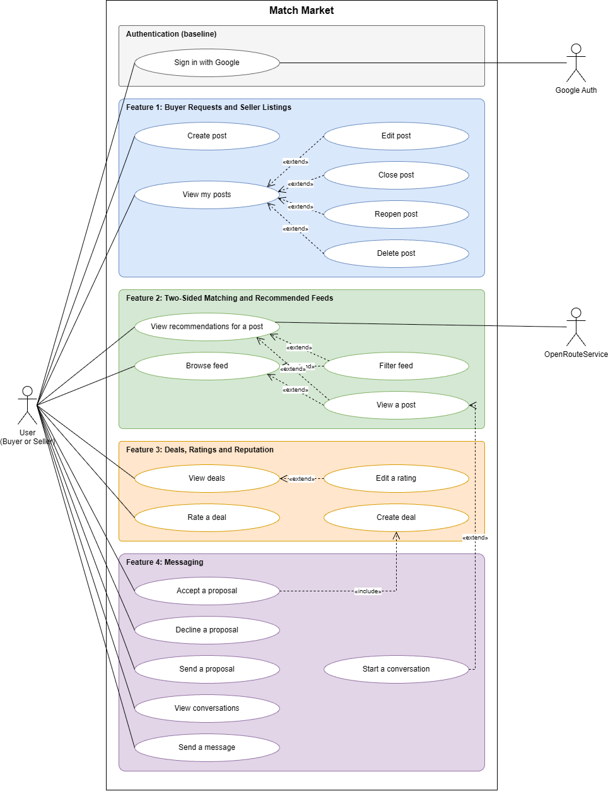
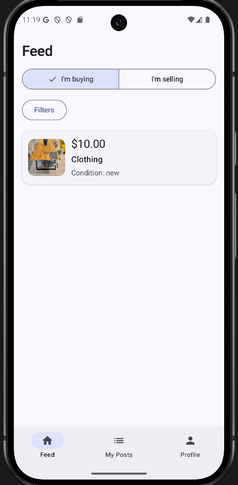
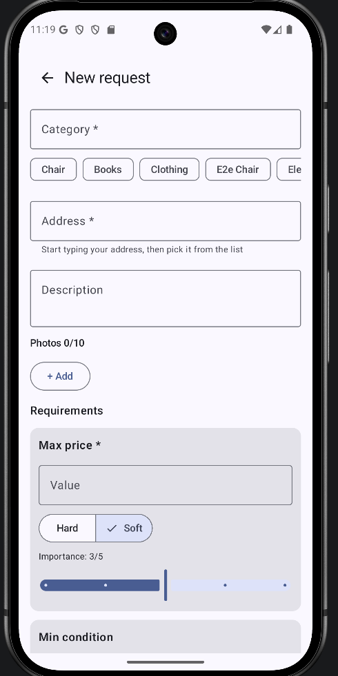
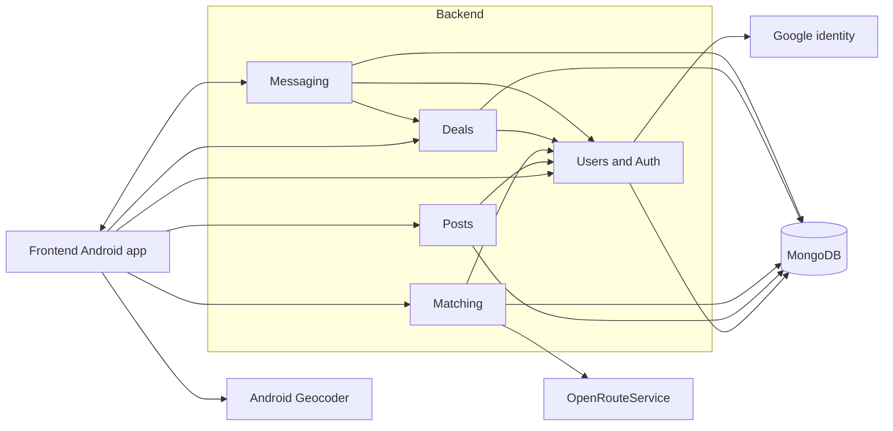
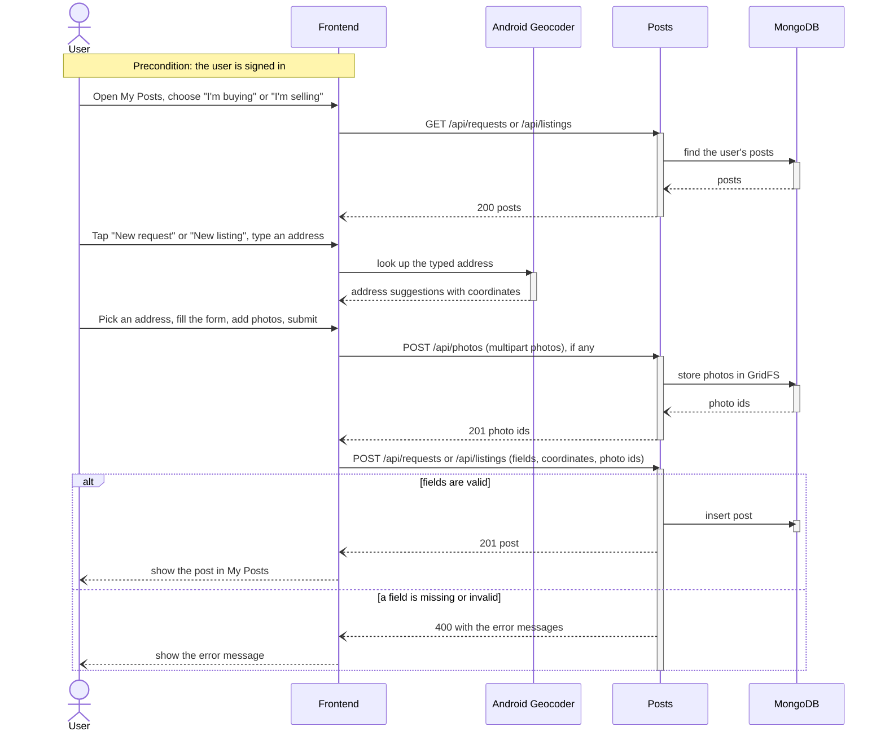
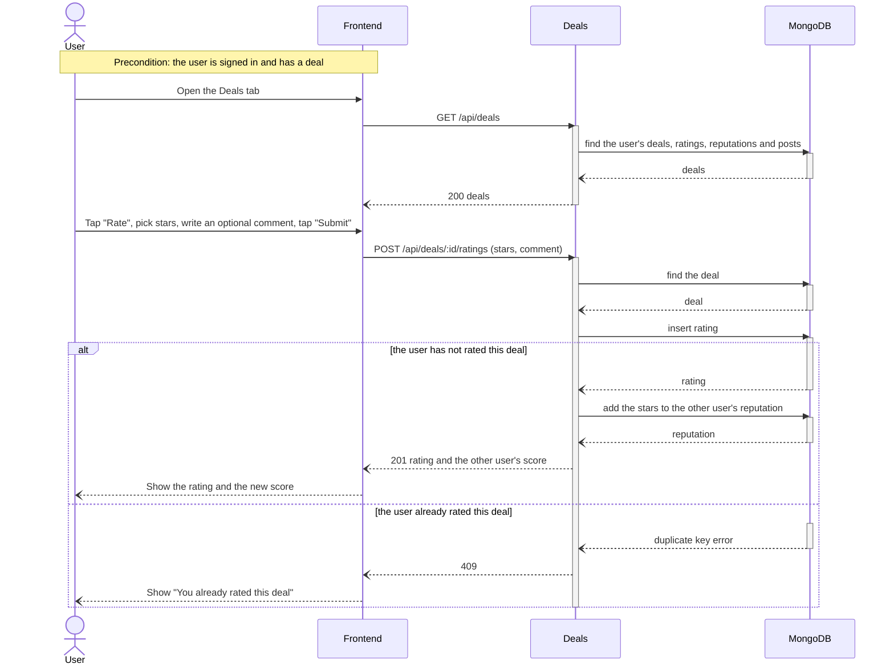
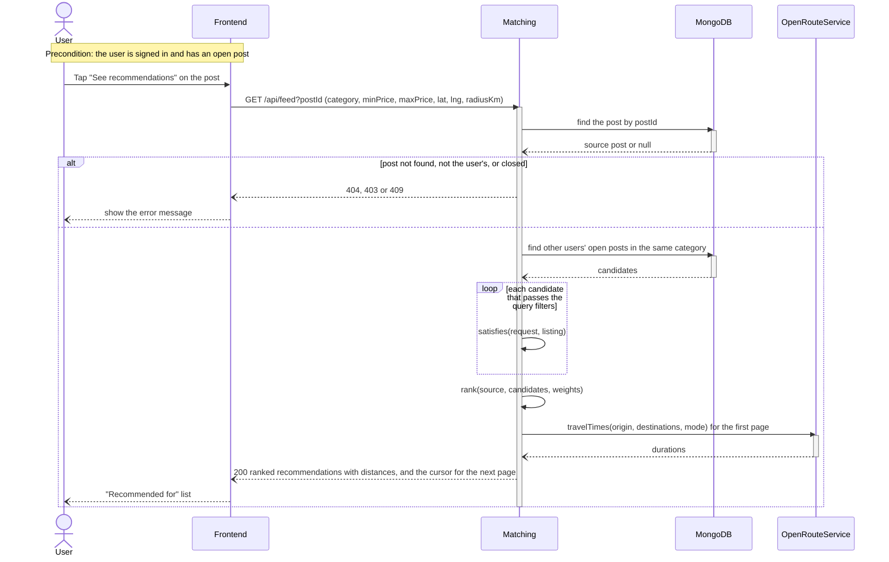
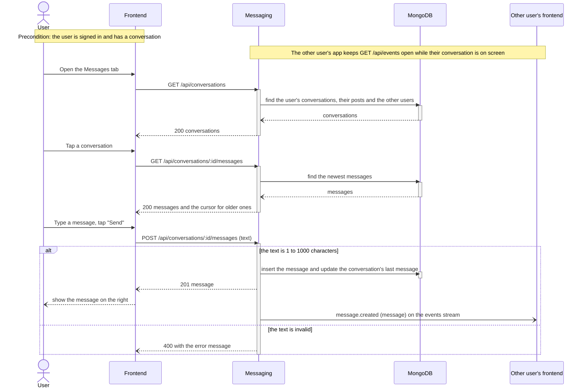
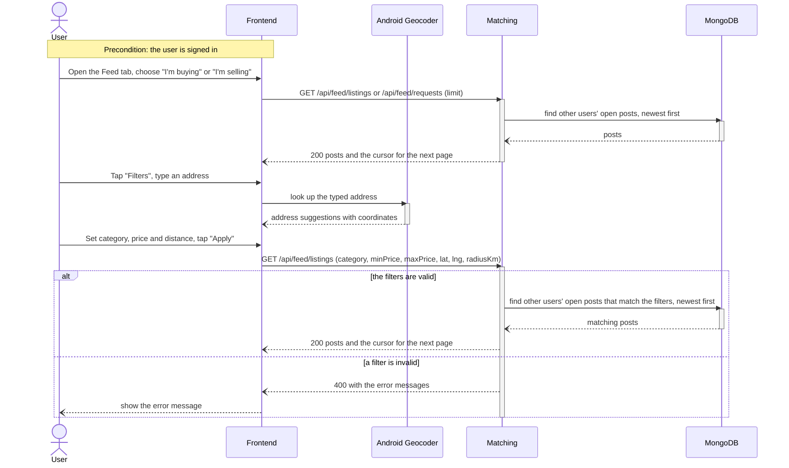

# Match Market Requirements and Design

## 1. Change History

| **Change Date** | **Modified Sections** | **Rationale** |
| --------------- | --------------------- | ------------- |
| 2026-10-12 | All | Initial draft for Match Market (two-sided second-hand marketplace), replacing the M1 LeftOBite idea. |
| 2026-10-12 | 2 | Updated project description to match the M2 presentation slides (tagline, problem, audience, matching approach). |
| 2026-10-12 | 3.1, 3.4 | Authentication is a required baseline, not a feature; features renumbered from four to three. |
| 2026-10-12 | 3.2, 3.4 | Split "Manage posts" into "Create buyer request" and "Create seller listing", one per actor. |
| 2026-10-12 | 3.5, 4.6 | Split the post use case into "Create Buyer Request" and "Create Seller Listing" formal specs and sequence diagrams (five formal specs). |
| 2026-10-12 | 4.1, 4.2, 4.4, 4.5, 4.6, 5 | Store listing photos in MongoDB using GridFS instead of a separate file volume. |
| 2026-10-12 | 3.5, 4.1 | Set photo limits: at most 10 photos, at most 5 MB each. |
| 2026-10-12 | 3.1, 3.4, 3.5, 4.1, 4.2, 4.6, 5 | Buyer requests can optionally include reference photos, same limits as listings. |
| 2026-10-12 | 2, 3.4, 3.5, 4.1, 4.6 | Removed match explanations; the feed shows ranked items with travel time only. |
| 2026-10-12 | 3.4, 3.5, 5 | Specified how users set soft-preference importance (0 to 5 sliders, defaults, normalized weights). |
| 2026-10-12 | 2, 3.4, 3.5, 4.1, 4.7, 5 | Defined hard requirements vs soft preferences vs temporary filters; one shared hard-requirement rule for both feeds, four importance weights, per-request radius with a profile default, optional filters and sort on a single /feed endpoint, travel times for the first page only. |
| 2026-10-12 | All | Removed offers, reservations, transactions, live updates, and push notifications; deferred to a future release. |
| 2026-10-12 | 3.2, 3.4, 3.5, 4.1, 4.6, 5 | Confirmed Feature 1 scope and clarified required inputs, saved defaults, photo counts, ownership, and the open/closed lifecycle. Added Manage Own Posts to the use-case coverage and recorded cross-component decisions still awaiting team agreement. |
| 2026-10-19 | 2-5 | Cross-checked the draft against main and active branches; corrected API and data-model descriptions; separated intended requirements from implementation status; recorded unresolved scope and behaviour differences. |
| 2026-10-21 | 4 | Matched Section 4 to the code on main: feed routes and filters, the hard-requirement rule, collections, libraries and test tools, and route prefixes in the sequence diagrams. |
| 2026-10-21 | 5 | Matched the data model to the code on main: request and listing fields, the options, custom fields and sessions collections, and request number validation. |
| 2026-10-21 | 3.2, 3.3, 4.6 | Redrew the use case diagram (one User actor, use cases grouped and colour-coded by feature), the actors and the sequence diagrams for the five current use cases; removed OpenRouteService geocoding; added Firebase Cloud Messaging. |
| 2026-10-21 | 4.1, 4.3, 4.5, 4.6 | Added the planned Transactions and Messaging components and Firebase Cloud Messaging; limited the dependency and sequence diagrams to the components and interfaces in 4.1; added error paths, loops, return messages and activation bars to the sequence diagrams. |
| 2026-10-21 | 2, 3.1, 3.6, 4.1, 4.2, 5 | Restored offers, transactions, live updates and messaging as planned features, reversing the 2026-10-12 removal; requests mark each field hard or soft; added browsing and filtering to Feature 2 and screen mock-ups; marked the user profile store and travel times as planned; added the planned proposals, transactions and messages collections. |
| 2026-10-21 | 3.7, 4.7 | Filled in the NFR values: 1 second at the 95th percentile with 1,000 candidate posts for feed ranking, the NFR test that measures it, and a 2-second routing timeout so the feed stays within 3 seconds. Justified the 3-second limit of the routing-service NFR. |
| 2026-10-30 | 3.5, 5 | Posts have a required name of up to 80 characters, entered in the post form and shown as the post's heading with its category underneath. Added the name to Use Case 1 and to the requests and listings data model. |
| 2026-10-30 | 2, 3.1, 3.3, 3.4, 3.5, 3.6, 4.1, 4.3, 4.5, 4.6, 4.7 | Connected travel times to OpenRouteService: the first page of recommendations shows each match's travel time (walking until a travel mode can be chosen), with "No route available" and "Travel time unavailable" for failures 5b and 5a, and NFR 2 is now tested. |
| 2026-10-31 | 3.1, 3.3, 3.4, 4.1, 4.2, 4.5, 5 | Added the Deals, Ratings and Reputation feature as built: the Deals tab, rating a deal, editing a rating, and the reputation score. Added the Deals component, its five interfaces, and the deals, ratings and reputations collections. |
| 2026-10-31 | 2, 3.1-3.6, 4.1, 4.3, 4.5, 4.6, 5 | Removed offers, acceptance, transactions and live updates. Deals, Ratings and Reputation is now Feature 3, Use Case 2 is now Rate a Deal, and the Deals component replaces Transactions. Redrew the use case diagram. |
| 2026-10-31 | 3.1 | Feature 3: deals are now recorded when a user accepts a proposed price in a conversation, so recording a deal is no longer planned on the back end. |
| 2026-11-01 | 3.5, 3.6 | Connected the feed to Messaging: Use Case 4 now starts from the "Message" button on a post, which sends the first price proposal and opens the conversation. |
| 2026-11-01 | 2, 3.1–3.5, 4.1–4.6, 5 | Following TA feedback, split combined use cases into one goal each (Section 3.4 and the use case diagram) and narrowed the formal use cases to match: Create Post, Rate a Deal, View Recommendations for a Post, Send a Message and Filter Feed. Described Messaging as built: conversations, messages, price proposals that record a deal when accepted, and live updates through Server-Sent Events. Used one term for each idea: deal, proposal, recommendation, hard requirement, soft preference, backend and frontend. Removed the planned ranking preferences use case and the planned Firebase Cloud Messaging push notifications, which are not built. |

---

## 2. Project Description

**Match Market** is an Android app, "the marketplace where buyers post too". Traditional marketplaces are one-way: sellers post and buyers hunt, re-running the same searches across several sites for days, while sellers never see who is already looking for what they own. Match Market makes the marketplace two-sided. A buyer posts a persistent *request* once, with a category and fields such as maximum price, minimum condition, size, search radius, brand and colour, marking each field as a hard requirement (a must-have) or a soft preference. Sellers post *listings* with photos, and can browse buyer requests that fit what they have.

The app matches both sides automatically, like a dating app for second-hand goods. Buyers and sellers fill in the same structured fields, listings that break a buyer's hard requirements are filtered out, and the remaining recommendations are ranked by how well they fit the buyer's soft preferences. Users see how far away each recommendation is, and the travel time for the first page of recommendations, and can also browse and filter all open posts.

Buyers and sellers message each other about a post to discuss the item and arrange collection, and either side can propose a price. When the other side accepts it, the sale is recorded as a deal. Both users see their deals in the Deals tab, rate each other from 1 to 5 stars, and build a reputation score that the other side can see.

The primary audience is buyers who know what they want and would rather be matched to it than scroll listings until one appears. The secondary audience is sellers with a specific item to move, who want it in front of the right buyer quickly. One account can act as both buyer and seller.

---

## 3. Requirements Specification

### **3.1. List of Features**

1. **Buyer Requests and Seller Listings**: Signed-in users create persistent buyer requests and seller listings, view their own posts, edit them, close and reopen them, and delete them. Listings include 1–10 item photos and requests may include up to 10 reference photos. Closed posts stay in the owner's list and are excluded from the feeds.
2. **Two-Sided Matching and Recommended Feeds**: Users browse other users' open listings or requests, newest first, and narrow them by category, price and distance. For each of their own open posts they also get recommendations: hard-requirement filtering and soft-preference ranking produce a buyer feed of listings for each request and a seller feed of requests for each listing, with the distance to each. Addresses are picked through the Android Geocoder, and travel times are computed with the OpenRouteService API.
3. **Deals, Ratings and Reputation**: Users see their deals in a Deals tab, with the agreed price, the listing and request behind each deal, and the other user's score. Either side of a deal can rate the other from 1 to 5 stars with an optional comment, and can edit that rating later. A user's reputation is the average of the ratings they have received. A deal is recorded when one user accepts the other user's proposed price in a conversation (Feature 4).
4. **Messaging**: Buyers and sellers message each other in the app about a listing or a request, to ask about the item and arrange collection. Either side can propose a price, which the other side accepts or declines; accepting records the deal (Feature 3) and closes the posts. New messages and proposal changes appear in the other user's open conversation without refreshing.

Authentication is a baseline requirement of the app rather than a feature: users sign in with Google, and the backend verifies the Google ID token and issues its own session token.

### **3.2. Use Case Diagram**

### **3.3. Actors Description**

The use case diagram shows a single **User (Buyer or Seller)** actor because every signed-in account can act as both a buyer and a seller and has access to the same use cases; the two roles are described separately below because they post and receive different kinds of posts.

1. **Buyer**: A signed-in user who posts item requests, reviews recommended listings, messages sellers, and rates sellers after a deal.
2. **Seller**: A signed-in user who posts listings with photos, reviews recommended buyer requests, messages buyers, and rates buyers after a deal. The same account can act as buyer and seller.
3. **Google Authentication Service** (external): Verifies the user's identity at sign-in.
4. **OpenRouteService** (external): Computes travel times between the user and recommended posts.

### **3.4. Use Case Description**

Each use case covers one goal. The five marked with a link have a formal specification in Section 3.5, and the use case diagram shows which use cases extend or include others.

**Authentication** (baseline requirement, not counted as a feature)

1. **Sign in with Google**: The user signs in with their Google account and gains access to their posts and the feed.

**Feature 1: Buyer Requests and Seller Listings**

2. **Create post** ([Use Case 1](#uc1)): A user creates a buyer request or a seller listing.
3. **View my posts**: A user opens My Posts and sees their own open and closed requests or listings.
4. **Edit post**: A user changes the fields of one of their posts and saves it. Closed posts can also be edited.
5. **Close post**: A user closes one of their open posts, which removes it from the feeds and recommendations but keeps it in My Posts.
6. **Reopen post**: A user reopens one of their closed posts, which shows it in the feeds and recommendations again.
7. **Delete post**: A user deletes one of their posts permanently, after confirming.

**Feature 2: Two-Sided Matching and Recommended Feeds**

8. **View recommendations for a post** ([Use Case 3](#uc3)): A user sees the posts that fit one of their open posts, ranked by how well they fit, with the distance to each and the travel time for the first page.
9. **Browse feed**: A user scrolls through other users' open posts, newest first.
10. **Filter feed** ([Use Case 5](#uc5)): A user narrows the feed by category, price or distance.
11. **View a post**: A user opens another user's post from the feed or the recommendations to see its details and photos.

**Feature 3: Deals, Ratings and Reputation**

12. **View deals**: A user opens the Deals tab and sees their deals, newest first, as buyer or seller. Each deal shows its title, agreed price, date, the listing and request it came from, the other user's score, and both ratings. Tapping the listing or request opens it, even if it has since closed. A user with no deals sees "No deals yet".
13. **Rate a deal** ([Use Case 2](#uc2)): A user rates the other side of a deal from 1 to 5 stars with an optional comment. The other user's score updates on the card.
14. **Edit a rating**: A user changes the stars or comment of a rating they gave earlier, and the other user's score updates.
15. **Create deal**: When a user accepts a proposal, the system records the deal between the two users at the proposed price and closes the listing and request. It is part of Accept a proposal and is never started on its own.

**Feature 4: Messaging**

16. **Start a conversation**: On another user's open post, a user taps "Message" and sends a proposal (a price with an optional note), and the conversation with the post's owner opens. A post opened from the recommendations for one of the user's posts also links that post to the conversation.
17. **View conversations**: A user opens the Messages tab and sees their conversations, newest activity first, each with the other user, the listing and request, and the last message.
18. **Send a message** ([Use Case 4](#uc4)): A user sends a message in a conversation, and it appears in the other user's open conversation without refreshing.
19. **Send a proposal**: A user proposes a price, with an optional note, in a conversation that has no pending or accepted proposal. The proposal appears in the other user's open conversation without refreshing.
20. **Accept a proposal**: A user accepts the other user's pending proposal. This includes Create deal: the deal is recorded at that price, both posts are closed, and the deal appears in both users' Deals tabs.
21. **Decline a proposal**: A user declines the other user's pending proposal, after which either user can propose again.

### **3.5. Formal Use Case Specifications (5 Most Major Use Cases)**

#### Use Case 1: Create Post

**Description**: A user creates a buyer request or a seller listing, which then appears in their My Posts.

**Primary actor(s)**: Buyer, Seller

**Main success scenario**:
1. The user opens My Posts and chooses "I'm buying" (requests) or "I'm selling" (listings).
2. The app shows the user's open and closed posts of that kind.
3. The user taps "New request" or "New listing".
4. The app shows the post form.
5. The user enters a name and a category and picks an address from the suggestions.
    - For a request: a maximum price (required), and optionally a minimum condition, maximum size, search radius, brand and colour. Each of these fields, including the maximum price, is marked Hard or Soft, and a Soft field gets an importance from 1 to 5. The user may also add a description, custom fields, and up to 10 reference photos.
    - For a listing: a price, a condition and 1–10 photos, and optionally a brand, colour, size, description and custom fields.
6. The user taps "Create request" or "Create listing".
7. The app saves the post and shows it in My Posts.

**Failure scenario(s)**:
- 2a. The network or server is unavailable when the posts are loaded.
    - 2a1. The app shows "Could not reach the server. Check your connection."
- 5a. A required field is missing or invalid.
    - 5a1. The app shows an error message, such as "Choose a category", "Enter a name", "Max price is required", "Enter a price", "Add at least one photo", or for a price below 0 "max price must be at least 0" (request) or "price must be a number of at least 0" (listing). Nothing is saved.
- 5b. The address was typed but not picked from the suggestions.
    - 5b1. The app highlights the address field and shows "Choose your address from the suggestions list".
- 5c. A photo is larger than 5 MB.
    - 5c1. The app shows "Each photo must be at most 5 MB" and the post is not saved.
- 5d. The user tries to add more than 10 photos.
    - 5d1. The photo picker only lets the user select as many photos as are still allowed, and the app disables adding photos once there are 10.
- 6a. The network or server is unavailable when the post is submitted.
    - 6a1. The app shows "Could not reach the server. Check your connection." and the form keeps what the user entered.

#### Use Case 2: Rate a Deal

**Description**: A user rates the other side of one of their deals from 1 to 5 stars with an optional comment. The other user's score updates.

**Primary actor(s)**: Buyer, Seller

**Main success scenario**:
1. The user opens the Deals tab.
2. The app shows the user's deals, newest first, with "Rate" on each deal they have not rated yet.
3. The user taps "Rate" on a deal.
4. The app shows the stars and an optional comment field.
5. The user picks 1 to 5 stars, optionally writes a comment, and taps "Submit".
6. The system saves the rating and updates the other user's score.
7. The app shows the rating and the other user's new score on the deal.

**Failure scenario(s)**:
- 2a. The deals cannot be loaded.
    - 2a1. The app shows an error message and a way to retry.
- 5a. The user has not picked any stars.
    - 5a1. "Submit" is disabled.
- 6a. The user already rated this deal on another device.
    - 6a1. The app shows "You already rated this deal" and the first rating is unchanged.
- 6b. The network or server is unavailable.
    - 6b1. The app shows an error message and the rating is not saved.

#### Use Case 3: View Recommendations for a Post

**Description**: A user sees the posts that fit one of their own open posts (listings for a request, requests for a listing), ranked by how well they fit.

**Primary actor(s)**: Buyer, Seller

**Main success scenario**:
1. The user opens one of their open posts and taps "See recommendations", or picks the post under "Recommended for" in the feed filters.
2. The app shows "Recommended for: <post>".
3. The system takes other users' open posts in the same category and keeps those that meet the request's hard requirements: within the request's radius (10 km if none was set) and every field the buyer marked Hard. Any feed filters (Use Case 5) also apply.
4. The system scores each remaining post on price, condition, distance and preference match, weights the four scores equally, and orders the best first.
5. The system requests walking travel times for the first 20 results from OpenRouteService.
6. The app shows the ranked list, 20 at a time; each item shows its price or budget, its condition (listings), and its distance, plus its travel time on the first page, such as "12 min walk".

**Failure scenario(s)**:
- 1a. The user has no open posts.
    - 1a1. The feed filters show "You have no open posts to get recommendations for".
- 1b. The post is closed.
    - 1b1. "See recommendations" is not shown, and the server returns no feed for it (409).
- 3a. No posts meet the hard requirements.
    - 3a1. The app shows "Nothing here yet. Try changing the filters or check back soon." and a "Refresh" button.
- 5a. The routing service is unavailable, rate-limited or takes more than 2 seconds.
    - 5a1. The app shows the ranked list without travel times, and each item on the first page shows "Travel time unavailable".
- 5b. No route exists for the user's travel mode.
    - 5b1. The app shows "No route available" for that item.
- 6a. The network or server is unavailable.
    - 6a1. The app shows "Couldn't load the feed. Check your connection and try again." and a "Retry" button.

#### Use Case 4: Send a Message

**Description**: A user sends a message in one of their conversations, and it appears in the other user's open conversation without refreshing.

**Primary actor(s)**: Buyer, Seller

**Main success scenario**:
1. The user opens the Messages tab.
2. The app shows the user's conversations, newest activity first, each with the other user, the listing and request, and the last message.
3. The user taps a conversation.
4. The app shows its messages with the newest at the bottom, 30 at a time, with "Load earlier messages" when there are older ones.
5. The user types a message of up to 1000 characters and taps "Send".
6. The system saves the message, and the app shows it on the right and clears the message box.
7. The message appears in the other user's open conversation without refreshing.

**Failure scenario(s)**:
- 2a. The network or server is unavailable when the conversations are loaded.
    - 2a1. The app shows "Could not reach the server. Check your connection." and a "Retry" button.
- 4a. The network or server is unavailable when the messages are loaded.
    - 4a1. The app shows "Could not reach the server. Check your connection." and a "Retry" button.
- 5a. The message is empty or only spaces.
    - 5a1. "Send" is disabled.
- 6a. The network or server is unavailable when the message is sent.
    - 6a1. The app shows "Could not send the message. Try again." and the message stays in the message box.
- 7a. The other user's connection to the server was lost.
    - 7a1. Their app reconnects within a few seconds and reloads the conversation, which then shows the message.

#### Use Case 5: Filter Feed

**Description**: A user narrows the feed of other users' open posts by category, price or distance.

**Primary actor(s)**: Buyer, Seller

**Main success scenario**:
1. The user opens the Feed tab and chooses "I'm buying" (listings) or "I'm selling" (requests).
2. The app shows other users' open posts of that kind, newest first.
3. The user taps "Filters" and sets any of: category, minimum and maximum price ("Min budget" and "Max budget" for requests), and "Near address", picked from the suggestions, with "Within (km)".
4. The user taps "Apply".
5. The app reloads the list with only the posts that pass the filters; "Clear" removes the filters.

**Failure scenario(s)**:
- 2a. The network or server is unavailable.
    - 2a1. The app shows "Couldn't load the feed. Check your connection and try again." and a "Retry" button.
- 3a. A price is not a number of 0 or more.
    - 3a1. The app shows "Enter a number of 0 or more".
- 3b. The minimum is more than the maximum.
    - 3b1. The app shows "Min must not be more than max".
- 3c. A distance is set without an address.
    - 3c1. The app shows "Pick an address to filter by distance".
- 3d. The distance is outside 0–100 km.
    - 3d1. The app shows "Enter a distance from 0 to 100".
- 5a. No posts pass the filters.
    - 5a1. The app shows "Nothing here yet. Try changing the filters or check back soon." and a "Refresh" button.
- 5b. The network or server is unavailable.
    - 5b1. The app shows "Couldn't load the feed. Check your connection and try again." and a "Retry" button.

### **3.6. Screen Mock-ups**

1. **Feed** ([Use Case 5](#uc5), [Use Case 3](#uc3)): other users' listings ("I'm buying") or requests ("I'm selling"), with the Filters button.

    

2. **New request** ([Use Case 1](#uc1)): the request form, where each requirement is marked Hard or Soft with an importance.

    

Both screens are built. A post opened from the feed or recommendations links to its messages with a "Message" button. The design keeps the same bottom-tab layout (Feed, My Posts, Profile).

### **3.7. Non-Functional Requirements**

1. **Performance: Feed ranking latency**
    - **Description**: The feed returns the first page of ranked recommendations for a post within 1 second for 95% of requests, with 1,000 open candidate posts in the same category, not counting the travel-time lookup. Section 4.7 describes how it is measured.
    - **Justification**: Recommendations are the core of the app, so the feed must load quickly. 1 second is the limit for a user's flow of thought to stay uninterrupted ([Nielsen Norman Group, "Response Times: The 3 Important Limits"](https://www.nngroup.com/articles/response-times-3-important-limits/)), and 1,000 open posts in one category is several times more than we expect from a student community.

2. **Reliability: Graceful degradation without the routing service**
    - **Description**: If the external routing service fails, times out or is rate-limited, the feed still returns the ranked recommendations within 3 seconds, without travel times, and shows that travel time is unavailable.
    - **Justification**: Prevents third-party service failures from disrupting core functionality. 3 seconds is the 1-second feed target in NFR 1 plus the 2-second routing timeout in Section 4.7, and stays well under the 10-second limit for keeping a user's attention.

---

## 4. Designs Specification

### **4.1. Main Components**

1. **Posts**
    - **Purpose**: Owns buyer requests and seller listings, including their photos, validation, and ownership.
    - **Rationale**: Both post types share most fields and lifecycle, so one component avoids duplicate logic; alternative of separate Requests and Listings components was rejected because every matching and feed operation needs both.
    - **Lifecycle and ownership**: Newly created posts have status open. Only the authenticated owner may edit, close, reopen or delete a post. Closing changes the stored status to closed and keeps the post in the owner's My Posts; closed posts can still be edited and are excluded from feeds and recommendations. Reopening sets the status back to open, and deleting removes the post permanently.
    - **Interfaces**: All routes use the `/api` prefix. Post operations require an authenticated session.
        1. `POST /api/requests` and `POST /api/listings`
            - **Purpose**: Create a post from JSON containing its fields, coordinates and photo IDs. Photos are uploaded separately before creating the post. Returns the created post with status 201.
        2. `GET /api/requests` and `GET /api/listings`
            - **Purpose**: Retrieve the authenticated user's own open and closed posts.
        3. `GET /api/requests/:id` and `GET /api/listings/:id`
            - **Purpose**: Retrieve an owned post. Returns 403 for another user's post or 404 if the post does not exist.
        4. `PATCH /api/requests/:id` and `PATCH /api/listings/:id`
            - **Purpose**: Update an owned post's fields or status. Setting `status=closed` closes it; `status=open` reopens it. Closed posts can also be edited.
        5. `DELETE /api/requests/:id` and `DELETE /api/listings/:id`
            - **Purpose**: Permanently delete an owned post. Returns status 204.
        6. `POST /api/photos`
            - **Purpose**: Upload 1–10 photos using multipart form data. Accepted MIME types are JPEG, PNG, WebP and GIF, with a current limit of 5 MB per photo. Returns the uploaded photo IDs.
        7. `GET /api/photos/:id`
            - **Purpose**: Retrieve a photo from GridFS. This endpoint is currently public.
        8. Options and custom fields
            - **Purpose**: `/api/options` supports retrieving and adding option values. `/api/custom-fields` supports retrieving and saving the user's reusable field definitions; `/api/custom-fields/:key` supports deleting a definition.

2. **Matching**
    - **Purpose**: Hard-requirement filtering and weighted ranking in both directions, plus travel time.
    - **Rationale**: Isolated from storage and HTTP so the team-written logic can be tested through the feed's interface tests; alternative of database-only filtering was rejected because ranking needs weighted scoring.
    - **Interfaces**:
        1. `GET /api/feed?postId=<id>&limit=&cursor=&category=&minPrice=&maxPrice=&lat=&lng=&radiusKm=`
            - **Purpose**: Return the feed for the user's own request or listing, with travel times for the first page: each recommendation has travelMinutes, and the response has travelMode and travelTimesAvailable, which is false when the routing service did not answer. The post type decides the direction: a request returns listings, a listing returns requests. Every parameter except postId, limit and cursor is an optional temporary filter. A value looser than the saved requirement is ignored, and an unsupported parameter returns 400. Returns 403 for another user's post and 409 for a closed post. The planned minCondition filter (request feeds only) and sort=best|nearest|cheapest are not implemented yet.
        2. `GET /api/feed/listings` and `GET /api/feed/requests`
            - **Purpose**: Return other users' open posts, newest first, with the same filters; `before` pages through them.
        3. `boolean satisfies(Request request, Listing listing)`
            - **Purpose**: The single hard-requirement rule (category and straight-line distance within radius, plus price, condition, dimensions or any other field the buyer marked hard) used by both feed directions.
        4. `List<RankedMatch> rank(Post source, List<Post> candidates, Weights weights)`
            - **Purpose**: Score each candidate on price, condition, distance, and brand/colour match, and order by the viewer's weights.
        5. `List<Duration> travelTimes(Location origin, List<Location> destinations, TravelMode mode)`
            - **Purpose**: Get travel times from the external routing service for one page of results; returns empty when it is unavailable.

3. **Users and Auth**
    - **Purpose**: Verifies Google sign-in and issues session tokens. Storing each user's profile, location and preferences is planned.
    - **Rationale**: Keeps identity and per-user settings in one place so Posts and Matching only depend on a user id; alternative of storing settings on each post was rejected because settings apply across all of a user's posts.
    - **Interfaces**:
        1. `POST /api/auth/google`
            - **Purpose**: Exchange a Google ID token for a session token; 401 if the token is invalid.
        2. `POST /api/auth/refresh`
            - **Purpose**: Rotates the token pair.
        3. `POST /api/auth/logout`
            - **Purpose**: Revokes the refresh-token family. Session tokens last 15 minutes; refresh tokens have a 30-day lifetime. Protected routes use requireAuth and currentUser.
        4. `GET /api/users/me`, `PATCH /api/users/me` *(planned)*
            - **Purpose**: Read or update profile, typed address and default radius, travel mode, and the four importance weights.
        5. `userId requireAuth(token)`
            - **Purpose**: Internal interface protecting every other route.

4. **Deals**
    - **Purpose**: Shows each user their deals, lets the two sides of a deal rate each other, and keeps each user's reputation score.
    - **Rationale**: Kept separate from Posts because a deal links two users and outlives the posts behind it, which may be closed or deleted. Reputation is stored as a running total per user rather than computed from ratings on every read, because the deals list shows a score for every deal on a page; the alternative of averaging ratings per read was rejected because it would add a query for each deal.
    - **Lifecycle and rules**: Deals are recorded by Messaging when a user accepts a proposal (`POST /api/conversations/:id/proposal/accept`). Each deal needs a listing, a request or both. A listing or request can belong to only one deal. Only the buyer and seller of a deal can rate it, each once, with no time limit, and either can edit their own rating. Ratings are never deleted.
    - **Interfaces**: All routes use the `/api` prefix and require an authenticated session. Failures return `{ error }`, and invalid input returns 400 with `{ error, details }`.
        1. `GET /api/deals?limit=&before=`
            - **Purpose**: Return the caller's deals, newest first, each with the caller's role, title, agreed price, listing and request summaries, the other user's score, and both ratings. `limit` is 1 to 50, default 20; `before` is the `nextCursor` of the previous page. A deleted post comes back as null. 400 for a bad or unknown parameter.
        2. `POST /api/deals/:id/ratings`
            - **Purpose**: Rate the other side of a deal from JSON `{ stars, comment }`: whole stars from 1 to 5, and an optional comment of up to 300 characters. Returns 201 with `{ rating, otherUser }`. Unknown fields return 400, a body over 4 KB returns 413, a caller outside the deal gets 403, an unknown deal returns 404, and a second rating returns 409.
        3. `PUT /api/deals/:id/ratings`
            - **Purpose**: Replace the caller's rating, with the same body and errors as `POST`. Returns 200 with `{ rating, otherUser }`, or 404 if the caller has not rated the deal.
        4. `GET /api/feed/listings/:id`
            - **Purpose**: Return one listing, open or closed, to any signed-in user, so a deal card can open its listing. 404 for a malformed or unknown id. The route sits under `/api/feed`, but the Deals tab is its only caller.
        5. `GET /api/feed/requests/:id`
            - **Purpose**: Return one request, open or closed, to any signed-in user, so a deal card can open its request. 404 for a malformed or unknown id. The route sits under `/api/feed`, but the Deals tab is its only caller.

5. **Messaging**
    - **Purpose**: Conversations between two users about a post, their messages, price proposals that record a deal when accepted, and live updates to the open app.
    - **Rationale**: A conversation has the same listingId, requestId, sellerId and buyerId as a deal, so accepting a proposal copies them into the deal instead of trusting the request body; the alternative of a general chat between any two users was rejected because every conversation is about a post. Live updates use Server-Sent Events rather than WebSockets because they only flow from the backend to the app: sending already uses the routes below, and the stream reuses the same session token and `requireAuth` without a new library.
    - **Lifecycle and rules**: There is one conversation per post and user who started it, so tapping "Message" on the same post again opens the existing conversation. A conversation started from the recommendations for one of the user's posts also links that post, and its posts never change. Only its two users can read or write it. One proposal can be pending at a time, and none can be made once one is accepted. Only the other user can accept or decline a proposal. Accepting records the deal at the proposed price and closes the listing and request; it fails if either post is closed, deleted or already in a deal.
    - **Interfaces**: All routes use the `/api` prefix and require an authenticated session. Only the conversation's two users can use the routes under `/api/conversations/:id` (403 for anyone else, 404 if it does not exist). Invalid input returns 400 with `{ error, details }`.
        1. `POST /api/conversations`
            - **Purpose**: Open the caller's conversation about another user's post from JSON `{ postId, postKind, myPostId? }`, where `myPostId` is the caller's own post of the other kind it was recommended for. Returns 201 with the new conversation, or 200 with the existing one, unchanged. 404 if a post does not exist, 400 if the post is the caller's own, 403 if `myPostId` is not the caller's, 409 if a post is closed.
        2. `GET /api/conversations`
            - **Purpose**: Return the caller's conversations, newest activity first, each with its listing and request, the other user, the last message and the current proposal.
        3. `GET /api/conversations/:id/messages?limit=&before=`
            - **Purpose**: Return a conversation's messages, newest first. `limit` is 1 to 50, default 30; `before` is the `nextCursor` of the previous page.
        4. `POST /api/conversations/:id/messages`
            - **Purpose**: Send a message from JSON `{ text }`, 1 to 1000 characters after trimming. Returns 201 with the message and sends `message.created` to the other user.
        5. `POST /api/conversations/:id/proposal`
            - **Purpose**: Propose a price from JSON `{ price, note? }`: a price of at least 0 and a note of up to 300 characters. Returns 201 with the proposal and sends `proposal.updated` to the other user. 409 while a proposal is pending or once one was accepted.
        6. `POST /api/conversations/:id/proposal/accept`
            - **Purpose**: Accept the other user's pending proposal: records the deal and closes both posts. Returns 201 with `{ deal, proposal }` and sends `proposal.updated`. 403 for the caller's own proposal; 409 if no proposal is pending, or a post is closed, deleted or already in a deal.
        7. `POST /api/conversations/:id/proposal/decline`
            - **Purpose**: Decline the other user's pending proposal, after which either user can propose again. Returns 200 with the proposal and sends `proposal.updated`. 403 for the caller's own proposal; 409 if no proposal is pending.
        8. `GET /api/events`
            - **Purpose**: The caller's live updates as Server-Sent Events. The response stays open, and the backend writes a `message.created` or `proposal.updated` event whenever the other user acts, plus a heartbeat every 25 seconds. Events sent while the app is disconnected are not replayed, so the app reloads the open conversation after it reconnects.

### **4.2. Databases**

1. **MongoDB** (self-hosted in Docker on the cloud VM)
    - **Purpose**: Stores requests, listings, options, custom fields, sessions, deals, ratings, reputations, conversations and messages, and will store users *(planned)*. Photos for requests and listings are stored in the same database using GridFS (fs.files and fs.chunks), and each post keeps the ids of its photos. Geospatial index on post locations.

### **4.3. External Modules**

1. **Google Sign-In / Google identity**
    - **Purpose**: Authenticates users. The backend verifies Google ID tokens with google-auth-library.
2. **Android Geocoder**
    - **Purpose**: Provides address suggestions and coordinates in the current frontend. The implemented lookup uses the Android 13+ callback API; the older-version path returns no suggestions.
3. **OpenRouteService**
    - **Purpose**: Travel times between the user's post and the first page of recommended posts, from its matrix API, for walking, cycling or driving. The backend needs an `ORS_API_KEY`; without it the feed is returned without travel times.

### **4.4. Frameworks and Libraries**

1. **Jetpack Compose and Kotlin** (frontend)
    - **Purpose**: Native Android UI.
    - **Reason**: Required by the project.
2. **HttpURLConnection** (frontend)
    - **Purpose**: REST calls to the backend and the live updates stream.
    - **Reason**: Part of Android, so no extra library is needed.
3. **Android Credential Manager / Google ID** (frontend)
    - **Purpose**: Google Sign-In.
    - **Reason**: Existing sign-in code is built on it.
4. **Express** (backend)
    - **Purpose**: HTTP routing and middleware.
    - **Reason**: Provided by the template.
5. **mongodb (official Node driver)** (backend)
    - **Purpose**: Database access.
    - **Reason**: Thin and explicit; geospatial queries are direct, and GridFS for photos is built in.
6. **google-auth-library** (backend)
    - **Purpose**: Verifies the Google ID token sent by the app.
    - **Reason**: Google's own library for validating ID tokens, so signature and audience checks are not hand-written.
7. **jsonwebtoken** (backend)
    - **Purpose**: Issues and verifies the backend's session tokens.
    - **Reason**: Standard JWT library for Node.js.
8. **Coil** (frontend)
    - **Purpose**: Loads and caches post photos in Compose screens.
    - **Reason**: Kotlin-first image loader with Compose support.
9. **Jest and Supertest** (backend), **Compose testing** (frontend)
    - **Purpose**: Backend interface tests and frontend Compose test dependencies are present. The frontend also includes AndroidX JUnit and Espresso. UI Automator is also declared; the end-to-end tests use it for the system photo picker. Feature 1 end-to-end tests (`CreatePostTest` and `ManagePostsTest`) are in the frontend's `androidTest` `e2e` package.
10. **Multer** (backend)
    - **Purpose**: Parses multipart photo uploads and enforces the photo count and size limits.
    - **Reason**: Standard Express middleware for multipart uploads.

### **4.5. Dependencies Diagram**

Every backend route except `/health` calls `requireAuth` in Users and Auth. The two-way link between the frontend and Messaging is the live updates stream, which the backend writes to while the app keeps it open. Messaging records deals through the Deals component's store when a proposal is accepted.

### **4.6. Use Case Sequence Diagram (5 Most Major Use Cases)**

1. [**Create Post**](#uc1)

2. [**Rate a Deal**](#uc2)

3. [**View Recommendations for a Post**](#uc3)

4. [**Send a Message**](#uc4)

5. [**Filter Feed**](#uc5)

### **4.7. Design of Non-Functional Requirements**

1. **Feed ranking latency**
    - **Implementation**: The design filters out ineligible candidates before calculating ranking scores. It then ranks the qualifying candidates and paginates the results. This supports the feed-ranking latency requirement in Section 3.7.

      Performance will be measured using this candidate workload and environment:
        - Candidate workload: 1,000 open posts in the same category as the user's post.
        - Target ranking latency: 1 second at the 95th percentile, not counting the travel-time lookup.
        - Measurement environment: a backend Jest NFR test in `backend/tests/nfr/`, run with `scripts/run-backend-nfr-tests.sh`, that sends 100 `GET /api/feed?postId=<id>` requests through Supertest. It measures the backend's response time only, without the phone's network.
2. **Graceful degradation without the routing service**
    - **Implementation**: The feed requests travel times only for the first page of recommendations, in one OpenRouteService matrix request with a timeout of 2 seconds (`ROUTING_TIMEOUT_MS` in `matching/travelTime.ts`). If the service fails, times out or is rate-limited, the feed returns the ranked recommendations with `travelTimesAvailable: false`, and the app shows "Travel time unavailable". The timeout lets the feed meet the 3-second response target in Section 3.7.
    - **Implementation status**: Matching on main filters candidates and ranks them before pagination. `backend/tests/nfr/routingFallback.test.ts` checks NFR 2: with a routing service that never answers, the feed returns its ranked recommendations in about 2 seconds, under the 3-second limit. NFR 1 is not measured yet.

---

## 5. Data Model

| **Collection** | **Key fields** |
| -------------- | -------------- |
| users *(planned)* | googleSub, name, email, address, location (GeoJSON), defaultRadiusKm, travelMode (walk, bike, drive), weights {price, condition, distance, match} (each an integer 0 to 5, default 3) |
| requests | ownerId, name, category, description, requestFields[] (built-in price (max), condition (min), dimensions {width, height, depth} (max), radiuskm, brand, colour, plus custom fields; each hard, or soft with an importance 1 to 5), address, location, photoIds[] (optional GridFS file ids), status (open, closed) |
| listings | ownerId, name, category, description, price, condition, listingFields[] (built-in brand, dimensions {width, height, depth}, colour, plus custom fields), address, location, photoIds[] (GridFS file ids), status (open, closed) |
| options | field, key, label, builtin, createdBy |
| customFields | ownerId, key, label, type (text, number, bool) |
| sessions | tokenHash, familyId, userId, expiresAt, usedAt |
| conversations | listingId, requestId (either may be null, not both), sellerId, buyerId, postKind (the post that was tapped: listing or request), lastMessage {senderId, text, createdAt} or null, proposal {proposerId, price, note (up to 300 characters), status (pending, accepted, declined), createdAt} (absent until the first proposal), createdAt, updatedAt |
| messages | conversationId, senderId, text (1 to 1000 characters), createdAt |
| deals | listingId, requestId (either may be null, not both), sellerId, buyerId, agreedPrice, createdAt |
| ratings | dealId, raterId, ratedUserId, stars (whole number 1 to 5), comment (up to 300 characters), createdAt, updatedAt (only after an edit) |
| reputations | userId, starSum, ratingCount, updatedAt |

Condition is one of five ordered levels: new, like new, good, fair, poor.

**Feature 1 data rules:**
- The backend obtains ownerId from the authenticated session. New posts start open. Closing retains a record; the current API also supports reopening and permanent deletion.
- Both post types require name, category, address and coordinates. Requests require a built-in price field. Listings require non-negative top-level price, a valid condition and at least one photo ID. Request price, radius and size cannot be negative. The 1–50 km radius rule is not enforced by the inspected request-field validation; it must not be claimed as completed validation.
- Requests allow 0–10 photo IDs and listings 1–10. Actual upload size is at most 5 MB per file. Post validation checks ID format/count; photo existence and ownership checks are not established by that validation.
- Categories are normalized, extendable option values rather than a fixed list. Description is supported, up to 2,000 characters. The name, up to 80 characters, is the post's title; posts saved before names were added use their category as the name. Dimensions use cm and radius uses km; CAD remains the intended currency.
- Unfilled optional editor rows are omitted. Existing post addresses and coordinates are saved with each post. Profile-based defaults are planned. Closed listings are excluded from the current open-listings feed.

**Feature 4 data rules:**
- A conversation has the same listingId, requestId, sellerId and buyerId as a deal, taken from the posts rather than the request body. Partial unique indexes allow one conversation per tapped post and the user who started it.
- lastMessage is copied from the newest message, so the conversations list needs one query instead of one per conversation.
- A new proposal is saved in one atomic update that only matches when the current proposal is not pending or accepted, so two proposals sent at once cannot both be saved.

**Feature 3 data rules:**
- A deal must have a listing, a request or both. Unique indexes allow one deal per listing and one per request; deals with a null post do not collide.
- A unique index on dealId and raterId allows each user one rating per deal. The rated user is always the other side of the deal, taken from the deal rather than the request.
- Each user has at most one reputation, created by their first rating. Adding a rating updates starSum and ratingCount in one atomic write, so simultaneous ratings all count, and editing a rating adds the star difference to starSum.

Condition values remain, best to worst: new, like new, good, fair, poor.
