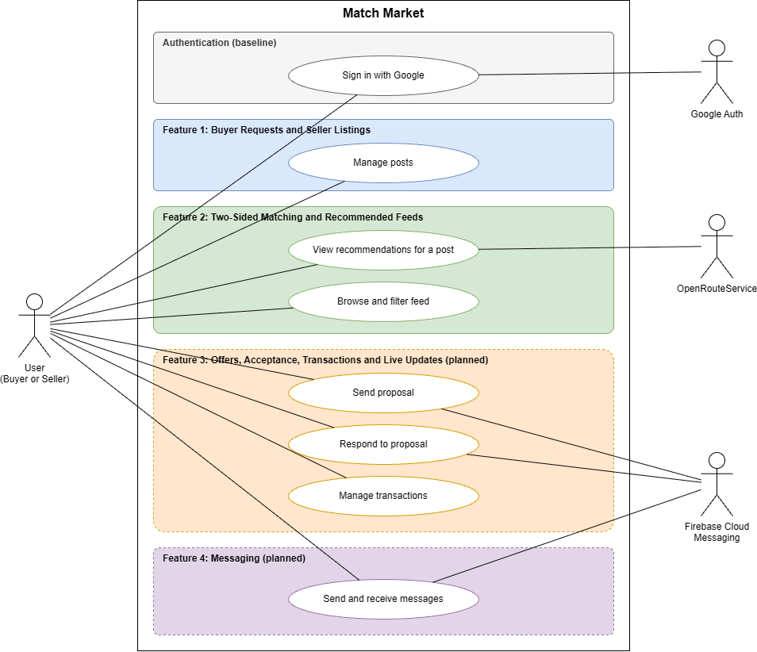
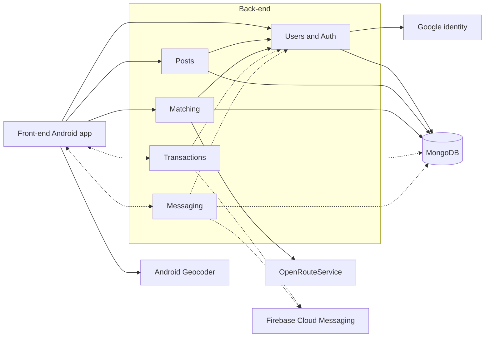
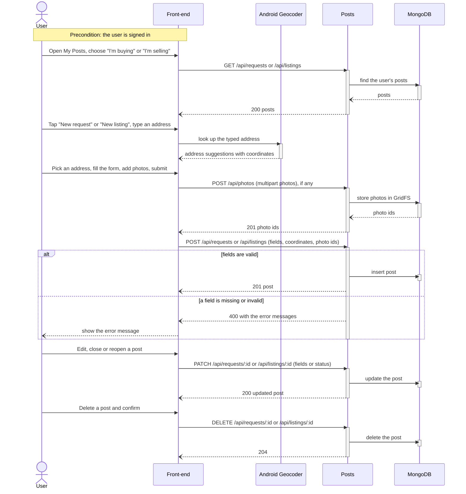
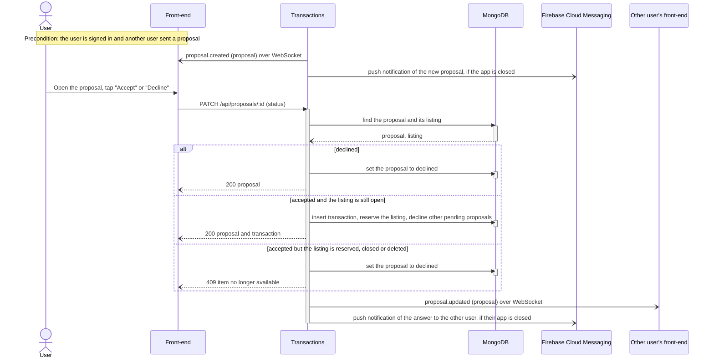
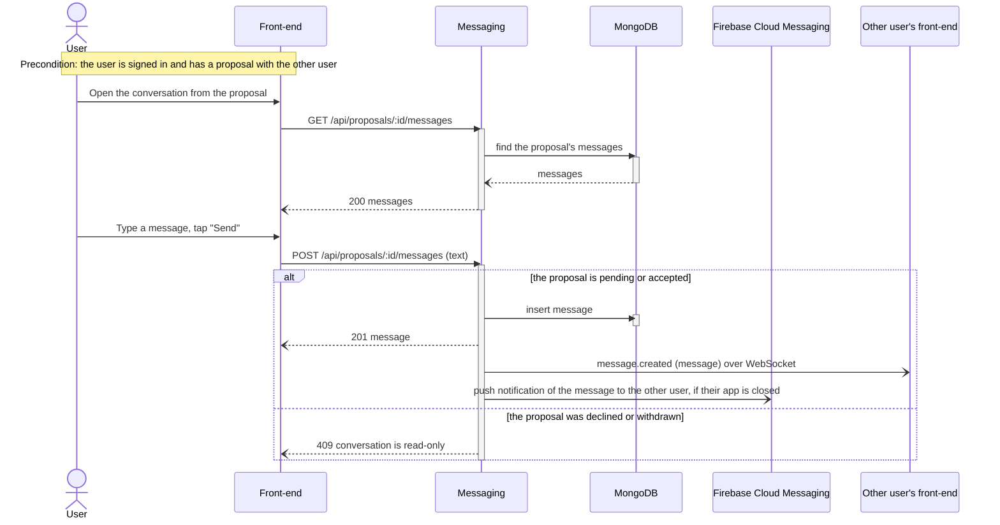

# Match Market Requirements and Design

## 1. Change History

| **Change Date** | **Modified Sections** | **Rationale** |
| --------------- | --------------------- | ------------- |
| 2026-10-12 | All | Initial draft for Match Market (two-sided second-hand marketplace), replacing the M1 LeftOBite idea. |
| 2026-10-12 | 2 | Updated project description to match the M2 presentation slides (tagline, problem, audience, matching approach). |
| 2026-10-12 | 3.1, 3.4 | Authentication is a required baseline, not a feature; features renumbered from four to three. |
| 2026-10-12 | 3.2, 3.4 | Split "Manage posts" into "Create buyer request" and "Create seller listing", one per actor. |
| 2026-10-12 | 3.5, 4.6 | Split the post use case into "Create Buyer Request" and "Create Seller Listing" formal specs and sequence diagrams (five formal specs). |
| 2026-10-12 | 4.1, 4.2, 4.4, 4.5, 4.6, 5 | Store listing photos in MongoDB using GridFS instead of a separate file volume. |
| 2026-10-12 | 3.5, 4.1 | Set photo limits: at most 10 photos, at most 5 MB each. |
| 2026-10-12 | 3.1, 3.4, 3.5, 4.1, 4.2, 4.6, 5 | Buyer requests can optionally include reference photos, same limits as listings. |
| 2026-10-12 | 2, 3.4, 3.5, 4.1, 4.6 | Removed match explanations; the feed shows ranked items with travel time only. |
| 2026-10-12 | 3.4, 3.5, 5 | Specified how users set soft-preference importance (0 to 5 sliders, defaults, normalized weights). |
| 2026-10-12 | 2, 3.4, 3.5, 4.1, 4.7, 5 | Defined hard requirements vs soft preferences vs temporary filters; one shared hard-requirement rule for both feeds, four importance weights, per-request radius with a profile default, optional filters and sort on a single /feed endpoint, travel times for the first page only. |
| 2026-10-12 | All | Removed offers, reservations, transactions, live updates, and push notifications; deferred to a future release. |
| 2026-10-12 | 3.2, 3.4, 3.5, 4.1, 4.6, 5 | Confirmed Feature 1 scope and clarified required inputs, saved defaults, photo counts, ownership, and the open/closed lifecycle. Added Manage Own Posts to the use-case coverage and recorded cross-component decisions still awaiting team agreement. |
| 2026-10-19 | 2-5 | Cross-checked the draft against main and active branches; corrected API and data-model descriptions; separated intended requirements from implementation status; recorded unresolved scope and behaviour differences. |
| 2026-10-21 | 4 | Matched Section 4 to the code on main: feed routes and filters, the hard-requirement rule, collections, libraries and test tools, and route prefixes in the sequence diagrams. |
| 2026-10-21 | 5 | Matched the data model to the code on main: request and listing fields, the options, custom fields and sessions collections, and request number validation. |
| 2026-10-21 | 3.2, 3.3, 4.6 | Redrew the use case diagram (one User actor, use cases grouped and colour-coded by feature), the actors and the sequence diagrams for the five current use cases; removed OpenRouteService geocoding; added Firebase Cloud Messaging. |
| 2026-10-21 | 4.1, 4.3, 4.5, 4.6 | Added the planned Transactions and Messaging components and Firebase Cloud Messaging; limited the dependency and sequence diagrams to the components and interfaces in 4.1; added error paths, loops, return messages and activation bars to the sequence diagrams. |
| 2026-10-21 | 2, 3.1, 3.6, 4.1, 4.2, 5 | Restored offers, transactions, live updates and messaging as planned features, reversing the 2026-10-12 removal; requests mark each field hard or soft; added browsing and filtering to Feature 2 and screen mock-ups; marked the user profile store and travel times as planned; added the planned proposals, transactions and messages collections. |
| 2026-10-21 | 3.7, 4.7 | Filled in the NFR values: 1 second at the 95th percentile with 1,000 candidate posts for feed ranking, the NFR test that measures it, and a 2-second routing timeout so the feed stays within 3 seconds. Justified the 3-second limit of the routing-service NFR. |
| 2026-10-30 | 3.5, 5 | Posts have a required name of up to 80 characters, entered in the post form and shown as the post's heading with its category underneath. Added the name to Use Case 1 and to the requests and listings data model. |
| 2026-10-30 | 2, 3.1, 3.3, 3.4, 3.5, 3.6, 4.1, 4.3, 4.5, 4.6, 4.7 | Connected travel times to OpenRouteService: the first page of recommendations shows each match's travel time (walking until a travel mode can be chosen), with "No route available" and "Travel time unavailable" for failures 5b and 5a, and NFR 2 is now tested. |

---

## 2. Project Description

**Match Market** is an Android app, "the marketplace where buyers post too". Traditional marketplaces are one-way: sellers post and buyers hunt, re-running the same searches across several sites for days, while sellers never see who is already looking for what they own. Match Market makes the marketplace two-sided. A buyer posts a persistent *request* once, with a category and fields such as maximum price, minimum condition, size, search radius, brand and colour, marking each field as a must-have (hard requirement) or a preference (soft requirement). Sellers post *listings* with photos, and can browse buyer requests that fit what they have.

The app matches both sides automatically, like a dating app for second-hand goods. Buyers and sellers fill in the same structured fields, listings that break a buyer's hard requirements are filtered out, and the remaining matches are ranked by how well they fit the buyer's soft preferences. Users see how far away each match is, and the travel time to the first page of matches, and can also browse and filter all open posts.

When a buyer finds a listing they want, they express interest; a seller can likewise send an offer on a buyer's request. The other party accepts or declines. An accepted proposal becomes a transaction that reserves the item, and both users see the change on their screen as it happens, without refreshing. Once connected by a proposal, the two users can message each other in the app to discuss the item and arrange collection.

The primary audience is buyers who know what they want and would rather be matched to it than scroll listings until one appears. The secondary audience is sellers with a specific item to move, who want it in front of the right buyer quickly. One account can act as both buyer and seller.

---

## 3. Requirements Specification

### **3.1. List of Features**

1. **Buyer Requests and Seller Listings**: Signed-in users create persistent buyer requests and seller listings, view their own posts, edit them, close and reopen them, and delete them. Listings include 1–10 item photos and requests may include up to 10 reference photos. Closed posts stay in the owner's list and are excluded from the feeds.
2. **Two-Sided Matching and Recommended Feeds**: Users browse other users' open listings or requests, newest first, and narrow them by category, price and distance. For each of their own open posts they also get recommendations: hard-constraint filtering and soft-preference ranking produce a buyer feed of listings for each request and a seller feed of requests for each listing, with the distance to each. Addresses are picked through the Android Geocoder, and travel times are computed with the OpenRouteService API.
3. **Offers, Acceptance, Transactions, and Live Updates**: From a feed, a buyer expresses interest in a listing or a seller sends an offer on a request. The recipient accepts or declines. Accepting creates a transaction, reserves the listing and declines the other pending proposals on it. Every proposal and transaction change appears on the other user's open screen within seconds over a WebSocket connection; Firebase Cloud Messaging adds a background push only when the app is closed.
4. **Messaging**: Buyers and sellers message each other in the app about a listing or a request, to ask about the item and arrange collection. New messages appear on the other user's open screen without refreshing.

Authentication is a baseline requirement of the app rather than a feature: users sign in with Google, and the backend verifies the Google ID token and issues its own session token.

### **3.2. Use Case Diagram**

### **3.3. Actors Description**

The use case diagram shows a single **User (Buyer or Seller)** actor because every signed-in account can act as both a buyer and a seller and has access to the same use cases; the two roles are described separately below because they post and receive different kinds of posts and proposals.

1. **Buyer**: A signed-in user who posts item requests, reviews recommended listings, expresses interest in listings, responds to offers, and messages sellers.
2. **Seller**: A signed-in user who posts listings with photos, reviews recommended buyer requests, sends offers on requests, responds to interest, and messages buyers. The same account can act as buyer and seller.
3. **Google Authentication Service** (external): Verifies the user's identity at sign-in.
4. **OpenRouteService** (external): Computes travel times between the user and recommended posts.
5. **Firebase Cloud Messaging** (external): Delivers push notifications for new proposals, answers and messages when the app is closed *(planned)*.

### **3.4. Use Case Description**

**Authentication** (baseline requirement, not counted as a feature)

1. **Sign in with Google**: The user signs in with their Google account and gains access to their posts and the feed.

**Feature 1: Buyer Requests and Seller Listings**

2. **Manage posts** ([Use Case 1](#uc1)): A user creates a buyer request or a seller listing, and later edits, closes, reopens or deletes their own posts.

**Feature 2: Two-Sided Matching and Recommended Feeds**

3. **View recommendations for a post** ([Use Case 3](#uc3)): A user sees the posts that match one of their open posts, ranked by how well they fit, with the distance to each and the travel time to the first page. Once built, the user will be able to set the radius, travel mode and importance weights used for the ranking.
4. **Browse and filter feed** ([Use Case 5](#uc5)): A user browses other users' open posts, newest first, and narrows them by category, price or distance.

**Feature 3: Offers, Acceptance, Transactions and Live Updates** *(planned)*

5. **Send proposal**: A buyer expresses interest in a listing, or a seller offers one of their listings for a request. The sender can withdraw it while it is still pending.
6. **Respond to proposal** ([Use Case 2](#uc2)): The other user sees the proposal appear live and accepts or declines it. Accepting reserves the listing and creates a transaction, and the sender sees the answer without refreshing.
7. **Manage transactions**: Either user marks the transaction completed, which closes the listing and the request, or cancels it, which reopens the listing.

**Feature 4: Messaging** *(planned)*

8. **Send and receive messages** ([Use Case 4](#uc4)): Buyers and sellers message each other about a listing or a request, and new messages appear live.

### **3.5. Formal Use Case Specifications (5 Most Major Use Cases)**

#### Use Case 1: Manage Posts

**Description**: A user creates a buyer request or a seller listing, then views, edits, closes, reopens or deletes their own posts.

**Primary actor(s)**: Buyer, Seller

**Main success scenario**:
1. The user opens My Posts and chooses "I'm buying" (requests) or "I'm selling" (listings).
2. The app shows the user's open and closed posts of that kind.
3. The user taps "New request" or "New listing".
4. The app shows the post form.
5. The user enters a name and a category and picks an address from the suggestions.
    - For a request: a maximum price (required), and optionally a minimum condition, maximum size, search radius, brand and colour. Each of these fields, including the maximum price, is marked Hard or Soft, and a Soft field gets an importance from 1 to 5. The user may also add a description, custom fields, and up to 10 reference photos.
    - For a listing: a price, a condition and 1–10 photos, and optionally a brand, colour, size, description and custom fields.
6. The user taps "Create request" or "Create listing".
7. The app saves the post and shows it in My Posts.
8. The user opens one of their posts, or its ⋮ menu, and either edits it and taps "Save changes", taps "Close" or "Reopen", or taps "Delete" and confirms.
9. The app shows the updated post, or removes the deleted post from the list.

**Failure scenario(s)**:
- 2a. The network or server is unavailable when the posts are loaded.
    - 2a1. The app shows "Could not reach the server. Check your connection."
- 5a. A required field is missing or invalid.
    - 5a1. The app shows an error message, such as "Choose a category", "Enter a name", "Max price is required", "Enter a price", "Add at least one photo", or for a price below 0 "max price must be at least 0" (request) or "price must be a number of at least 0" (listing). Nothing is saved.
- 5b. The address was typed but not picked from the suggestions.
    - 5b1. The app highlights the address field and shows "Choose your address from the suggestions list".
- 5c. A photo is larger than 5 MB.
    - 5c1. The app shows "Each photo must be at most 5 MB" and the post is not saved.
- 5d. The user tries to add more than 10 photos.
    - 5d1. The photo picker only lets the user select as many photos as are still allowed, and the app disables adding photos once there are 10.
- 6a. The network or server is unavailable when the post is submitted.
    - 6a1. The app shows "Could not reach the server. Check your connection." and the form keeps what the user entered.
- 8a. The network or server is unavailable when a post is saved, closed, reopened or deleted.
    - 8a1. The app shows "Could not reach the server. Check your connection." and the post is unchanged.
- 8b. An edit makes a field invalid.
    - 8b1. The app shows an error message, such as "Choose a category", and the post is unchanged.

#### Use Case 2: Respond to Proposal *(planned)*

**Description**: A user receives a buyer's interest in their listing, or a seller's offer on their request, sees it appear live, and accepts or declines it. The other user sees the answer without refreshing.

**Primary actor(s)**: Buyer, Seller

**Main success scenario**:
1. Another user expresses interest in the user's listing, or sends an offer on the user's request.
2. The proposal appears on the user's open screen within 2 seconds; if the app is closed, a push notification is shown.
3. The user opens the proposal and sees the post and the other user.
4. The user taps "Accept" or "Decline".
5. On accept, the system creates a transaction, reserves the listing, and declines the other pending proposals on it.
6. The other user's screen shows "Accepted" or "Declined" within 2 seconds, without refreshing.

**Failure scenario(s)**:
- 3a. The other user withdrew the proposal.
    - 3a1. The app shows that the proposal was withdrawn, and it cannot be answered.
- 5a. The listing is already reserved, closed or deleted.
    - 5a1. The app shows that the item is no longer available, and the proposal is declined.
- 5b. The network or server is unavailable.
    - 5b1. The app shows an error message and the proposal stays pending.
- 6a. The other user's connection is lost.
    - 6a1. They see the new status when they reconnect.

#### Use Case 3: View Recommendations for a Post

**Description**: A user sees the posts that match one of their own open posts (listings for a request, requests for a listing), ranked by how well they fit, and can change the preferences used for the ranking.

**Primary actor(s)**: Buyer, Seller

**Main success scenario**:
1. The user opens one of their open posts and taps "See recommendations", or picks the post under "Recommended for" in the feed filters.
2. The app shows "Recommended for: <post>".
3. The system takes other users' open posts in the same category and keeps those that meet the request's hard requirements: within the request's radius (10 km if none was set) and every field the buyer marked Hard. Any feed filters (Use Case 5) also apply.
4. The system scores each remaining post on price, condition, distance and preference match, weights the scores by the user's importance settings (3 each until the user saves preferences), and orders the best first.
5. The system requests travel times for the first 20 results from OpenRouteService, by walking until the user can choose a travel mode.
6. The app shows the ranked list, 20 at a time; each item shows its price or budget, its condition (listings), and its distance, plus its travel time on the first page, such as "12 min walk".
7. *(Planned)* The user opens preferences, sets a default search radius (1–50 km), a travel mode (walk, bike or drive) and the importance (0–5) of price, condition, distance and preference match, and taps "Save"; the recommendations re-rank with them.

**Failure scenario(s)**:
- 1a. The user has no open posts.
    - 1a1. The feed filters show "You have no open posts to get recommendations for".
- 1b. The post is closed.
    - 1b1. "See recommendations" is not shown, and the server returns no feed for it (409).
- 3a. No posts meet the hard requirements.
    - 3a1. The app shows "Nothing here yet. Try changing the filters or check back soon." and a "Refresh" button.
- 5a. The routing service is unavailable, rate-limited or takes more than 2 seconds.
    - 5a1. The app shows the ranked list without travel times, and each item on the first page shows "Travel time unavailable".
- 5b. No route exists for the user's travel mode.
    - 5b1. The app shows "No route available" for that item.
- 6a. The network or server is unavailable.
    - 6a1. The app shows "Couldn't load the feed. Check your connection and try again." and a "Retry" button.
- 7a. *(Planned)* The network or server is unavailable when the preferences are saved.
    - 7a1. The app shows "Could not reach the server. Check your connection." and the preferences are unchanged.

#### Use Case 4: Send and Receive Messages *(planned)*

**Description**: Two users connected by an interest or an offer message each other in the app to discuss the item and arrange collection, and new messages appear live.

**Primary actor(s)**: Buyer, Seller

**Main success scenario**:
1. From a proposal, the user opens the conversation with the other user.
2. The app shows the earlier messages.
3. The user types a message and taps "Send".
4. The system saves the message and delivers it to the other user, where it appears on their open screen within 2 seconds, or as a push notification if the app is closed.
5. The other user's reply appears on the user's screen without refreshing.

**Failure scenario(s)**:
- 1a. The proposal was declined or withdrawn.
    - 1a1. The conversation can be read but not added to.
- 3a. The message is empty.
    - 3a1. "Send" is disabled.
- 4a. The network or server is unavailable.
    - 4a1. The message is marked as not sent and the user can retry.
- 5a. The connection is lost.
    - 5a1. Missed messages appear when the user reconnects.

#### Use Case 5: Browse and Filter Feed

**Description**: A user browses other users' open posts, newest first, and narrows them by category, price or distance.

**Primary actor(s)**: Buyer, Seller

**Main success scenario**:
1. The user opens the Feed tab and chooses "I'm buying" (listings) or "I'm selling" (requests).
2. The app shows other users' open posts of that kind, newest first, 20 at a time.
3. The user scrolls, and the app loads more posts.
4. The user taps "Filters" and sets any of: category, minimum and maximum price ("Min budget" and "Max budget" for requests), and "Near address" with "Within (km)".
5. The user taps "Apply", and the list reloads with only the matching posts; "Clear" removes the filters.
6. The user taps a post to see its details.

**Failure scenario(s)**:
- 2a. No posts match.
    - 2a1. The app shows "Nothing here yet. Try changing the filters or check back soon." and a "Refresh" button.
- 2b. The network or server is unavailable.
    - 2b1. The app shows "Couldn't load the feed. Check your connection and try again." and a "Retry" button.
- 4a. A price is not a number of 0 or more.
    - 4a1. The app shows "Enter a number of 0 or more".
- 4b. The minimum is more than the maximum.
    - 4b1. The app shows "Min must not be more than max".
- 4c. A distance is set without an address.
    - 4c1. The app shows "Pick an address to filter by distance".
- 4d. The distance is outside 0–100 km.
    - 4d1. The app shows "Enter a distance from 0 to 100".

### **3.6. Screen Mock-ups**

1. **Feed** ([Use Case 5](#uc5), [Use Case 3](#uc3)): other users' listings ("I'm buying") or requests ("I'm selling"), with the Filters button.

    

2. **New request** ([Use Case 1](#uc1)): the request form, where each requirement is marked Hard or Soft with an importance.

    

Both screens are built and will be extended with the planned features: feed items will gain an "Interested" or "Make an offer" button, and posts will link to their proposals and messages. The design keeps the same bottom-tab layout (Feed, My Posts, Profile).

### **3.7. Non-Functional Requirements**

1. **Performance: Feed ranking latency**
    - **Description**: The feed returns the first page of ranked matches for a post within 1 second for 95% of requests, with 1,000 open candidate posts in the same category, not counting the travel-time lookup. Section 4.7 describes how it is measured.
    - **Justification**: Recommendations are the core of the app, so the feed must load quickly. 1 second is the limit for a user's flow of thought to stay uninterrupted ([Nielsen Norman Group, "Response Times: The 3 Important Limits"](https://www.nngroup.com/articles/response-times-3-important-limits/)), and 1,000 open posts in one category is several times more than we expect from a student community.

2. **Reliability: Graceful degradation without the routing service**
    - **Description**: If the external routing service fails, times out or is rate-limited, the feed still returns the ranked matches within 3 seconds, without travel times, and shows that travel time is unavailable.
    - **Justification**: Prevents third-party service failures from disrupting core functionality. 3 seconds is the 1-second feed target in NFR 1 plus the 2-second routing timeout in Section 4.7, and stays well under the 10-second limit for keeping a user's attention.

---

## 4. Designs Specification

### **4.1. Main Components**

1. **Posts**
    - **Purpose**: Owns buyer requests and seller listings, including their photos, validation, and ownership.
    - **Rationale**: Both post types share most fields and lifecycle, so one component avoids duplicate logic; alternative of separate Requests and Listings components was rejected because every matching and feed operation needs both.
    - **Lifecycle and ownership**: Newly created posts have status open. Only the authenticated owner may edit, close, reopen or delete a post. Closing changes the stored status to closed and keeps the post in the owner's My Posts; closed posts can still be edited and are excluded from feeds and recommendations. Reopening sets the status back to open, and deleting removes the post permanently.
    - **Interfaces**: All routes use the `/api` prefix. Post operations require an authenticated session.
        1. `POST /api/requests` and `POST /api/listings`
            - **Purpose**: Create a post from JSON containing its fields, coordinates and photo IDs. Photos are uploaded separately before creating the post. Returns the created post with status 201.
        2. `GET /api/requests` and `GET /api/listings`
            - **Purpose**: Retrieve the authenticated user's own open and closed posts.
        3. `GET /api/requests/:id` and `GET /api/listings/:id`
            - **Purpose**: Retrieve an owned post. Returns 403 for another user's post or 404 if the post does not exist.
        4. `PATCH /api/requests/:id` and `PATCH /api/listings/:id`
            - **Purpose**: Update an owned post's fields or status. Setting `status=closed` closes it; `status=open` reopens it. Closed posts can also be edited.
        5. `DELETE /api/requests/:id` and `DELETE /api/listings/:id`
            - **Purpose**: Permanently delete an owned post. Returns status 204.
        6. `POST /api/photos`
            - **Purpose**: Upload 1–10 photos using multipart form data. Accepted MIME types are JPEG, PNG, WebP and GIF, with a current limit of 5 MiB per photo. Returns the uploaded photo IDs.
        7. `GET /api/photos/:id`
            - **Purpose**: Retrieve a photo from GridFS. This endpoint is currently public.
        8. Options and custom fields
            - **Purpose**: `/api/options` supports retrieving and adding option values. `/api/custom-fields` supports retrieving and saving the user's reusable field definitions; `/api/custom-fields/:key` supports deleting a definition.

2. **Matching**
    - **Purpose**: Hard-requirement filtering and weighted ranking in both directions, plus travel time.
    - **Rationale**: Isolated from storage and HTTP so the team-written logic can be tested through the feed's interface tests; alternative of database-only filtering was rejected because ranking needs weighted scoring.
    - **Interfaces**:
        1. `GET /api/feed?postId=<id>&limit=&cursor=&category=&minPrice=&maxPrice=&lat=&lng=&radiusKm=`
            - **Purpose**: Return the feed for the user's own request or listing, with travel times for the first page: each match has travelMinutes, and the response has travelMode and travelTimesAvailable, which is false when the routing service did not answer. The post type decides the direction: a request returns listings, a listing returns requests. Every parameter except postId, limit and cursor is an optional temporary filter. A value looser than the saved requirement is ignored, and an unsupported parameter returns 400. Returns 403 for another user's post and 409 for a closed post. The planned minCondition filter (request feeds only) and sort=best|nearest|cheapest are not implemented yet.
        2. `GET /api/feed/listings` and `GET /api/feed/requests`
            - **Purpose**: Return other users' open posts, newest first, with the same filters; `before` pages through them.
        3. `boolean satisfies(Request request, Listing listing)`
            - **Purpose**: The single hard-requirement rule (category and straight-line distance within radius, plus price, condition, dimensions or any other field the buyer marked hard) used by both feed directions.
        4. `List<RankedMatch> rank(Post source, List<Post> candidates, Weights weights)`
            - **Purpose**: Score each candidate on price, condition, distance, and brand/colour match, and order by the viewer's weights.
        5. `List<Duration> travelTimes(Location origin, List<Location> destinations, TravelMode mode)`
            - **Purpose**: Get travel times from the external routing service for one page of results; returns empty when it is unavailable.

3. **Users & Auth**
    - **Purpose**: Verifies Google sign-in and issues session tokens. Storing each user's profile, location and preferences is planned.
    - **Rationale**: Keeps identity and per-user settings in one place so Posts and Matching only depend on a user id; alternative of storing settings on each post was rejected because settings apply across all of a user's posts.
    - **Interfaces**:
        1. `POST /api/auth/google`
            - **Purpose**: Exchange a Google ID token for a session token; 401 if the token is invalid.
        2. `POST /api/auth/refresh`
            - **Purpose**: Rotates the token pair.
        3. `POST /api/auth/logout`
            - **Purpose**: Revokes the refresh-token family. Session tokens last 15 minutes; refresh tokens have a 30-day lifetime. Protected routes use requireAuth and currentUser.
        4. `GET /api/users/me`, `PATCH /api/users/me` *(planned)*
            - **Purpose**: Read or update profile, typed address and default radius, travel mode, and the four importance weights.
        5. `userId requireAuth(token)`
            - **Purpose**: Internal interface protecting every other route.

4. **Transactions** *(planned)*
    - **Purpose**: Owns proposals (a buyer's interest in a listing or a seller's offer on a request) and the transactions created when one is accepted, and pushes their changes to both users live.
    - **Rationale**: Kept separate from Posts because a proposal links two users' posts and has its own lifecycle (pending, accepted, declined, withdrawn); alternative of storing proposals on each post was rejected because accepting one must update the listing, the transaction and every other pending proposal together.
    - **Interfaces**:
        1. `POST /api/proposals`
            - **Purpose**: Send an interest (listing id) or an offer (request id and the sender's listing id). Returns the pending proposal with status 201.
        2. `GET /api/proposals`
            - **Purpose**: Retrieve the proposals the user sent and received, with their status.
        3. `PATCH /api/proposals/:id`
            - **Purpose**: The recipient accepts or declines, or the sender withdraws, a pending proposal. Accepting creates a transaction, reserves the listing and declines the other pending proposals on it. Returns the proposal (and the transaction on accept); 409 if the proposal is no longer pending or the listing is reserved, closed or deleted.
        4. `PATCH /api/transactions/:id`
            - **Purpose**: Either user marks the transaction completed, which closes the listing and the request, or cancels it, which reopens the listing. Returns the transaction.
        5. WebSocket events `proposal.created` and `proposal.updated`
            - **Purpose**: Deliver a new proposal, or its new status, to the other user's open app.

5. **Messaging** *(planned)*
    - **Purpose**: Stores and delivers the messages between the two users of a proposal.
    - **Rationale**: Separate from Transactions so conversations can grow without changing proposal logic; alternative of a general chat between any two users was rejected because messages are only needed once users are connected by a proposal.
    - **Interfaces**:
        1. `GET /api/proposals/:id/messages`
            - **Purpose**: Retrieve the conversation for a proposal the user is part of, oldest first; 403 otherwise.
        2. `POST /api/proposals/:id/messages`
            - **Purpose**: Send a non-empty message. Returns the message with status 201; 409 if the proposal was declined or withdrawn, which makes the conversation read-only.
        3. WebSocket event `message.created`
            - **Purpose**: Deliver a new message to the other user's open app.

### **4.2. Databases**

1. **MongoDB** (self-hosted in Docker on the cloud VM)
    - **Purpose**: Stores requests, listings, options, custom fields, and sessions, and will store users *(planned)*. Photos for requests and listings are stored in the same database using GridFS (fs.files and fs.chunks), and each post keeps the ids of its photos. Geospatial index on post locations.

### **4.3. External Modules**

1. **Google Sign-In / Google identity**
    - **Purpose**: Authenticates users. The backend verifies Google ID tokens with google-auth-library.
2. **Android Geocoder**
    - **Purpose**: Provides address suggestions and coordinates in the current frontend. The implemented lookup uses the Android 13+ callback API; the older-version path returns no suggestions.
3. **OpenRouteService**
    - **Purpose**: Travel times between the user's post and the first page of recommended posts, from its matrix API, for walking, cycling or driving. The backend needs an `ORS_API_KEY`; without it the feed is returned without travel times.
4. **Firebase Cloud Messaging** *(planned)*
    - **Purpose**: Push notifications for new proposals, answers and messages when the app is closed. Transactions and Messaging send them; live updates in the open app use WebSocket events instead.

### **4.4. Frameworks and Libraries**

1. **Jetpack Compose and Kotlin** (frontend)
    - **Purpose**: Native Android UI.
    - **Reason**: Required by the project.
2. **OkHttp** (frontend)
    - **Purpose**: REST calls to the backend.
    - **Reason**: Already in the project.
3. **Android Credential Manager / Google ID** (frontend)
    - **Purpose**: Google Sign-In.
    - **Reason**: Existing sign-in code is built on it.
4. **Express** (backend)
    - **Purpose**: HTTP routing and middleware.
    - **Reason**: Provided by the template.
5. **mongodb (official Node driver)** (backend)
    - **Purpose**: Database access.
    - **Reason**: Thin and explicit; geospatial queries are direct, and GridFS for photos is built in.
6. **google-auth-library** (backend)
    - **Purpose**: Verifies the Google ID token sent by the app.
    - **Reason**: Google's own library for validating ID tokens, so signature and audience checks are not hand-written.
7. **jsonwebtoken** (backend)
    - **Purpose**: Issues and verifies the backend's session tokens.
    - **Reason**: Standard JWT library for Node.js.
8. **Coil** (frontend)
    - **Purpose**: Loads and caches post photos in Compose screens.
    - **Reason**: Kotlin-first image loader with Compose support.
9. **Jest and Supertest** (backend), **Compose testing** (frontend)
    - **Purpose**: Backend interface tests and frontend Compose test dependencies are present. The frontend also includes AndroidX JUnit and Espresso. UI Automator is also declared; the end-to-end tests use it for the system photo picker. Feature 1 end-to-end tests (`CreatePostTest` and `ManagePostsTest`) are in the frontend's `androidTest` `e2e` package.
10. **Multer** (backend)
    - **Purpose**: Parses multipart photo uploads and enforces the photo count and size limits.
    - **Reason**: Standard Express middleware for multipart uploads.

### **4.5. Dependencies Diagram**

Every back-end route except `/health` calls `requireAuth` in Users and Auth. Dashed links are planned: Transactions and Messaging are not built yet. The two-way links are the planned WebSocket events, which the back-end sends to the app.

### **4.6. Use Case Sequence Diagram (5 Most Major Use Cases)**

1. [**Manage Posts**](#uc1)

2. [**Respond to Proposal**](#uc2) *(planned)*

3. [**View Recommendations for a Post**](#uc3)

4. [**Send and Receive Messages**](#uc4) *(planned)*

5. [**Browse and Filter Feed**](#uc5)

### **4.7. Design of Non-Functional Requirements**

1. **Feed ranking latency**
    - **Implementation**: The design filters out ineligible candidates before calculating ranking scores. It then ranks the qualifying candidates and paginates the results. This supports the feed-ranking latency requirement in Section 3.7.

      Performance will be measured using this candidate workload and environment:
        - Candidate workload: 1,000 open posts in the same category as the user's post.
        - Target ranking latency: 1 second at the 95th percentile, not counting the travel-time lookup.
        - Measurement environment: a backend Jest NFR test in `backend/tests/nfr/`, run with `scripts/run-backend-nfr-tests.sh`, that sends 100 `GET /api/feed?postId=<id>` requests through Supertest. It measures the backend's response time only, without the phone's network.
2. **Graceful degradation without the routing service**
    - **Implementation**: The feed requests travel times only for the first page of matches, in one OpenRouteService matrix request with a timeout of 2 seconds (`ROUTING_TIMEOUT_MS` in `matching/travelTime.ts`). If the service fails, times out or is rate-limited, the feed returns the ranked matches with `travelTimesAvailable: false`, and the app shows "Travel time unavailable". The timeout lets the feed meet the 3-second response target in Section 3.7.
    - **Implementation status**: Matching on main filters candidates and ranks them before pagination. `backend/tests/nfr/routingFallback.test.ts` checks NFR 2: with a routing service that never answers, the feed returns its ranked matches in about 2 seconds, under the 3-second limit. NFR 1 is not measured yet.

---

## 5. Data Model

| **Collection** | **Key fields** |
| -------------- | -------------- |
| users *(planned)* | googleSub, name, email, address, location (GeoJSON), defaultRadiusKm, travelMode (walk, bike, drive), weights {price, condition, distance, match} (each an integer 0 to 5, default 3) |
| requests | ownerId, name, category, description, requestFields[] (built-in price (max), condition (min), dimensions {width, height, depth} (max), radiuskm, brand, colour, plus custom fields; each hard, or soft with an importance 1 to 5), address, location, photoIds[] (optional GridFS file ids), status (open, closed) |
| listings | ownerId, name, category, description, price, condition, listingFields[] (built-in brand, dimensions {width, height, depth}, colour, plus custom fields), address, location, photoIds[] (GridFS file ids), status (open, closed) |
| options | field, key, label, builtin, createdBy |
| customFields | ownerId, key, label, type (text, number, bool) |
| sessions | tokenHash, familyId, userId, expiresAt, usedAt |
| proposals *(planned)* | type (interest, offer), senderId, recipientId, listingId, requestId (offers only), status (pending, accepted, declined, withdrawn), createdAt |
| transactions *(planned)* | proposalId, buyerId, sellerId, listingId, requestId (if any), status (reserved, completed, cancelled), createdAt |
| messages *(planned)* | proposalId, senderId, text, createdAt |

Condition is one of five ordered levels: new, like new, good, fair, poor.

**Feature 1 data rules:**
- The backend obtains ownerId from the authenticated session. New posts start open. Closing retains a record; the current API also supports reopening and permanent deletion.
- Both post types require name, category, address and coordinates. Requests require a built-in price field. Listings require non-negative top-level price, a valid condition and at least one photo ID. Request price, radius and size cannot be negative. The 1–50 km radius rule is not enforced by the inspected request-field validation; it must not be claimed as completed validation.
- Requests allow 0–10 photo IDs and listings 1–10. Actual upload size is at most 5 MiB per file. Post validation checks ID format/count; photo existence and ownership checks are not established by that validation.
- Categories are normalized, extendable option values rather than a fixed list. Description is supported, up to 2,000 characters. The name, up to 80 characters, is the post's title; posts saved before names were added use their category as the name. Dimensions use cm and radius uses km; CAD remains the intended currency.
- Unfilled optional editor rows are omitted. Existing post addresses and coordinates are saved with each post. Profile-based defaults are planned. Closed listings are excluded from the current open-listings feed.

Condition values remain, best to worst: new, like new, good, fair, poor.
