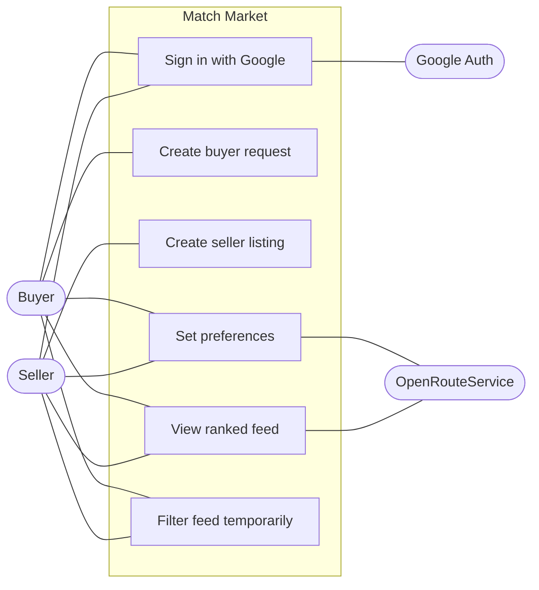
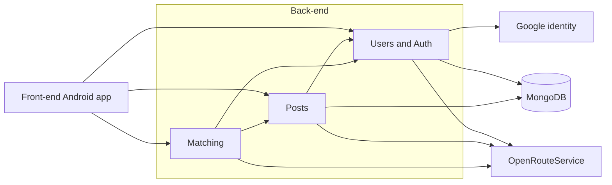
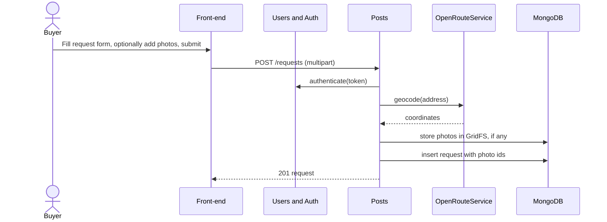
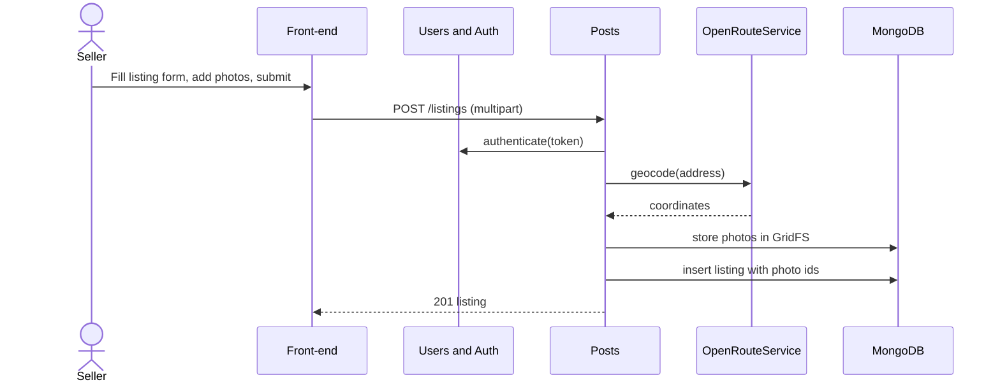
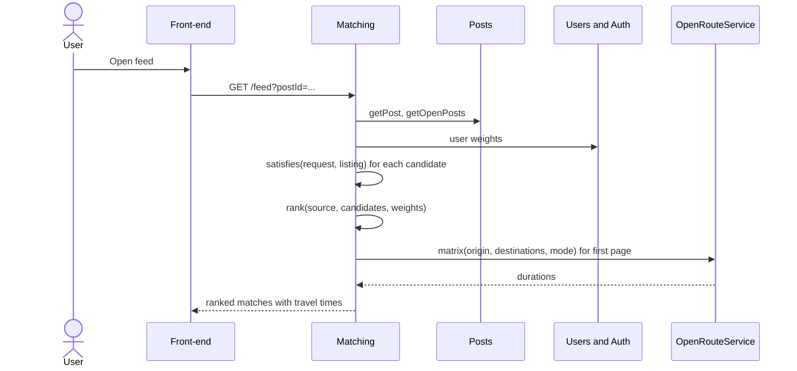
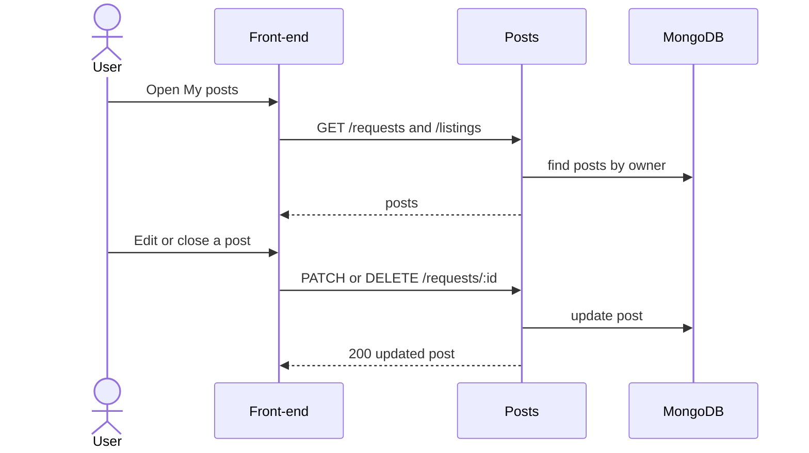
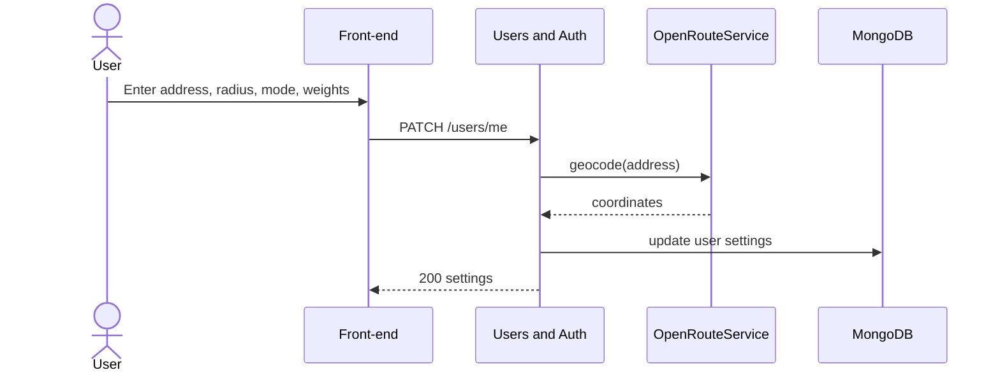

# Requirements and Design

## 1. Change History

| **Change Date** | **Modified Sections** | **Rationale** |
| --------------- | --------------------- | ------------- |
| 2026-10-12 | All | Initial draft for Match Market (two-sided second-hand marketplace), replacing the M1 LeftOBite idea. |
| 2026-10-12 | 2 | Updated project description to match the M2 presentation slides (tagline, problem, audience, matching approach). |
| 2026-10-12 | 3.1, 3.4 | Authentication is a required baseline, not a feature; features renumbered from four to three. |
| 2026-10-12 | 3.2, 3.4, 3.5, 4.6 | Simplified use cases: merged post/listing/manage into "Manage posts", renamed "Set preferences", split travel time out of the feed. |
| 2026-10-12 | 3.2, 3.4, 3.5, 4.6 | Folded "View travel time" into "View ranked feed"; removed the separate travel time use case and sequence diagram. |
| 2026-10-12 | 3.2, 3.4 | Split "Manage posts" into "Create buyer request" and "Create seller listing", one per actor. |
| 2026-10-12 | 3.5, 4.6 | Split the post use case into "Create Buyer Request" and "Create Seller Listing" formal specs and sequence diagrams (five formal specs). |
| 2026-10-12 | 4.1, 4.2, 4.4, 4.5, 4.6, 5 | Store listing photos in MongoDB using GridFS instead of a separate file volume. |
| 2026-10-12 | 3.5, 4.1 | Set photo limits for listings: at most 10 photos, at most 10 MB each. |
| 2026-10-12 | 3.1, 3.4, 3.5, 4.1, 4.2, 4.6, 5 | Buyer requests can optionally include reference photos, same limits as listings. |
| 2026-10-12 | 2, 3.4, 3.5, 4.1, 4.6 | Removed match explanations; the feed shows ranked items with travel time only. |
| 2026-10-12 | 3.4, 3.5, 5 | Specified how users set soft-preference importance (0 to 5 sliders, defaults, normalized weights) and the radius and travel mode inputs. |
| 2026-10-12 | 4.4 | Listed the auth, JWT, multipart upload, and image-loading libraries as approved for use. |
| 2026-10-12 | 2, 3.4, 3.5, 4.1, 4.7, 5 | Defined hard requirements vs soft preferences vs temporary filters: fields per post, one shared hard-requirement rule for both feeds, four importance weights, per-request radius with a profile default, optional filters and sort on a single /feed endpoint, travel times for the first page only. |
| 2026-10-12 | All | Removed offers, reservations, transactions, live updates, and push notifications everywhere; deferred to a future release. Replaced formal use cases 4 and 5, and the removed non-functional requirements. |
| 2026-10-20 | 3.5, 4.1 | Lowered the photo size limit from 10 MB to 5 MB to match the app and back-end, which both reject photos over 5 MB. |

---

## 2. Project Description

**Match Market** is an Android app, "the marketplace where buyers post too". Traditional marketplaces are one-way: sellers post and buyers hunt, re-running the same searches across several sites for days, while sellers never see who is already looking for what they own. Match Market makes the marketplace two-sided. A buyer posts a persistent *request* once, with must-haves (hard requirements: category, maximum price, minimum condition, maximum size, and search radius) and preferences (soft requirements: brand and colour). Sellers post *listings* with photos, and can browse buyer requests that fit what they have.

The app matches both sides automatically, like a dating app for second-hand goods. Buyers and sellers fill in the same structured fields, listings that break a buyer's hard requirements are filtered out, and the remaining matches are ranked by how well they fit the buyer's soft preferences. Users can set their location and search radius to find nearby matches and check the travel time to an item.

The primary audience is buyers who know what they want and would rather be matched to it than scroll listings until one appears. The secondary audience is sellers with a specific item to move, who want it in front of the right buyer quickly. One account can act as both buyer and seller.

---

## 3. Requirements Specification

### **3.1. List of Features**

1. **Buyer Requests and Seller Listings**: create, view, edit, and close requests and listings (listings include photos; requests can optionally include reference photos).
2. **Two-Sided Matching and Recommended Feeds**: hard-constraint filtering and soft-preference ranking, with location, search radius, and travel time, producing a buyer feed of listings and a seller feed of requests.

Authentication is a baseline requirement of the app rather than a feature: users sign in with Google, and the backend verifies the Google ID token and issues its own session token.

Planned for a future release: offers and reservations, live updates, and push notifications. Out of scope: in-app messaging between users.

### **3.2. Use Case Diagram**

### **3.3. Actors Description**

1. **Buyer**: A signed-in user who posts item requests and reviews matching listings.
2. **Seller**: A signed-in user who posts listings with photos and reviews matching buyer requests. The same account can act as buyer and seller.
3. **Google Authentication Service** (external): Verifies the user's identity at sign-in.
4. **OpenRouteService** (external): Converts typed addresses to coordinates and computes travel times.

### **3.4. Use Case Description**

**Authentication** (baseline requirement, not counted as a feature)

1. **Sign in with Google**: The user signs in with their Google account and gains access to their saved posts and preferences.

**Feature 1: Buyer Requests and Seller Listings**

2. **Create buyer request**: A buyer posts a persistent request with hard requirements (category, maximum price, minimum condition, maximum dimensions, search radius), soft preferences (brand, colour), a location, and optional photos. The buyer can later edit or close it.
3. **Create seller listing**: A seller posts a listing with category, price, condition, brand, dimensions, colour, location, and photos. The seller can later edit or close it.

**Feature 2: Two-Sided Matching and Recommended Feeds**

4. **Set preferences**: A user sets their address, default search radius, travel mode, and how much price, condition, distance, and brand/colour match matter (0 to 5 each).
5. **View ranked feed**: A buyer sees the listings that satisfy their request, and a seller sees the requests their listing satisfies, ordered by the viewer's weights and each with its travel time.
6. **Filter feed temporarily**: A user narrows or re-sorts the feed (maximum price, minimum condition, smaller radius, sort order) without changing the saved post or their preferences.

### **3.5. Formal Use Case Specifications (5 Most Major Use Cases)**

#### Use Case 1: Create Buyer Request

**Description**: A buyer creates a persistent request describing the item they want, with hard requirements, soft preferences, and optional reference photos.

**Primary actor(s)**: Buyer

**Main success scenario**:
1. The buyer opens the create-request screen.
2. The app shows the request form.
3. The buyer enters the hard requirements (category, maximum price, minimum condition, maximum dimensions, search radius), the soft preferences (preferred brand and colour), and a typed address, and optionally adds reference photos. Only category and maximum price are required; the radius defaults to the value in the buyer's preferences.
4. The buyer submits the form.
5. The app confirms the request was saved and shows it in "My posts".

**Failure scenario(s)**:
- 3a. A required field is missing or invalid (for example negative price, unknown category).
    - 3a1. The app highlights the field and shows an error message.
- 3b. A photo is larger than 5 MB or is not an image.
    - 3b1. The app rejects the photo and shows an error message.
- 3c. The buyer adds more than 10 photos.
    - 3c1. The app rejects the extra photos and shows an error message.
- 4a. The typed address cannot be located.
    - 4a1. The app shows "Address not found" and asks the buyer to correct it.
- 4b. The network or server is unavailable.
    - 4b1. The app shows an error message asking the buyer to try again later; no request is created.

#### Use Case 2: Create Seller Listing

**Description**: A seller creates a listing for an item they have available, with photos.

**Primary actor(s)**: Seller

**Main success scenario**:
1. The seller opens the create-listing screen.
2. The app shows the listing form.
3. The seller enters the category, price, condition, brand, dimensions, colour, and a typed address, and adds photos.
4. The seller submits the form.
5. The app confirms the listing was saved and shows it in "My posts".

**Failure scenario(s)**:
- 3a. A required field is missing or invalid (for example negative price, unknown category).
    - 3a1. The app highlights the field and shows an error message.
- 3b. A photo is larger than 5 MB or is not an image.
    - 3b1. The app rejects the photo and shows an error message.
- 3c. The seller adds more than 10 photos.
    - 3c1. The app rejects the extra photos and shows an error message.
- 4a. The typed address cannot be located.
    - 4a1. The app shows "Address not found" and asks the seller to correct it.
- 4b. The network or server is unavailable.
    - 4b1. The app shows an error message asking the seller to try again later; no listing is created.

#### Use Case 3: View Ranked Feed

**Description**: A user views the feed for one of their posts: listings for a buyer's request, requests for a seller's listing. Items are ordered by how well they fit the viewer's importance weights, and each shows its travel time, computed with the OpenRouteService API.

**Primary actor(s)**: Buyer, Seller

**Main success scenario**:
1. The user opens the feed screen and selects one of their requests (buyer) or listings (seller).
2. The system removes candidates that fail the hard requirements: same category, price within the maximum, condition at or above the minimum, dimensions that fit, and straight-line distance within the radius. Both feeds use the same rule, so a listing appears in a buyer's feed exactly when the request appears in the seller's feed.
3. The system scores each remaining candidate on price (cheaper is better), condition (better is better), distance (nearer is better), and brand/colour match, and orders them by the viewer's importance weights.
4. The system requests travel times for the first page of results (20 items) from the external routing service.
5. The app shows the ranked list, each item with its travel time.
6. The user applies temporary filters (maximum price, minimum condition, a smaller radius) or changes the sort order (best match, nearest, cheapest), and the list updates. Filters can only be stricter than the saved requirements, and the saved post is not changed.

**Failure scenario(s)**:
- 2a. No candidates satisfy the hard requirements.
    - 2a1. The app shows an empty state explaining that no matches were found and suggesting the user relax a requirement or widen the radius.
- 3a. The user has not set a post to match against.
    - 3a1. The app prompts the user to create a request or listing first.
- 4a. The routing service is unavailable or rate-limited.
    - 4a1. The app shows the ranked list without travel times and a message that travel time is unavailable.
- 4b. No route exists for the request owner's travel mode to an item.
    - 4b1. The app shows "No route available" for that item.
- 6a. A filter value is looser than the saved requirement (for example a maximum price above the request's maximum).
    - 6a1. The system applies the saved requirement instead and the app shows the effective value.
- 5a. The network or server is unavailable.
    - 5a1. The app shows an error message and a retry button.

#### Use Case 4: Manage Own Posts

**Description**: A user views, edits, or closes the requests and listings they have posted.

**Primary actor(s)**: Buyer, Seller

**Main success scenario**:
1. The user opens "My posts".
2. The app shows the user's open and closed requests and listings.
3. The user selects a post and edits its fields, or taps "Close".
4. The app confirms the change and shows the updated post.

**Failure scenario(s)**:
- 2a. The user has no posts.
    - 2a1. The app shows an empty state with a button to create a post.
- 3a. An edited field is invalid.
    - 3a1. The app highlights the field and shows an error message; the post is unchanged.
- 4a. The network or server is unavailable.
    - 4a1. The app shows an error message asking the user to try again later; the post is unchanged.

#### Use Case 5: Set Preferences

**Description**: A user sets their address, a default search radius, how they travel, and how important price, condition, distance, and brand/colour match are when results are ordered.

**Primary actor(s)**: Buyer, Seller

**Main success scenario**:
1. The user opens the preferences screen, which shows their current settings (or the defaults if none are saved).
2. The user types an address.
3. The user sets the default search radius with a slider from 1 to 50 km (default 10 km). New requests start with this radius, and each request can override it.
4. The user chooses a travel mode: walk, bike, or drive (default walk).
5. The user sets the importance of each preference with a slider from 0 ("doesn't matter") to 5 ("very important"): price, condition, distance, and brand/colour match. Each defaults to 3.
6. The user taps "Save".
7. The system converts the address to coordinates through the external geocoding service and stores the settings.
8. The app confirms the settings were saved, and the next feed uses them.

The importance values are relative: the system divides each value by the sum of the four to get the ranking weights (for example 5, 3, 2, 2 gives weights of about 0.42, 0.25, 0.17, and 0.17). Setting all four to 0 gives equal weights. A tap on "Reset to defaults" restores 10 km, walk, and 3 / 3 / 3 / 3. Hard requirements are not set here; they belong to each request.

**Failure scenario(s)**:
- 2a. The address field is empty.
    - 2a1. The app highlights the field and shows an error message.
- 6a. A value is out of range (for example a radius of zero).
    - 6a1. The app highlights the field and shows an error message.
- 7a. The address cannot be located.
    - 7a1. The app shows "Address not found" and keeps the previous settings.
- 7b. The geocoding service is unavailable.
    - 7b1. The app shows an error message asking the user to try again later; the previous settings are kept.

### **3.6. Screen Mock-ups**

_TODO: add after the team agrees on screen layout._

### **3.7. Non-Functional Requirements**

1. **Feed ranking latency**
    - **Description**: Computing a ranked feed for up to x candidate posts must complete within y seconds at the 95th percentile on the deployed server, excluding the external routing call.
    - **Justification**: The app only removes the searching hassle if results appear immediately; x candidates is well above the expected size of a student community and y seconds is the point at which users perceive a wait.

2. **Graceful degradation without the routing service**
    - **Description**: When the external routing service is unavailable or rate-limited, the feed is still returned within 3 seconds with travel time omitted, instead of failing.
    - **Justification**: The free routing tier has a low daily request cap, so outages and throttling are expected; ranking and matching must keep working without it.

---

## 4. Designs Specification
### **4.1. Main Components**

1. **Posts**
    - **Purpose**: Owns buyer requests and seller listings, including their photos, validation, and ownership.
    - **Rationale**: Both post types share most fields and lifecycle, so one component avoids duplicate logic; alternative of separate Requests and Listings components was rejected because every matching and feed operation needs both.
    - **Interfaces**:
        1. `POST /requests`, `POST /listings`
            - **Purpose**: Create a post (multipart for photos, which are optional for requests; at most 10 photos of at most 5 MB each). Returns the created post, or 400 if invalid.
        2. `GET /requests`, `GET /listings` (own posts), `GET /requests/:id`, `GET /listings/:id`
            - **Purpose**: List or fetch posts.
        3. `PATCH /requests/:id`, `PATCH /listings/:id`, `DELETE /requests/:id`, `DELETE /listings/:id`
            - **Purpose**: Edit or close an owned post; 403 if not the owner.
        4. `GET /photos/:photoId`
            - **Purpose**: Stream a request or listing photo from GridFS; requires a signed-in user.
        5. `Post createPost(userId, type, PostInput input)`, `Post getPost(postId)`, `List<Post> getOpenPosts(type, category)`
            - **Purpose**: Internal interface used by Matching.

2. **Matching**
    - **Purpose**: Hard-requirement filtering and weighted ranking in both directions, plus travel time.
    - **Rationale**: Isolated from storage and HTTP so the team-written logic can be unit-tested directly; alternative of database-only filtering was rejected because ranking needs weighted scoring.
    - **Interfaces**:
        1. `GET /feed?postId=<id>&maxPrice=&minCondition=&radiusKm=&sort=best|nearest|cheapest`
            - **Purpose**: Return the feed for the user's own request or listing, with travel times for the first page. The post type decides the direction: a request returns listings, a listing returns requests. Every parameter except `postId` is an optional temporary filter. `maxPrice` and `minCondition` apply to request feeds only; `radiusKm` and `sort` apply to both. A value looser than the saved requirement is ignored, and an unsupported parameter returns 400.
        2. `boolean satisfies(Request request, Listing listing)`
            - **Purpose**: The single hard-requirement rule (category, price, condition, dimensions, straight-line distance within radius) used by both feed directions.
        3. `List<RankedMatch> rank(Post source, List<Post> candidates, Weights weights)`
            - **Purpose**: Score each candidate on price, condition, distance, and brand/colour match, and order by the viewer's weights.
        4. `List<Duration> travelTimes(Location origin, List<Location> destinations, TravelMode mode)`
            - **Purpose**: Get travel times from the external routing service for one page of results; returns empty when it is unavailable.

3. **Users & Auth**
    - **Purpose**: Verifies Google sign-in, issues session tokens, and stores profile, location, and preferences.
    - **Rationale**: Keeps identity and per-user settings in one place so Posts and Matching only depend on a user id; alternative of storing settings on each post was rejected because settings apply across all of a user's posts.
    - **Interfaces**:
        1. `POST /auth/google`
            - **Purpose**: Exchange a Google ID token for a session token; 401 if the token is invalid.
        2. `GET /users/me`, `PATCH /users/me`
            - **Purpose**: Read or update profile, typed address and default radius, travel mode, and the four importance weights.
        3. `AuthMiddleware: userId authenticate(token)`
            - **Purpose**: Internal interface protecting every other route.

### **4.2. Databases**

1. **MongoDB** (self-hosted in Docker on the cloud VM)
    - **Purpose**: Stores `users`, `requests`, and `listings`. Photos for requests and listings are stored in the same database using GridFS (`fs.files` and `fs.chunks`), and each post keeps the ids of its photos. Geospatial index on post locations.

### **4.3. External Modules**

1. **Google Sign-In / Google identity**
    - **Purpose**: Authenticates users; the backend verifies the ID token.
2. **OpenRouteService**
    - **Purpose**: Geocoding of typed addresses and travel-time matrix between the user and matched items.

### **4.4. Frameworks and Libraries**

1. **Jetpack Compose and Kotlin** (frontend)
    - **Purpose**: Native Android UI.
    - **Reason**: Required by the project.
2. **OkHttp** (frontend)
    - **Purpose**: REST calls to the backend.
    - **Reason**: Already in the project.
3. **Android Credential Manager / Google ID** (frontend)
    - **Purpose**: Google Sign-In.
    - **Reason**: Existing sign-in code is built on it.
4. **Express** (backend)
    - **Purpose**: HTTP routing and middleware.
    - **Reason**: Provided by the template.
5. **mongodb (official Node driver)** (backend)
    - **Purpose**: Database access.
    - **Reason**: Thin and explicit; geospatial queries are direct, and GridFS for photos is built in.
6. **google-auth-library** (backend)
    - **Purpose**: Verifies the Google ID token sent by the app.
    - **Reason**: Google's own library for validating ID tokens, so signature and audience checks are not hand-written.
7. **jsonwebtoken** (backend)
    - **Purpose**: Issues and verifies the backend's session tokens.
    - **Reason**: Standard JWT library for Node.js.
8. **Coil** (frontend)
    - **Purpose**: Loads and caches post photos in Compose screens.
    - **Reason**: Kotlin-first image loader with Compose support.
9. **Jest and supertest** (backend), **Compose testing and UI Automator** (frontend)
    - **Purpose**: Required testing frameworks.
    - **Reason**: Required by the project.

### **4.5. Dependencies Diagram**

### **4.6. Use Case Sequence Diagram (5 Most Major Use Cases)**

1. [**Create Buyer Request**](#uc1)

2. [**Create Seller Listing**](#uc2)

3. [**View Ranked Feed**](#uc3)

4. [**Manage Own Posts**](#uc4)

5. [**Set Preferences**](#uc5)

### **4.7. Design of Non-Functional Requirements**
TBD
---

## 5. Data Model (supporting detail)

| Collection | Key fields |
| --- | --- |
| `users` | `googleSub`, `name`, `email`, `address`, `location` (GeoJSON), `defaultRadiusKm`, `travelMode` (walk, bike, drive), `weights` {price, condition, distance, match} (each an integer 0 to 5, default 3) |
| `requests` | `ownerId`, `category` (fixed list), `maxPrice`, `minCondition`, `maxDimensions` {width, height, depth}, `radiusKm`, `preferredBrand`, `preferredColour`, `address`, `location`, `photoIds[]` (optional GridFS file ids), `status` (open, closed) |
| `listings` | `ownerId`, `category`, `price`, `condition`, `brand`, `dimensions` {width, height, depth}, `colour`, `address`, `location`, `photoIds[]` (GridFS file ids), `status` (open, closed) |

Condition is one of five ordered levels: new, like new, good, fair, poor.
