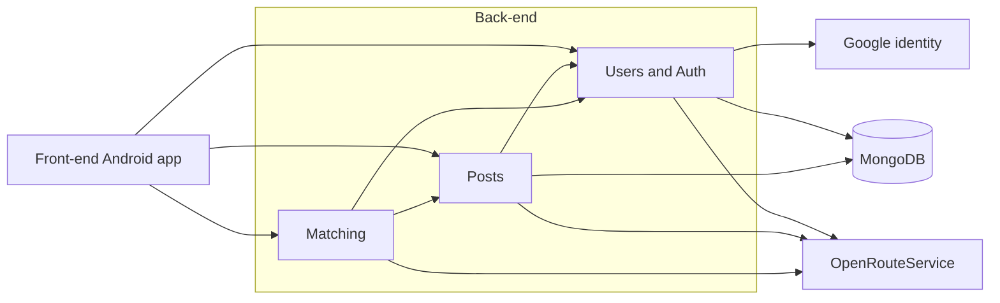
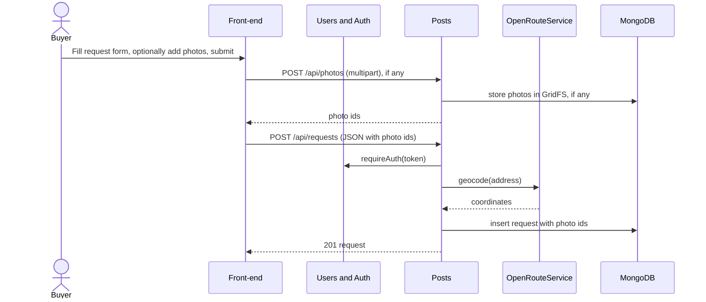
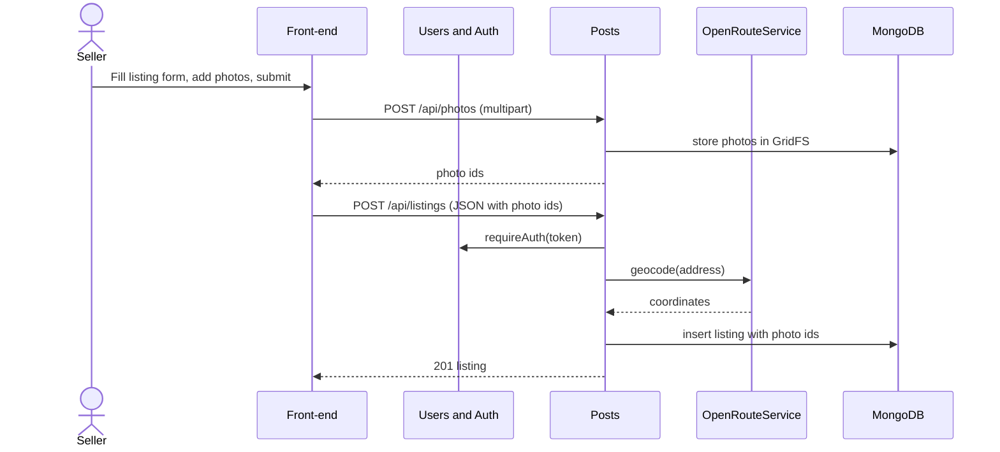
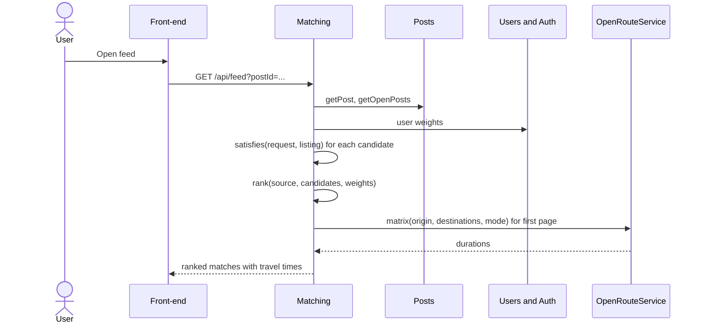
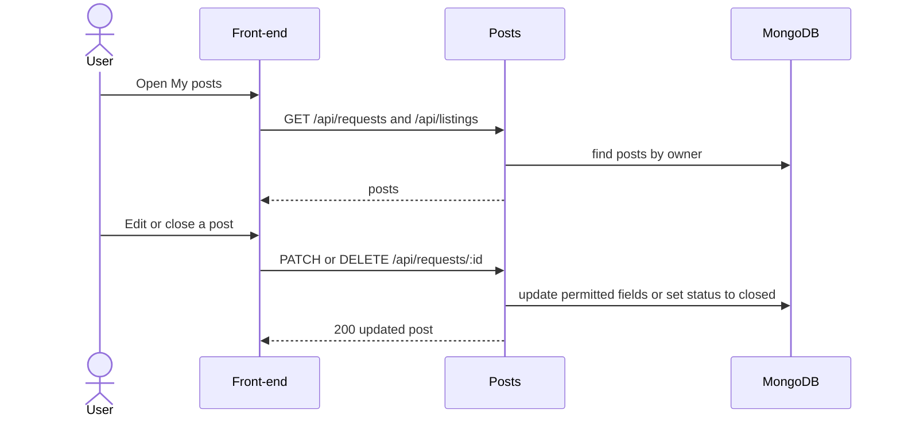
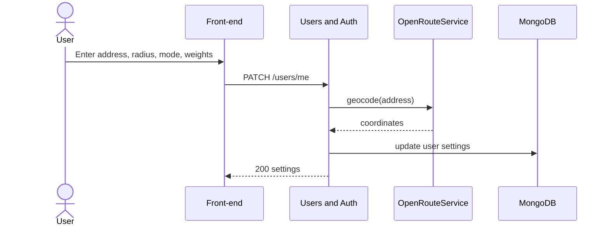

# Match Market Requirements and Design

## 1. Change History

| **Change Date** | **Modified Sections** | **Rationale** |
| --------------- | --------------------- | ------------- |
| 2026-10-12 | All | Initial draft for Match Market (two-sided second-hand marketplace), replacing the M1 LeftOBite idea. |
| 2026-10-12 | 2 | Updated project description to match the M2 presentation slides (tagline, problem, audience, matching approach). |
| 2026-10-12 | 3.1, 3.4 | Authentication is a required baseline, not a feature; features renumbered from four to three. |
| 2026-10-12 | 3.2, 3.4 | Split "Manage posts" into "Create buyer request" and "Create seller listing", one per actor. |
| 2026-10-12 | 3.5, 4.6 | Split the post use case into "Create Buyer Request" and "Create Seller Listing" formal specs and sequence diagrams (five formal specs). |
| 2026-10-12 | 4.1, 4.2, 4.4, 4.5, 4.6, 5 | Store listing photos in MongoDB using GridFS instead of a separate file volume. |
| 2026-10-12 | 3.5, 4.1 | Set photo limits: at most 10 photos, at most 5 MB each. |
| 2026-10-12 | 3.1, 3.4, 3.5, 4.1, 4.2, 4.6, 5 | Buyer requests can optionally include reference photos, same limits as listings. |
| 2026-10-12 | 2, 3.4, 3.5, 4.1, 4.6 | Removed match explanations; the feed shows ranked items with travel time only. |
| 2026-10-12 | 3.4, 3.5, 5 | Specified how users set soft-preference importance (0 to 5 sliders, defaults, normalized weights). |
| 2026-10-12 | 2, 3.4, 3.5, 4.1, 4.7, 5 | Defined hard requirements vs soft preferences vs temporary filters; one shared hard-requirement rule for both feeds, four importance weights, per-request radius with a profile default, optional filters and sort on a single /feed endpoint, travel times for the first page only. |
| 2026-10-12 | All | Removed offers, reservations, transactions, live updates, and push notifications; deferred to a future release. |
| 2026-10-12 | 3.2, 3.4, 3.5, 4.1, 4.6, 5 | Confirmed Feature 1 scope and clarified required inputs, saved defaults, photo counts, ownership, and the open/closed lifecycle. Added Manage Own Posts to the use-case coverage and recorded cross-component decisions still awaiting team agreement. |
| 2026-10-19 | 2-5 | Cross-checked the draft against main and active branches; corrected API and data-model descriptions; separated intended requirements from implementation status; recorded unresolved scope and behaviour differences. |
| 2026-10-21 | All | Fixed the document's formatting: headings, lists, escaped characters, use case anchors, and the Mermaid diagrams in 4.5 and 4.6. No requirements were changed. |
| 2026-10-21 | 4 | Matched Section 4 to the code on main: feed routes and filters, the hard-requirement rule, collections, libraries and test tools, and route prefixes in the sequence diagrams. |
| 2026-10-21 | 5 | Matched the data model to the code on main: request and listing fields, the options, custom fields and sessions collections, and request number validation. |

---

## 2. Project Description

**Match Market** is an Android app, "the marketplace where buyers post too". Traditional marketplaces are one-way: sellers post and buyers hunt, re-running the same searches across several sites for days, while sellers never see who is already looking for what they own. Match Market makes the marketplace two-sided. A buyer posts a persistent *request* once, with must-haves (hard requirements: category, maximum price, minimum condition, maximum size, and search radius) and preferences (soft requirements: brand and colour). Sellers post *listings* with photos, and can browse buyer requests that fit what they have.

The app matches both sides automatically, like a dating app for second-hand goods. Buyers and sellers fill in the same structured fields, listings that break a buyer's hard requirements are filtered out, and the remaining matches are ranked by how well they fit the buyer's soft preferences. Users can set their location and search radius to find nearby matches and check the travel time to an item.

When a buyer finds a listing they want, they express interest; a seller can likewise send an offer on a buyer's request. The other party accepts or declines. An accepted proposal becomes a transaction that reserves the item, and both users see the change on their screen as it happens, without refreshing.

The primary audience is buyers who know what they want and would rather be matched to it than scroll listings until one appears. The secondary audience is sellers with a specific item to move, who want it in front of the right buyer quickly. One account can act as both buyer and seller.

---

## 3. Requirements Specification

### **3.1. List of Features**

1. **Buyer Requests and Seller Listings**: Signed-in users create persistent buyer requests and seller listings, view their own posts, edit them, close and reopen them, and delete them. Listings include 1–10 item photos and requests may include up to 10 reference photos. Closed posts stay in the owner's list and are excluded from the feeds.
2. **Two-Sided Matching and Recommended Feeds**: hard-constraint filtering and soft-preference ranking, with location, search radius, and travel time, producing a buyer feed of listings and a seller feed of requests. It produces a buyer feed of listings for each request and a seller feed of requests for each listing. Addresses are geocoded and travel times computed with the OpenRouteService API.
3. **Offers, Acceptance, Transactions, and Live Updates**: From a feed, a buyer expresses interest in a listing or a seller sends an offer on a request. The recipient accepts or declines. Accepting creates a transaction, reserves the listing and declines the other pending proposals on it. Every proposal and transaction change appears on the other user's open screen within seconds over a WebSocket connection; Firebase Cloud Messaging adds a background push only when the app is closed.
4. **Messaging**: Authentication is a baseline requirement of the app rather than a feature: users sign in with Google, and the backend verifies the Google ID token and issues its own session token.

Planned for a future release: offers and reservations, live updates, and push notifications. Out of scope: in-app messaging between users.

### **3.2. Use Case Diagram**

### **3.3. Actors Description**

1. **Buyer**: A signed-in user who posts item requests and reviews matching listings in the intended product.
2. **Seller**: A signed-in user who posts listings with photos and reviews matching buyer requests in the intended product. The same account can act as buyer and seller.
3. **Google Authentication Service** (external): Verifies the user's identity at sign-in.
4. **OpenRouteService** (external): Converts typed addresses to coordinates and computes travel times.

### **3.4. Use Case Description**

- Authentication (baseline requirement, not counted as a feature)
1. **Sign in with Google**: The user signs in with their Google account and gains access to their saved posts and basic profile. Saving location and ranking preferences remains planned.

- Use cases for feature 1: Buyer Requests and Seller Listings
2. **Create buyer request**: A buyer creates a persistent request with a category, maximum price, valid location, and search radius, and may add minimum condition, maximum dimensions, preferred brand/colour, and reference photos. These saved requirements describe the item the buyer wants.
3. **Create seller listing**: A seller creates a persistent listing with a category, price, condition, valid location, and at least one item photo. The listing may include brand and colour; the applicable dimension requirements will follow the shared category rules recorded in PD1.
4. **Manage own posts**: A user views their own requests and listings, opens a post's details, edits it, closes or reopens it, or permanently deletes it after confirming. Closed posts stay in My Posts and are excluded from the feeds.

- Use cases for feature 2: Two-Sided Matching and Recommended Feeds
5. **Set preferences**: A user sets their address, default search radius, travel mode, and how much price, condition, distance, and brand/colour match matter (0 to 5 each).
6. **View ranked feed**: A buyer sees the listings that satisfy their request, and a seller sees the requests their listing satisfies, ordered by the viewer's weights and each with its travel time.
7. **Filter feed temporarily**: A user narrows or re-sorts the feed (maximum price, minimum condition, smaller radius, sort order) without changing the saved post or their preferences.

- Use cases for feature 3: Interest, Offers, Transactions and Live Updates
8. **Express interest**: From the feed of one of their requests, a buyer tells the seller they want a recommended listing, creating a pending interest.
9. **Send offer**: From the feed of one of their listings, a seller offers that listing to a recommended request, creating a pending offer.
10. **Respond to interest**: A seller sees incoming interests on their listings appear live and accepts or declines one; accepting reserves the listing and creates a transaction.
11. **Respond to offer**: A buyer sees incoming offers on their requests appear live and accepts or declines one, with the same effects as responding to an interest.
12. **Track proposal status**: A user watches the proposals they sent change from pending to accepted or declined on screen, as the other party responds, without refreshing.
13. **Withdraw proposal**: The user who sent a pending proposal cancels it before the other party responds.
14. **Manage transactions**: Either party marks a transaction completed, which closes the listing and the request, or cancels it, which reopens the listing.

#### Feature 1 Intended Behaviour

| **Area** | **Behaviour** |
| -------- | ------------- |
| Scope | Feature 1 covers Create Buyer Request, Create Seller Listing, and Manage Own Posts, including validation, photos, persistence, and ownership. Authentication, profile settings, and Matching are cooperating components. |
| Required request inputs | Category, maximum price, and a valid effective location are required. Minimum condition, maximum dimensions, preferred brand/colour, and reference photos are optional. Search radius is saved on the request using its selected or default value. |
| Required listing inputs | Category, price, condition, valid effective location, and at least one item photo are required. Brand and colour are optional. Category-dependent dimension requirements remain under PD1. |
| Location and defaults | A new post may use the saved profile address/location as its starting value. If a valid saved location is unavailable, the user must supply an address that can be located. The selected address and coordinates are saved with the post. |
| Request radius | A new request copies the user's default search radius, or 10 km if no default has been saved. The request radius may be set from 1 to 50 km. Later profile address or radius changes do not modify existing posts. |
| Optional buyer fields | A missing minimum condition or maximum dimension means no restriction on that attribute. A missing preferred brand or colour means no preference. Missing values must not be interpreted as zero. Handling of missing seller attributes during matching remains under PD1. |
| Units and condition | Prices use CAD, dimensions use cm, and search radius uses km. Prices may be zero but must not be negative. Condition values, best to worst, are new, like new, good, fair, and poor. |
| Photos | Requests allow 0–10 photos; listings require 1–10 photos. Each photo must be no larger than 5 MB. These counts also apply after editing. Supported formats, upload transport, and cleanup details remain under PD4. |
| Lifecycle | A newly saved post is open. An owner may edit an open post or close it after confirmation. Closed posts remain readable in My Posts, are read-only, and are excluded from active matching. Reopening and permanent deletion are outside this version. |
| Ownership | The backend obtains the owner identity from the verified session. Only the owner may edit or close a post. Non-owner detail and photo access rules remain under PD3. |
| Display labels | This version uses category-based labels, such as "Looking for: Desk" for a request and "Desk" for a listing. Custom title and description fields are not introduced by this revision. |
| Responsibility boundary | Hard requirements and brand/colour preferences are stored on requests. Ranking weights belong to user preferences, and temporary feed filters do not modify saved posts. |
| Basic failure handling | Entered form values are retained while the user remains in the editing flow. Submission controls prevent repeated taps during an active save. The app does not automatically repeat a create request after an uncertain timeout or claim that a post was not saved without confirmation. Retry/reconciliation details remain under PD5. |

#### Feature 1 Observed Implementation

| **Topic** | **Observed Implementation** |
| --------- | --------------------------- |
| Photo limits | Both frontend and backend enforce 5 MiB per photo (5 × 1024 × 1024 bytes), not the draft's 5 MB. Requests allow 0–10 photos and listings 1–10. Confirm the final size requirement. |
| Location and radius | The user selects an Android Geocoder address suggestion. No saved profile address or radius is loaded. Request radius is optional in the current form; the 1–50 km rule is not enforced by the inspected backend. |
| Fields and labels | Categories can be extended. Posts support a description and reusable custom fields. Buyer fields carry hard/soft flags and optional importance values; maximum price is not forced to be hard. Confirm this against the intended matching rules. |
| Lifecycle | Owners can edit closed posts, reopen posts and permanently delete them. Closing uses PATCH with status=closed. DELETE removes the record. The current UI confirms deletion, but does not request a separate close confirmation. |
| Visibility | Individual request/listing detail endpoints are owner-only. Photo reads are public. The signed-in listings feed returns open listings from other users. |
| Save failures | The editor retains entered state after a caught API error and blocks repeated submit taps while saving. A distinct unknown-save-status message, reconciliation flow and idempotent create mechanism are not established. |

### **3.5. Formal Use Case Specifications (5 Most Major Use Cases)**

#### Use Case 1: Create Buyer Request

**Description**: A buyer creates a persistent request describing the item they want, with hard requirements, soft preferences, and optional reference photos.

**Primary actor(s)**: Buyer

**Main success scenario**:
1. The buyer opens the create-request screen.
2. The app shows the request form.
3. The buyer selects a category and enters a maximum price, confirms or enters a valid address, and sets the search radius. The address may be prefilled from the saved profile, and the radius starts from the profile default or 10 km. The buyer may also enter a minimum condition, maximum dimensions, preferred brand and colour, and up to 10 reference photos. Each photo must be no larger than 5 MB. The permitted radius is 1–50 km.
4. The buyer submits the form.
5. The app confirms the request was saved and shows it in "My posts".

**Failure scenario(s)**:
- 3a. A required field is missing or invalid (for example negative price, unknown category).
    - 3a1. The app highlights the field and shows an error message.
- 3b. A photo is larger than 5 MB or is not an image.
    - 3b1. The app rejects the photo and shows an error message.
- 3c. The buyer adds more than 10 photos.
    - 3c1. The app rejects the extra photos and shows an error message.
- 4a. The typed address cannot be located.
    - 4a1. The app shows "Address not picked from suggestions" and asks the buyer to correct it.
- 4b. The submission is not sent because the app is offline, or the server confirms that the post was not saved.
    - 4b1. The app explains the failure and retains the entered values and selected photos in the current form so the user can correct the issue or try again.
- 4c. The connection is lost or the request times out before the app receives a definite save result.
    - 4c1. The app retains the form data, explains that the save status is unknown, and provides a way to check My Posts after reconnecting. It does not automatically resubmit the form or state that nothing was saved. The reliable retry/reconciliation mechanism remains to be finalized under PD5.

#### Use Case 2: Create Seller Listing

**Description**: A seller creates a listing for an item they have available, with photos.

**Primary actor(s)**: Seller

**Main success scenario**:
1. The seller opens the create-listing screen.
2. The app shows the listing form.
3. The seller selects a category, enters the price and condition, confirms or enters a valid address, and adds 1–10 item photos, each no larger than 5 MB. The address may be prefilled from the saved profile. Brand and colour are optional; dimension fields follow the shared category rules, which remain to be finalized under PD1.
4. The seller submits the form.
5. The app confirms the listing was saved and shows it in "My posts".

**Failure scenario(s)**:
- 3a. A required field is missing or invalid (for example negative price, unknown category).
    - 3a1. The app highlights the field and shows an error message.
- 3b. A photo is larger than 5 MB or is not an image.
    - 3b1. The app rejects the photo and shows an error message.
- 3c. The seller adds more than 10 photos.
    - 3c1. The app rejects the extra photos and shows an error message.
- 4a. The typed address cannot be located.
    - 4a1. The app shows "Address not found" and asks the seller to correct it.
- 4b. The submission is not sent because the app is offline, or the server confirms that the post was not saved.
    - 4b1. The app explains the failure and retains the entered values and selected photos in the current form so the user can correct the issue or try again.
- 4c. The connection is lost or the request times out before the app receives a definite save result.
    - 4c1. The app retains the form data, explains that the save status is unknown, and provides a way to check My Posts after reconnecting. It does not automatically resubmit the form or state that nothing was saved. The reliable retry/reconciliation mechanism remains to be finalized under PD5.

#### Use Case 3: View Ranked Feed

**Description**: A user views the feed for one of their posts: listings for a buyer's request, requests for a seller's listing. Items are ordered by how well they fit the viewer's importance weights, and each shows its travel time, computed with the OpenRouteService API.

**Primary actor(s)**: Buyer, Seller

**Main success scenario**:
1. The user opens the feed screen and selects one of their requests (buyer) or listings (seller).
2. The system removes candidates that fail the hard requirements: same category, price within the maximum, condition at or above the minimum, dimensions that fit, and straight-line distance within the radius. Both feeds use the same rule, so a listing appears in a buyer's feed exactly when the request appears in the seller's feed.
3. The system scores each remaining candidate on price (cheaper is better), condition (better is better), distance (nearer is better), and brand/colour match, and orders them by the viewer's importance weights.
4. The system requests travel times for the first page of results (20 items) from the external routing service.
5. The app shows the ranked list, each item with its travel time.
6. The user applies temporary filters (maximum price, minimum condition, a smaller radius) or changes the sort order (best match, nearest, cheapest), and the list updates. Filters can only be stricter than the saved requirements, and the saved post is not changed.

**Failure scenario(s)**:
- 2a. No candidates satisfy the hard requirements.
    - 2a1. The app shows an empty state explaining that no matches were found and suggesting the user relax a requirement or widen the radius.
- 3a. The user has not set a post to match against.
    - 3a1. The app prompts the user to create a request or listing first.
- 4a. The routing service is unavailable or rate-limited.
    - 4a1. The app shows the ranked list without travel times and a message that travel time is unavailable.
- 4b. No route exists for the request owner's travel mode to an item.
    - 4b1. The app shows "No route available" for that item.
- 5a. The network or server is unavailable.
    - 5a1. The app shows an error message and a retry button.
- 6a. A filter value is looser than the saved requirement (for example a maximum price above the request's maximum).
    - 6a1. The system applies the saved requirement instead and the app shows the effective value.

#### Use Case 4: Manage Own Posts

**Description**: A signed-in user views their own buyer requests and seller listings, opens their details, edits an open post, or closes it. Closed posts remain readable in My Posts and are excluded from active matching.

**Primary actor(s)**: Buyer, Seller

**Main success scenario**:
1. The user opens My Posts.
2. The app displays the user's open and closed requests and listings.
3. The user selects a post and views its details. Closed posts are read-only.
4. For an open post, the user either edits permitted fields and submits the changes, or selects Close and confirms the action.
5. The system checks ownership and the current post status, validates the operation, saves the change, and returns confirmation. The app displays the updated post. A closed post remains in My Posts and is excluded from active matching.

**Failure scenario(s)**:
- 2a. The user has no posts.
    - 2a1. The app displays an empty state with an option to create a request or listing.
- 2b. The user's posts cannot be loaded.
    - 2b1. The app displays a loading error and a retry option.
- 4a. An edited field or photo selection is invalid.
    - 4a1. The app identifies the invalid input and retains the edited form values. The invalid changes are not saved.
- 4b. The user cancels the close confirmation.
    - 4b1. The app returns to the post details without sending a close operation.
- 5a. The authenticated user is not the post owner.
    - 5a1. The server rejects the operation and the app displays an access error. The post is unchanged.
- 5b. An edit is submitted for a post that has already been closed.
    - 5b1. The server rejects the edit and the app refreshes the post to show its closed, read-only state.
- 5c. The system confirms that an update or close operation was not saved.
    - 5c1. The app explains the failure and allows the user to retry when appropriate. The previously saved post is unchanged.
- 5d. The save result is unknown because the response was lost or timed out.
    - 5d1. The app reports that the result is unknown and allows the user to refresh the post details after reconnecting. It does not claim the operation failed without confirmation; reliable reconciliation is addressed under PD5.

#### Use Case 5: Set Preferences

**Description**: A user sets their address, a default search radius, how they travel, and how important price, condition, distance, and brand/colour match are when results are ordered.

**Primary actor(s)**: Buyer, Seller

**Main success scenario**:
1. The user opens the preferences screen, which shows their current settings (or the defaults if none are saved).
2. The user types an address.
3. The user sets the default search radius with a slider from 1 to 50 km (default 10 km). New requests start with this radius, and each request can override it.
4. The user chooses a travel mode: walk, bike, or drive (default walk).
5. The user sets the importance of each preference with a slider from 0 ("doesn't matter") to 5 ("very important"): price, condition, distance, and brand/colour match. Each defaults to 3.
6. The user taps "Save".
7. The system converts the address to coordinates through the external geocoding service and stores the settings.
8. The app confirms the settings were saved, and the next feed uses them.

The importance values are relative: the system divides each value by the sum of the four to get the ranking weights (for example 5, 3, 2, 2 gives weights of about 0.42, 0.25, 0.17, and 0.17). Setting all four to 0 gives equal weights. A tap on "Reset to defaults" restores 10 km, walk, and 3 / 3 / 3 / 3. Hard requirements are not set here; they belong to each request.

**Failure scenario(s)**:
- 2a. The address field is empty.
    - 2a1. The app highlights the field and shows an error message.
- 6a. A value is out of range (for example a radius of zero).
    - 6a1. The app highlights the field and shows an error message.
- 7a. The address cannot be located.
    - 7a1. The app shows "Address not found" and keeps the previous settings.
- 7b. The geocoding service is unavailable.
    - 7b1. The app shows an error message asking the user to try again later; the previous settings are kept.

### **3.6. Screen Mock-ups**

*Pending team input: Add the agreed screen mock-ups or labelled screenshots. My Posts, post details, the editor and the basic Profile screen exist in main; the complete preference and ranked-feed screens are not verified in main.*

### **3.7. Non-Functional Requirements**

1. **Performance: Listing Page Loading**
    - **Description**: The listing page should display the first 20 listings within 1 second for 95% of requests under normal conditions.
    - **Justification**: Ensures smooth and efficient browsing for buyers and sellers.

2. **Reliability: System Uptime**
    - **Description**: The system should maintain 99.99% uptime, allowing less than 1 hour of unplanned downtime per year.
    - **Justification**: Ensures the marketplace remains consistently accessible.

3. **Reliability: External Service Failure**
    - **Description**: If the external routing service is unavailable, the app should still display listings and matching results without travel-time estimates.
    - **Justification**: Prevents third-party service failures from disrupting core functionality.

4. **Security: User Data Protection**
    - **Description**: Only authenticated users can access protected features, and users can modify only their own listings and requests.
    - **Justification**: Protects user information and prevents unauthorized modifications.

5. **Usability: Ease of Posting**
    - **Description**: At least 80% of first-time users should be able to create a buyer request or seller listing within 3 minutes without assistance.
    - **Justification**: Makes the marketplace easy to use for new users.

---

## 4. Designs Specification

### **4.1. Main Components**

1. **Posts**
    - **Purpose**: Owns buyer requests and seller listings, including their photos, validation, and ownership.
    - **Rationale**: Both post types share most fields and lifecycle, so one component avoids duplicate logic; alternative of separate Requests and Listings components was rejected because every matching and feed operation needs both.
    - **Lifecycle and ownership**: Newly created posts have status open. Only the authenticated owner may edit an open post or close it. Closing changes the stored status to closed and preserves the post for the owner's history; closed posts are read-only and excluded from active candidate retrieval. Reopening and permanent deletion are outside this version.
    - **Interface decision pending (PD2)**: The current draft uses DELETE routes for closing. The backend and frontend owners must confirm whether to retain that logical-close contract or use PATCH with status=closed. Do not change the HTTP verb in one section without updating the corresponding interface definitions, callers, and sequence diagrams. Keep the existing MongoDB/GridFS choices, component rationale, and other interfaces. This amendment does not finalize the full API contract.
    - **Interfaces**: All routes use the `/api` prefix. Post operations require an authenticated session.
        1. `POST /api/requests` and `POST /api/listings`
            - **Purpose**: Create a post from JSON containing its fields, coordinates and photo IDs. Photos are uploaded separately before creating the post. Returns the created post with status 201.
        2. `GET /api/requests` and `GET /api/listings`
            - **Purpose**: Retrieve the authenticated user's own open and closed posts.
        3. `GET /api/requests/:id` and `GET /api/listings/:id`
            - **Purpose**: Retrieve an owned post. Returns 403 for another user's post or 404 if the post does not exist.
        4. `PATCH /api/requests/:id` and `PATCH /api/listings/:id`
            - **Purpose**: Update an owned post's fields or status. Setting `status=closed` closes it; `status=open` reopens it. The current implementation also permits editing closed posts; the intended restriction remains under PD2.
        5. `DELETE /api/requests/:id` and `DELETE /api/listings/:id`
            - **Purpose**: Permanently delete an owned post. Returns status 204.
        6. `POST /api/photos`
            - **Purpose**: Upload 1–10 photos using multipart form data. Accepted MIME types are JPEG, PNG, WebP and GIF, with a current limit of 5 MiB per photo. Returns the uploaded photo IDs.
        7. `GET /api/photos/:id`
            - **Purpose**: Retrieve a photo from GridFS. This endpoint is currently public.
        8. Options and custom fields
            - **Purpose**: `/api/options` supports retrieving and adding option values. `/api/custom-fields` supports retrieving and saving the user's reusable field definitions; `/api/custom-fields/:key` supports deleting a definition.

2. **Matching**
    - **Purpose**: Hard-requirement filtering and weighted ranking in both directions, plus travel time.
    - **Rationale**: Isolated from storage and HTTP so the team-written logic can be tested through the feed's interface tests; alternative of database-only filtering was rejected because ranking needs weighted scoring.
    - **Interfaces**:
        1. `GET /api/feed?postId=<id>&limit=&cursor=&category=&minPrice=&maxPrice=&lat=&lng=&radiusKm=`
            - **Purpose**: Return the feed for the user's own request or listing, with travel times for the first page. The post type decides the direction: a request returns listings, a listing returns requests. Every parameter except postId, limit and cursor is an optional temporary filter. A value looser than the saved requirement is ignored, and an unsupported parameter returns 400. Returns 403 for another user's post and 409 for a closed post. The planned minCondition filter (request feeds only) and sort=best|nearest|cheapest are not implemented yet.
        2. `GET /api/feed/listings` and `GET /api/feed/requests`
            - **Purpose**: Return other users' open posts, newest first, with the same filters; `before` pages through them.
        3. `boolean satisfies(Request request, Listing listing)`
            - **Purpose**: The single hard-requirement rule (category and straight-line distance within radius, plus price, condition, dimensions or any other field the buyer marked hard) used by both feed directions.
        4. `List<RankedMatch> rank(Post source, List<Post> candidates, Weights weights)`
            - **Purpose**: Score each candidate on price, condition, distance, and brand/colour match, and order by the viewer's weights.
        5. `List<Duration> travelTimes(Location origin, List<Location> destinations, TravelMode mode)`
            - **Purpose**: Get travel times from the external routing service for one page of results; returns empty when it is unavailable.

3. **Users & Auth**
    - **Purpose**: Verifies Google sign-in, issues session tokens, and stores profile, location, and preferences.
    - **Rationale**: Keeps identity and per-user settings in one place so Posts and Matching only depend on a user id; alternative of storing settings on each post was rejected because settings apply across all of a user's posts.
    - **Interfaces**:
        1. `POST /api/auth/google`
            - **Purpose**: Exchange a Google ID token for a session token; 401 if the token is invalid.
        2. `POST /api/auth/refresh`
            - **Purpose**: Rotates the token pair.
        3. `POST /api/auth/logout`
            - **Purpose**: Revokes the refresh-token family. Session tokens last 15 minutes; refresh tokens have a 30-day lifetime. Protected routes use requireAuth and currentUser.
        4. `GET /users/me`, `PATCH /users/me`
            - **Purpose**: Read or update profile, typed address and default radius, travel mode, and the four importance weights.
        5. `userId requireAuth(token)`
            - **Purpose**: Internal interface protecting every other route.

### **4.2. Databases**

1. **MongoDB** (self-hosted in Docker on the cloud VM)
    - **Purpose**: Stores users, requests, listings, options, custom fields, and sessions. Photos for requests and listings are stored in the same database using GridFS (fs.files and fs.chunks), and each post keeps the ids of its photos. Geospatial index on post locations.

### **4.3. External Modules**

1. **Google Sign-In / Google identity**
    - **Purpose**: Authenticates users. The backend verifies Google ID tokens with google-auth-library.
2. **Android Geocoder**
    - **Purpose**: Provides address suggestions and coordinates in the current frontend. The implemented lookup uses the Android 13+ callback API; the older-version path returns no suggestions.
3. **OpenRouteService**
    - **Purpose**: Intended for external geocoding and travel-time results. It is not connected in main, and Matching still uses a travel-time stub.

### **4.4. Frameworks and Libraries**

1. **Jetpack Compose and Kotlin** (frontend)
    - **Purpose**: Native Android UI.
    - **Reason**: Required by the project.
2. **OkHttp** (frontend)
    - **Purpose**: REST calls to the backend.
    - **Reason**: Already in the project.
3. **Android Credential Manager / Google ID** (frontend)
    - **Purpose**: Google Sign-In.
    - **Reason**: Existing sign-in code is built on it.
4. **Express** (backend)
    - **Purpose**: HTTP routing and middleware.
    - **Reason**: Provided by the template.
5. **mongodb (official Node driver)** (backend)
    - **Purpose**: Database access.
    - **Reason**: Thin and explicit; geospatial queries are direct, and GridFS for photos is built in.
6. **google-auth-library** (backend)
    - **Purpose**: Verifies the Google ID token sent by the app.
    - **Reason**: Google's own library for validating ID tokens, so signature and audience checks are not hand-written.
7. **jsonwebtoken** (backend)
    - **Purpose**: Issues and verifies the backend's session tokens.
    - **Reason**: Standard JWT library for Node.js.
8. **Coil** (frontend)
    - **Purpose**: Loads and caches post photos in Compose screens.
    - **Reason**: Kotlin-first image loader with Compose support.
9. **Jest and Supertest** (backend), **Compose testing** (frontend)
    - **Purpose**: Backend interface tests and frontend Compose test dependencies are present. The frontend also includes AndroidX JUnit and Espresso. UI Automator is also declared; the end-to-end tests use it for the system photo picker. Feature 1 end-to-end tests (`CreatePostTest` and `ManagePostsTest`) are in the frontend's `androidTest` `e2e` package.
10. **Multer** (backend)
    - **Purpose**: Parses multipart photo uploads and enforces the photo count and size limits.
    - **Reason**: Standard Express middleware for multipart uploads.

### **4.5. Dependencies Diagram**

OpenRouteService connections and stored user preferences are not implemented in the inspected main commit. In the current post-creation flow, the frontend calls Android Geocoder, then sends coordinates to Posts. Matching is on main.

### **4.6. Use Case Sequence Diagram (5 Most Major Use Cases)**

1. [**Create Buyer Request**](#uc1)

2. [**Create Seller Listing**](#uc2)

3. [**View Ranked Feed**](#uc3)

4. [**Manage Own Posts**](#uc4)

5. [**Set Preferences**](#uc5)

### **4.7. Design of Non-Functional Requirements**

1. **Feed ranking latency**
    - **Implementation**: The design filters out ineligible candidates before calculating ranking scores. It then ranks the qualifying candidates and paginates the results. This supports the feed-ranking latency requirement in Section 3.7.

      Performance will be measured using the agreed candidate workload and deployment environment. These details remain pending:
        - Candidate workload: ____ posts.
        - Target ranking latency: ____ seconds at the 95th percentile.
        - Measurement environment: ____.
2. **Graceful degradation without the routing service**
    - **Implementation**: The planned design requests travel times only for the first page of matches. The routing request will have a timeout of ____ seconds. If the service fails, times out or is rate-limited, the feed will return the ranked matches without travel times and indicate that travel time is unavailable. The timeout must allow the feed to meet the 3-second response target in Section 3.7.
    - **Implementation status**: Matching on main filters candidates and ranks them before pagination. Its travel-time function is a placeholder and is not connected to an external routing service. Routing timeout behaviour and compliance with both performance requirements remain unverified.

---

## 5. Data Model

| **Collection** | **Key fields** |
| -------------- | -------------- |
| users | googleSub, name, email, address, location (GeoJSON), defaultRadiusKm, travelMode (walk, bike, drive), weights {price, condition, distance, match} (each an integer 0 to 5, default 3) |
| requests | ownerId, category, description, requestFields[] (built-in price (max), condition (min), dimensions {width, height, depth} (max), radiuskm, brand, colour, plus custom fields; each hard, or soft with an importance 1 to 5), address, location, photoIds[] (optional GridFS file ids), status (open, closed) |
| listings | ownerId, category, description, price, condition, listingFields[] (built-in brand, dimensions {width, height, depth}, colour, plus custom fields), address, location, photoIds[] (GridFS file ids), status (open, closed) |
| options | field, key, label, builtin, createdBy |
| customFields | ownerId, key, label, type (text, number, bool) |
| sessions | tokenHash, familyId, userId, expiresAt, usedAt |

Condition is one of five ordered levels: new, like new, good, fair, poor.

**Feature 1 data rules:**
- The backend obtains ownerId from the authenticated session. New posts start open. Closing retains a record; the current API also supports reopening and permanent deletion.
- Both post types require category, address and coordinates. Requests require a built-in price field. Listings require non-negative top-level price, a valid condition and at least one photo ID. Request price, radius and size cannot be negative. The 1–50 km radius rule is not enforced by the inspected request-field validation; it must not be claimed as completed validation.
- Requests allow 0–10 photo IDs and listings 1–10. Actual upload size is at most 5 MiB per file. Post validation checks ID format/count; photo existence and ownership checks are not established by that validation.
- Categories are normalized, extendable option values rather than a fixed list. Description is supported, up to 2,000 characters. No separate custom title field is defined. Dimensions use cm and radius uses km; CAD remains the intended currency.
- Unfilled optional editor rows are omitted. Existing post addresses and coordinates are saved with each post. Profile-based defaults are planned. Closed listings are excluded from the current open-listings feed.

Condition values remain, best to worst: new, like new, good, fair, poor.
