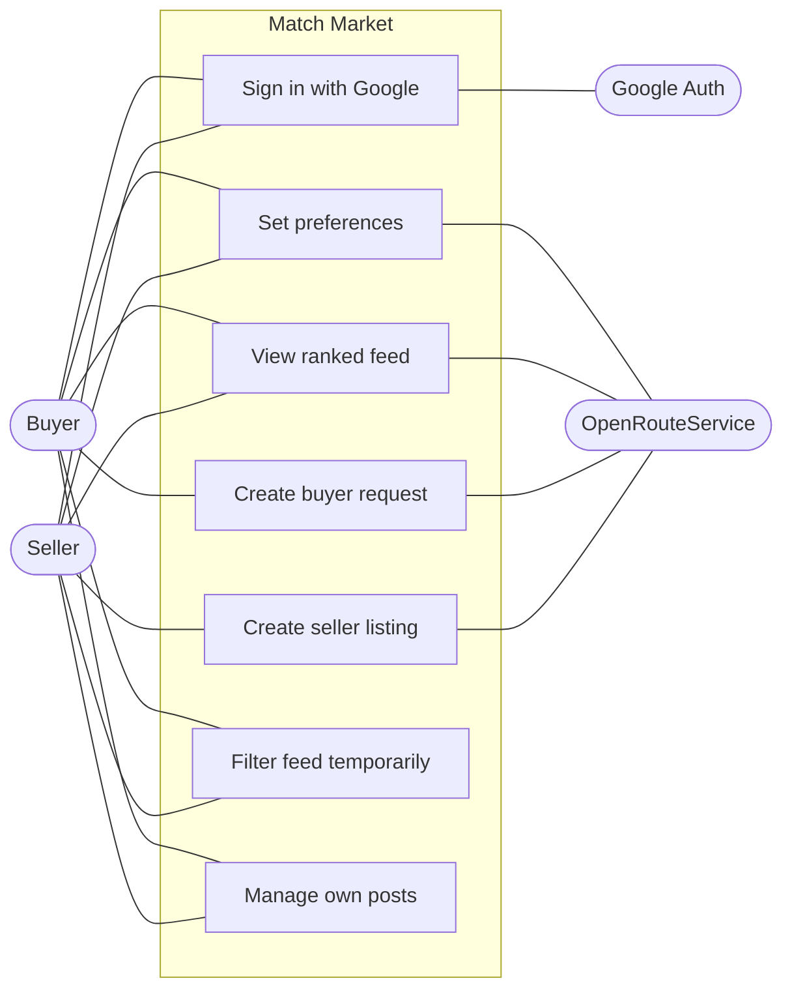
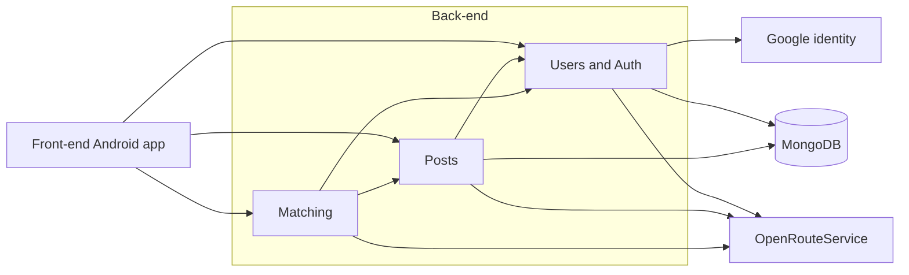
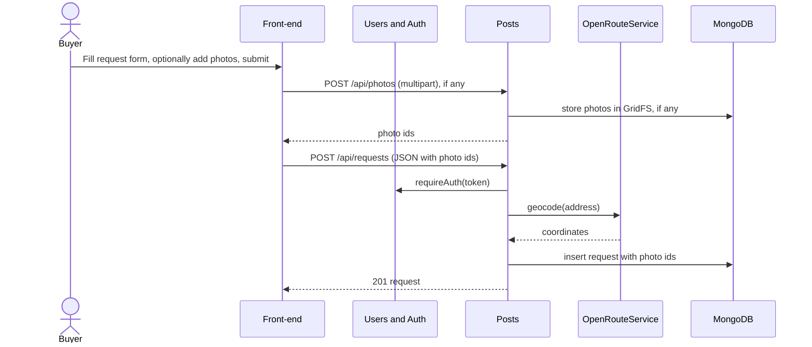
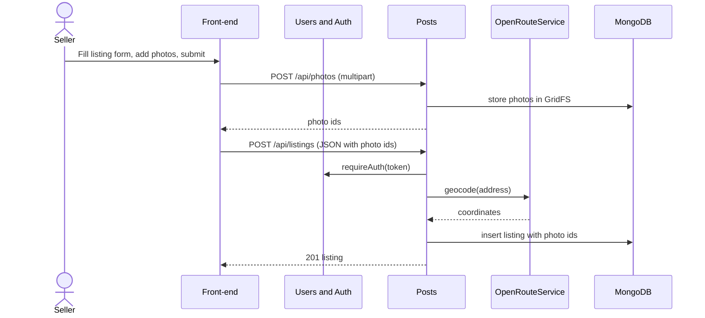
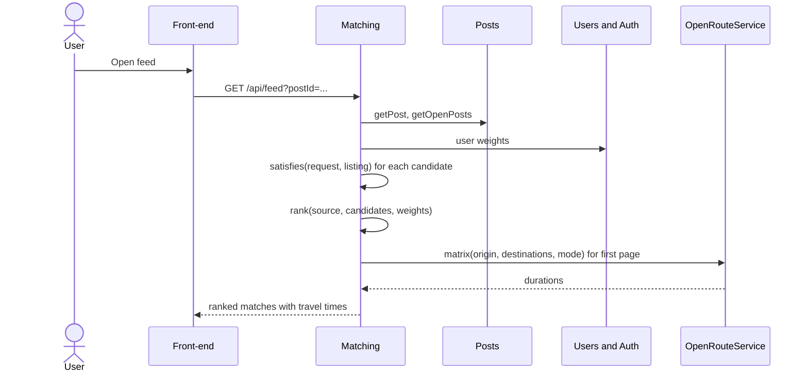
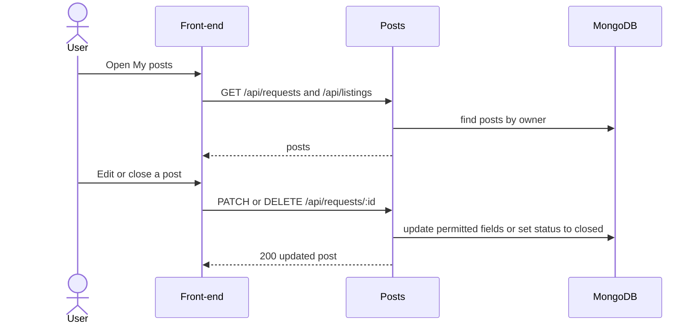
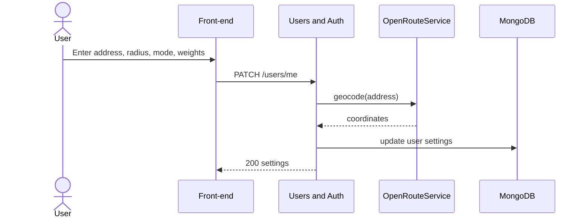

# Match Market Requirements and Design

## 1. Change History

| **Change Date** | **Modified Sections** | **Rationale** |
| --------------- | --------------------- | ------------- |
| 2026-10-12 | All | Initial draft for Match Market (two-sided second-hand marketplace), replacing the M1 LeftOBite idea. |
| 2026-10-12 | 2 | Updated project description to match the M2 presentation slides (tagline, problem, audience, matching approach). |
| 2026-10-12 | 3.1, 3.4 | Authentication is a required baseline, not a feature; features renumbered from four to three. |
| 2026-10-12 | 3.2, 3.4 | Split "Manage posts" into "Create buyer request" and "Create seller listing", one per actor. |
| 2026-10-12 | 3.5, 4.6 | Split the post use case into "Create Buyer Request" and "Create Seller Listing" formal specs and sequence diagrams (five formal specs). |
| 2026-10-12 | 4.1, 4.2, 4.4, 4.5, 4.6, 5 | Store listing photos in MongoDB using GridFS instead of a separate file volume. |
| 2026-10-12 | 3.5, 4.1 | Set photo limits: at most 10 photos, at most 5 MB each. |
| 2026-10-12 | 3.1, 3.4, 3.5, 4.1, 4.2, 4.6, 5 | Buyer requests can optionally include reference photos, same limits as listings. |
| 2026-10-12 | 2, 3.4, 3.5, 4.1, 4.6 | Removed match explanations; the feed shows ranked items with travel time only. |
| 2026-10-12 | 3.4, 3.5, 5 | Specified how users set soft-preference importance (0 to 5 sliders, defaults, normalized weights). |
| 2026-10-12 | 2, 3.4, 3.5, 4.1, 4.7, 5 | Defined hard requirements vs soft preferences vs temporary filters; one shared hard-requirement rule for both feeds, four importance weights, per-request radius with a profile default, optional filters and sort on a single /feed endpoint, travel times for the first page only. |
| 2026-10-12 | All | Removed offers, reservations, transactions, live updates, and push notifications; deferred to a future release. |
| 2026-10-12 | 3.2, 3.4, 3.5, 4.1, 4.6, 5 | Confirmed Feature 1 scope and clarified required inputs, saved defaults, photo counts, ownership, and the open/closed lifecycle. Added Manage Own Posts to the use-case coverage and recorded cross-component decisions still awaiting team agreement. |
| 2026-10-19 | 2-5 | Cross-checked the draft against main and active branches; corrected API and data-model descriptions; separated intended requirements from implementation status; recorded unresolved scope and behaviour differences. |
| 2026-10-21 | 4 | Matched Section 4 to the code on main: feed routes and filters, the hard-requirement rule, collections, libraries and test tools, and route prefixes in the sequence diagrams. |
| 2026-10-21 | 5 | Matched the data model to the code on main: request and listing fields, the options, custom fields and sessions collections, and request number validation. |

---

## 2. Project Description

**Match Market** is an Android app, "the marketplace where buyers post too". Traditional marketplaces are one-way: sellers post and buyers hunt, re-running the same searches across several sites for days, while sellers never see who is already looking for what they own. Match Market makes the marketplace two-sided. A buyer posts a persistent *request* once, with must-haves (hard requirements: category, maximum price, minimum condition, maximum size, and search radius) and preferences (soft requirements: brand and colour). Sellers post *listings* with photos, and can browse buyer requests that fit what they have.

The app matches both sides automatically, like a dating app for second-hand goods. Buyers and sellers fill in the same structured fields, listings that break a buyer's hard requirements are filtered out, and the remaining matches are ranked by how well they fit the buyer's soft preferences. Users can set their location and search radius to find nearby matches and check the travel time to an item.

When a buyer finds a listing they want, they express interest; a seller can likewise send an offer on a buyer's request. The other party accepts or declines. An accepted proposal becomes a transaction that reserves the item, and both users see the change on their screen as it happens, without refreshing.

The primary audience is buyers who know what they want and would rather be matched to it than scroll listings until one appears. The secondary audience is sellers with a specific item to move, who want it in front of the right buyer quickly. One account can act as both buyer and seller.

---

## 3. Requirements Specification

### **3.1. List of Features**

1. **Buyer Requests and Seller Listings**: Signed-in users create persistent buyer requests and seller listings, view their own posts, edit them, close and reopen them, and delete them. Listings include 1–10 item photos and requests may include up to 10 reference photos. Closed posts stay in the owner's list and are excluded from the feeds.
2. **Two-Sided Matching and Recommended Feeds**: hard-constraint filtering and soft-preference ranking, with location, search radius, and travel time, producing a buyer feed of listings and a seller feed of requests. It produces a buyer feed of listings for each request and a seller feed of requests for each listing. Addresses are geocoded and travel times computed with the OpenRouteService API.
3. **Offers, Acceptance, Transactions, and Live Updates**: From a feed, a buyer expresses interest in a listing or a seller sends an offer on a request. The recipient accepts or declines. Accepting creates a transaction, reserves the listing and declines the other pending proposals on it. Every proposal and transaction change appears on the other user's open screen within seconds over a WebSocket connection; Firebase Cloud Messaging adds a background push only when the app is closed.
4. **Messaging**: Buyers and sellers message each other in the app about a listing or a request, to ask about the item and arrange collection. New messages appear on the other user's open screen without refreshing.

Authentication is a baseline requirement of the app rather than a feature: users sign in with Google, and the backend verifies the Google ID token and issues its own session token.

### **3.2. Use Case Diagram**

### **3.3. Actors Description**

1. **Buyer**: A signed-in user who posts item requests and reviews matching listings in the intended product.
2. **Seller**: A signed-in user who posts listings with photos and reviews matching buyer requests in the intended product. The same account can act as buyer and seller.
3. **Google Authentication Service** (external): Verifies the user's identity at sign-in.
4. **OpenRouteService** (external): Converts typed addresses to coordinates and computes travel times.

### **3.4. Use Case Description**

**Authentication** (baseline requirement, not counted as a feature)

1. **Sign in with Google**: The user signs in with their Google account and gains access to their posts and the feed.

**Feature 1: Buyer Requests and Seller Listings**

2. **Manage posts** ([Use Case 1](#uc1)): A user creates a buyer request or a seller listing, and later edits, closes, reopens or deletes their own posts.

**Feature 2: Two-Sided Matching and Recommended Feeds**

3. **View recommendations for a post** ([Use Case 3](#uc3)): A user sees the posts that match one of their open posts, ranked by how well they fit, with the distance to each. Once built, each match will also show its travel time, and the user will be able to set the radius, travel mode and importance weights used for the ranking.
4. **Browse and filter feed** ([Use Case 5](#uc5)): A user browses other users' open posts, newest first, and narrows them by category, price or distance.

**Feature 3: Offers, Acceptance, Transactions and Live Updates** *(planned)*

5. **Send proposal**: A buyer expresses interest in a listing, or a seller offers one of their listings for a request. The sender can withdraw it while it is still pending.
6. **Respond to proposal** ([Use Case 2](#uc2)): The other user sees the proposal appear live and accepts or declines it. Accepting reserves the listing and creates a transaction, and the sender sees the answer without refreshing.
7. **Manage transactions**: Either user marks the transaction completed, which closes the listing and the request, or cancels it, which reopens the listing.

**Feature 4: Messaging** *(planned)*

8. **Send and receive messages** ([Use Case 4](#uc4)): Buyers and sellers message each other about a listing or a request, and new messages appear live.

### **3.5. Formal Use Case Specifications (5 Most Major Use Cases)**

#### Use Case 1: Manage Posts

**Description**: A user creates a buyer request or a seller listing, then views, edits, closes, reopens or deletes their own posts.

**Primary actor(s)**: Buyer, Seller

**Main success scenario**:
1. The user opens My Posts and chooses "I'm buying" (requests) or "I'm selling" (listings).
2. The app shows the user's open and closed posts of that kind, or "Nothing here yet. Tap the button below to create your first one." if there are none.
3. The user taps "New request" or "New listing".
4. The app shows the post form.
5. The user enters a category and picks an address from the suggestions.
    - For a request: a maximum price (required), and optionally a minimum condition, maximum size, search radius, brand and colour. Each of these fields, including the maximum price, is marked Hard or Soft, and a Soft field gets an importance from 1 to 5. The user may also add a description, custom fields, and up to 10 reference photos.
    - For a listing: a price, a condition and 1–10 photos, and optionally a brand, colour, size, description and custom fields.
6. The user taps "Create request" or "Create listing".
7. The app saves the post and shows it in My Posts.
8. The user opens one of their posts, or its ⋮ menu, and either edits it and taps "Save changes", taps "Close" or "Reopen", or taps "Delete" and confirms.
9. The app shows the updated post, or removes the deleted post from the list.

**Failure scenario(s)**:
- 2a. The posts cannot be loaded.
    - 2a1. The app shows an error message.
- 5a. A required field is missing or invalid.
    - 5a1. The app shows an error message, such as "Choose a category", "Max price is required", "Enter a price", "Add at least one photo", or for a price below 0 "max price must be at least 0" (request) or "price must be a number of at least 0" (listing). Nothing is saved.
- 5b. The address was typed but not picked from the suggestions.
    - 5b1. The app highlights the address field and shows "Choose your address from the suggestions list".
- 5c. A photo is larger than 5 MB.
    - 5c1. The app shows "Each photo must be at most 5 MB" and the post is not saved.
- 5d. The user tries to add more than 10 photos.
    - 5d1. The photo picker only lets the user select as many photos as are still allowed, and the app disables adding photos once there are 10.
- 6a. The network or server is unavailable when the post is submitted.
    - 6a1. The app shows "Could not reach the server. Check your connection." and the form keeps what the user entered.
- 8a. The network or server is unavailable when a post is saved, closed, reopened or deleted.
    - 8a1. The app shows "Could not reach the server. Check your connection." and the post is unchanged.
- 8b. An edit makes a field invalid.
    - 8b1. The app shows an error message and the post is unchanged.

#### Use Case 2: Respond to Proposal *(planned)*

**Description**: A user receives a buyer's interest in their listing, or a seller's offer on their request, sees it appear live, and accepts or declines it. The other user sees the answer without refreshing.

**Primary actor(s)**: Buyer, Seller

**Main success scenario**:
1. Another user expresses interest in the user's listing, or sends an offer on the user's request.
2. The proposal appears on the user's open screen within seconds; if the app is closed, a push notification is shown.
3. The user opens the proposal and sees the post and the other user.
4. The user taps "Accept" or "Decline".
5. On accept, the system creates a transaction, reserves the listing, and declines the other pending proposals on it.
6. The other user's screen shows "Accepted" or "Declined" within seconds, without refreshing.

**Failure scenario(s)**:
- 3a. The other user withdrew the proposal.
    - 3a1. The app shows that the proposal was withdrawn, and it cannot be answered.
- 5a. The listing is already reserved, closed or deleted.
    - 5a1. The app shows that the item is no longer available, and the proposal is declined.
- 5b. The network or server is unavailable.
    - 5b1. The app shows an error message and the proposal stays pending.
- 6a. The other user's connection is lost.
    - 6a1. They see the new status when they reconnect.

#### Use Case 3: View Recommendations for a Post

**Description**: A user sees the posts that match one of their own open posts (listings for a request, requests for a listing), ranked by how well they fit, and can change the preferences used for the ranking.

**Primary actor(s)**: Buyer, Seller

**Main success scenario**:
1. The user opens one of their open posts and taps "See recommendations", or picks the post under "Recommended for" in the feed filters.
2. The app shows "Recommended for: <post>".
3. The system takes other users' open posts in the same category and keeps those that meet the request's hard requirements: within the request's radius (10 km if none was set) and every field the buyer marked Hard. Any feed filters (Use Case 5) also apply.
4. The system scores each remaining post on price, condition, distance and preference match, weights the scores by the user's importance settings (3 each until the user saves preferences), and orders the best first.
5. *(Planned)* The system requests travel times for the first 20 results from OpenRouteService.
6. The app shows the ranked list, 20 at a time; each item shows its price or budget, its condition (listings), and its distance, plus its travel time *(planned)*.
7. *(Planned)* The user opens preferences, sets a default search radius (1–50 km), a travel mode (walk, bike or drive) and the importance (0–5) of price, condition, distance and preference match, and taps "Save"; the recommendations re-rank with them.

**Failure scenario(s)**:
- 1a. The user has no open posts.
    - 1a1. The feed filters show "You have no open posts to get recommendations for".
- 1b. The post is closed.
    - 1b1. "See recommendations" is not shown, and the server returns no feed for it (409).
- 3a. No posts meet the hard requirements.
    - 3a1. The app shows "Nothing here yet. Try changing the filters or check back soon." and a "Refresh" button.
- 5a. *(Planned)* The routing service is unavailable or rate-limited.
    - 5a1. The app shows the ranked list without travel times.
- 5b. *(Planned)* No route exists for the user's travel mode.
    - 5b1. The app shows "No route available" for that item.
- 6a. The network or server is unavailable.
    - 6a1. The app shows "Couldn't load the feed. Check your connection and try again." and a "Retry" button.
- 7a. *(Planned)* A preference value is out of range.
    - 7a1. The app highlights the field and shows an error message, and nothing is saved.

#### Use Case 4: Send and Receive Messages *(planned)*

**Description**: Two users connected by an interest or an offer message each other in the app to discuss the item and arrange collection, and new messages appear live.

**Primary actor(s)**: Buyer, Seller

**Main success scenario**:
1. From a proposal, the user opens the conversation with the other user.
2. The app shows the earlier messages.
3. The user types a message and taps "Send".
4. The system saves the message and delivers it to the other user, where it appears on their open screen within seconds, or as a push notification if the app is closed.
5. The other user's reply appears on the user's screen without refreshing.

**Failure scenario(s)**:
- 1a. The proposal was declined or withdrawn.
    - 1a1. The conversation can be read but not added to.
- 3a. The message is empty.
    - 3a1. "Send" is disabled.
- 4a. The network or server is unavailable.
    - 4a1. The message is marked as not sent and the user can retry.
- 5a. The connection is lost.
    - 5a1. Missed messages appear when the user reconnects.

#### Use Case 5: Browse and Filter Feed

**Description**: A user browses other users' open posts, newest first, and narrows them by category, price or distance.

**Primary actor(s)**: Buyer, Seller

**Main success scenario**:
1. The user opens the Feed tab and chooses "I'm buying" (listings) or "I'm selling" (requests).
2. The app shows other users' open posts of that kind, newest first, 20 at a time.
3. The user scrolls, and the app loads more posts.
4. The user taps "Filters" and sets any of: category, minimum and maximum price ("Min budget" and "Max budget" for requests), and "Near address" with "Within (km)".
5. The user taps "Apply", and the list reloads with only the matching posts; "Clear" removes the filters.
6. The user taps a post to see its details.

**Failure scenario(s)**:
- 2a. No posts match.
    - 2a1. The app shows "Nothing here yet. Try changing the filters or check back soon." and a "Refresh" button.
- 2b. The network or server is unavailable.
    - 2b1. The app shows "Couldn't load the feed. Check your connection and try again." and a "Retry" button.
- 4a. A price is not a number of 0 or more.
    - 4a1. The app shows "Enter a number of 0 or more".
- 4b. The minimum is more than the maximum.
    - 4b1. The app shows "Min must not be more than max".
- 4c. A distance is set without an address.
    - 4c1. The app shows "Pick an address to filter by distance".
- 4d. The distance is outside 0–100 km.
    - 4d1. The app shows "Enter a distance from 0 to 100".

### **3.6. Screen Mock-ups**

*Pending team input: Add the agreed screen mock-ups or labelled screenshots. My Posts, post details, the editor and the basic Profile screen exist in main; the complete preference and ranked-feed screens are not verified in main.*

### **3.7. Non-Functional Requirements**

1. **Performance: Recommendation latency**
    - **Description**: With 1,000 open candidate posts in the same category, `GET /api/feed?postId=<id>` returns the first page of 20 ranked matches within 1 second for 95% of requests, not counting the travel-time lookup.
    - **Justification**: Recommendations are the core of the app, so they must feel instant. 1 second is the limit for a user's flow of thought to stay uninterrupted ([Nielsen Norman Group, "Response Times: The 3 Important Limits"](https://www.nngroup.com/articles/response-times-3-important-limits/)), and 1,000 open posts in one category is several times more than we expect from a student community.

2. **Reliability: Routing service failure**
    - **Description**: When the external routing service fails or does not answer within 2 seconds, `GET /api/feed?postId=<id>` still returns the ranked matches within 3 seconds, with travel time left out (`travelMinutes: null`).
    - **Justification**: OpenRouteService's free tier has a daily request limit and no uptime guarantee, so outages and rate limits are expected; matching and ranking must keep working without it. 3 seconds is the 2-second timeout plus a margin for ranking.

3. **Security: Authentication and ownership**
    - **Description**: Every request, listing, feed, option and custom-field route, and photo uploads, return 401 without a valid session token. Reading, editing, closing or deleting another user's post returns 403 and leaves the post unchanged.
    - **Justification**: Posts hold users' addresses and are tied to their account, so only signed-in users may use the app and only a post's owner may see its private details or change it.

---

## 4. Designs Specification

### **4.1. Main Components**

1. **Posts**
    - **Purpose**: Owns buyer requests and seller listings, including their photos, validation, and ownership.
    - **Rationale**: Both post types share most fields and lifecycle, so one component avoids duplicate logic; alternative of separate Requests and Listings components was rejected because every matching and feed operation needs both.
    - **Lifecycle and ownership**: Newly created posts have status open. Only the authenticated owner may edit an open post or close it. Closing changes the stored status to closed and preserves the post for the owner's history; closed posts are read-only and excluded from active candidate retrieval. Reopening and permanent deletion are outside this version.
    - **Interface decision pending (PD2)**: The current draft uses DELETE routes for closing. The backend and frontend owners must confirm whether to retain that logical-close contract or use PATCH with status=closed. Do not change the HTTP verb in one section without updating the corresponding interface definitions, callers, and sequence diagrams. Keep the existing MongoDB/GridFS choices, component rationale, and other interfaces. This amendment does not finalize the full API contract.
    - **Interfaces**: All routes use the `/api` prefix. Post operations require an authenticated session.
        1. `POST /api/requests` and `POST /api/listings`
            - **Purpose**: Create a post from JSON containing its fields, coordinates and photo IDs. Photos are uploaded separately before creating the post. Returns the created post with status 201.
        2. `GET /api/requests` and `GET /api/listings`
            - **Purpose**: Retrieve the authenticated user's own open and closed posts.
        3. `GET /api/requests/:id` and `GET /api/listings/:id`
            - **Purpose**: Retrieve an owned post. Returns 403 for another user's post or 404 if the post does not exist.
        4. `PATCH /api/requests/:id` and `PATCH /api/listings/:id`
            - **Purpose**: Update an owned post's fields or status. Setting `status=closed` closes it; `status=open` reopens it. The current implementation also permits editing closed posts; the intended restriction remains under PD2.
        5. `DELETE /api/requests/:id` and `DELETE /api/listings/:id`
            - **Purpose**: Permanently delete an owned post. Returns status 204.
        6. `POST /api/photos`
            - **Purpose**: Upload 1–10 photos using multipart form data. Accepted MIME types are JPEG, PNG, WebP and GIF, with a current limit of 5 MiB per photo. Returns the uploaded photo IDs.
        7. `GET /api/photos/:id`
            - **Purpose**: Retrieve a photo from GridFS. This endpoint is currently public.
        8. Options and custom fields
            - **Purpose**: `/api/options` supports retrieving and adding option values. `/api/custom-fields` supports retrieving and saving the user's reusable field definitions; `/api/custom-fields/:key` supports deleting a definition.

2. **Matching**
    - **Purpose**: Hard-requirement filtering and weighted ranking in both directions, plus travel time.
    - **Rationale**: Isolated from storage and HTTP so the team-written logic can be tested through the feed's interface tests; alternative of database-only filtering was rejected because ranking needs weighted scoring.
    - **Interfaces**:
        1. `GET /api/feed?postId=<id>&limit=&cursor=&category=&minPrice=&maxPrice=&lat=&lng=&radiusKm=`
            - **Purpose**: Return the feed for the user's own request or listing, with travel times for the first page. The post type decides the direction: a request returns listings, a listing returns requests. Every parameter except postId, limit and cursor is an optional temporary filter. A value looser than the saved requirement is ignored, and an unsupported parameter returns 400. Returns 403 for another user's post and 409 for a closed post. The planned minCondition filter (request feeds only) and sort=best|nearest|cheapest are not implemented yet.
        2. `GET /api/feed/listings` and `GET /api/feed/requests`
            - **Purpose**: Return other users' open posts, newest first, with the same filters; `before` pages through them.
        3. `boolean satisfies(Request request, Listing listing)`
            - **Purpose**: The single hard-requirement rule (category and straight-line distance within radius, plus price, condition, dimensions or any other field the buyer marked hard) used by both feed directions.
        4. `List<RankedMatch> rank(Post source, List<Post> candidates, Weights weights)`
            - **Purpose**: Score each candidate on price, condition, distance, and brand/colour match, and order by the viewer's weights.
        5. `List<Duration> travelTimes(Location origin, List<Location> destinations, TravelMode mode)`
            - **Purpose**: Get travel times from the external routing service for one page of results; returns empty when it is unavailable.

3. **Users & Auth**
    - **Purpose**: Verifies Google sign-in, issues session tokens, and stores profile, location, and preferences.
    - **Rationale**: Keeps identity and per-user settings in one place so Posts and Matching only depend on a user id; alternative of storing settings on each post was rejected because settings apply across all of a user's posts.
    - **Interfaces**:
        1. `POST /api/auth/google`
            - **Purpose**: Exchange a Google ID token for a session token; 401 if the token is invalid.
        2. `POST /api/auth/refresh`
            - **Purpose**: Rotates the token pair.
        3. `POST /api/auth/logout`
            - **Purpose**: Revokes the refresh-token family. Session tokens last 15 minutes; refresh tokens have a 30-day lifetime. Protected routes use requireAuth and currentUser.
        4. `GET /users/me`, `PATCH /users/me`
            - **Purpose**: Read or update profile, typed address and default radius, travel mode, and the four importance weights.
        5. `userId requireAuth(token)`
            - **Purpose**: Internal interface protecting every other route.

### **4.2. Databases**

1. **MongoDB** (self-hosted in Docker on the cloud VM)
    - **Purpose**: Stores users, requests, listings, options, custom fields, and sessions. Photos for requests and listings are stored in the same database using GridFS (fs.files and fs.chunks), and each post keeps the ids of its photos. Geospatial index on post locations.

### **4.3. External Modules**

1. **Google Sign-In / Google identity**
    - **Purpose**: Authenticates users. The backend verifies Google ID tokens with google-auth-library.
2. **Android Geocoder**
    - **Purpose**: Provides address suggestions and coordinates in the current frontend. The implemented lookup uses the Android 13+ callback API; the older-version path returns no suggestions.
3. **OpenRouteService**
    - **Purpose**: Intended for external geocoding and travel-time results. It is not connected in main, and Matching still uses a travel-time stub.

### **4.4. Frameworks and Libraries**

1. **Jetpack Compose and Kotlin** (frontend)
    - **Purpose**: Native Android UI.
    - **Reason**: Required by the project.
2. **OkHttp** (frontend)
    - **Purpose**: REST calls to the backend.
    - **Reason**: Already in the project.
3. **Android Credential Manager / Google ID** (frontend)
    - **Purpose**: Google Sign-In.
    - **Reason**: Existing sign-in code is built on it.
4. **Express** (backend)
    - **Purpose**: HTTP routing and middleware.
    - **Reason**: Provided by the template.
5. **mongodb (official Node driver)** (backend)
    - **Purpose**: Database access.
    - **Reason**: Thin and explicit; geospatial queries are direct, and GridFS for photos is built in.
6. **google-auth-library** (backend)
    - **Purpose**: Verifies the Google ID token sent by the app.
    - **Reason**: Google's own library for validating ID tokens, so signature and audience checks are not hand-written.
7. **jsonwebtoken** (backend)
    - **Purpose**: Issues and verifies the backend's session tokens.
    - **Reason**: Standard JWT library for Node.js.
8. **Coil** (frontend)
    - **Purpose**: Loads and caches post photos in Compose screens.
    - **Reason**: Kotlin-first image loader with Compose support.
9. **Jest and Supertest** (backend), **Compose testing** (frontend)
    - **Purpose**: Backend interface tests and frontend Compose test dependencies are present. The frontend also includes AndroidX JUnit and Espresso. UI Automator is also declared; the end-to-end tests use it for the system photo picker. Feature 1 end-to-end tests (`CreatePostTest` and `ManagePostsTest`) are in the frontend's `androidTest` `e2e` package.
10. **Multer** (backend)
    - **Purpose**: Parses multipart photo uploads and enforces the photo count and size limits.
    - **Reason**: Standard Express middleware for multipart uploads.

### **4.5. Dependencies Diagram**

OpenRouteService connections and stored user preferences are not implemented in the inspected main commit. In the current post-creation flow, the frontend calls Android Geocoder, then sends coordinates to Posts. Matching is on main.

### **4.6. Use Case Sequence Diagram (5 Most Major Use Cases)**

1. [**Create Buyer Request**](#uc1)

2. [**Create Seller Listing**](#uc2)

3. [**View Ranked Feed**](#uc3)

4. [**Manage Own Posts**](#uc4)

5. [**Set Preferences**](#uc5)

### **4.7. Design of Non-Functional Requirements**

1. **Feed ranking latency**
    - **Implementation**: The design filters out ineligible candidates before calculating ranking scores. It then ranks the qualifying candidates and paginates the results. This supports the feed-ranking latency requirement in Section 3.7.

      Performance will be measured using the agreed candidate workload and deployment environment. These details remain pending:
        - Candidate workload: ____ posts.
        - Target ranking latency: ____ seconds at the 95th percentile.
        - Measurement environment: ____.
2. **Graceful degradation without the routing service**
    - **Implementation**: The planned design requests travel times only for the first page of matches. The routing request will have a timeout of ____ seconds. If the service fails, times out or is rate-limited, the feed will return the ranked matches without travel times and indicate that travel time is unavailable. The timeout must allow the feed to meet the 3-second response target in Section 3.7.
    - **Implementation status**: Matching on main filters candidates and ranks them before pagination. Its travel-time function is a placeholder and is not connected to an external routing service. Routing timeout behaviour and compliance with both performance requirements remain unverified.

---

## 5. Data Model

| **Collection** | **Key fields** |
| -------------- | -------------- |
| users | googleSub, name, email, address, location (GeoJSON), defaultRadiusKm, travelMode (walk, bike, drive), weights {price, condition, distance, match} (each an integer 0 to 5, default 3) |
| requests | ownerId, category, description, requestFields[] (built-in price (max), condition (min), dimensions {width, height, depth} (max), radiuskm, brand, colour, plus custom fields; each hard, or soft with an importance 1 to 5), address, location, photoIds[] (optional GridFS file ids), status (open, closed) |
| listings | ownerId, category, description, price, condition, listingFields[] (built-in brand, dimensions {width, height, depth}, colour, plus custom fields), address, location, photoIds[] (GridFS file ids), status (open, closed) |
| options | field, key, label, builtin, createdBy |
| customFields | ownerId, key, label, type (text, number, bool) |
| sessions | tokenHash, familyId, userId, expiresAt, usedAt |

Condition is one of five ordered levels: new, like new, good, fair, poor.

**Feature 1 data rules:**
- The backend obtains ownerId from the authenticated session. New posts start open. Closing retains a record; the current API also supports reopening and permanent deletion.
- Both post types require category, address and coordinates. Requests require a built-in price field. Listings require non-negative top-level price, a valid condition and at least one photo ID. Request price, radius and size cannot be negative. The 1–50 km radius rule is not enforced by the inspected request-field validation; it must not be claimed as completed validation.
- Requests allow 0–10 photo IDs and listings 1–10. Actual upload size is at most 5 MiB per file. Post validation checks ID format/count; photo existence and ownership checks are not established by that validation.
- Categories are normalized, extendable option values rather than a fixed list. Description is supported, up to 2,000 characters. No separate custom title field is defined. Dimensions use cm and radius uses km; CAD remains the intended currency.
- Unfilled optional editor rows are omitted. Existing post addresses and coordinates are saved with each post. Profile-based defaults are planned. Closed listings are excluded from the current open-listings feed.

Condition values remain, best to worst: new, like new, good, fair, poor.
