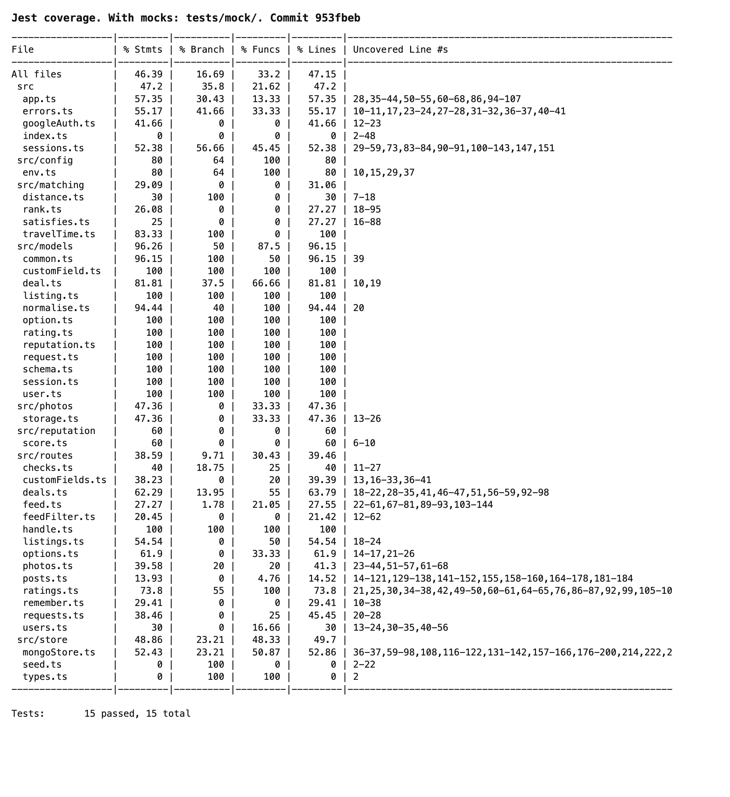
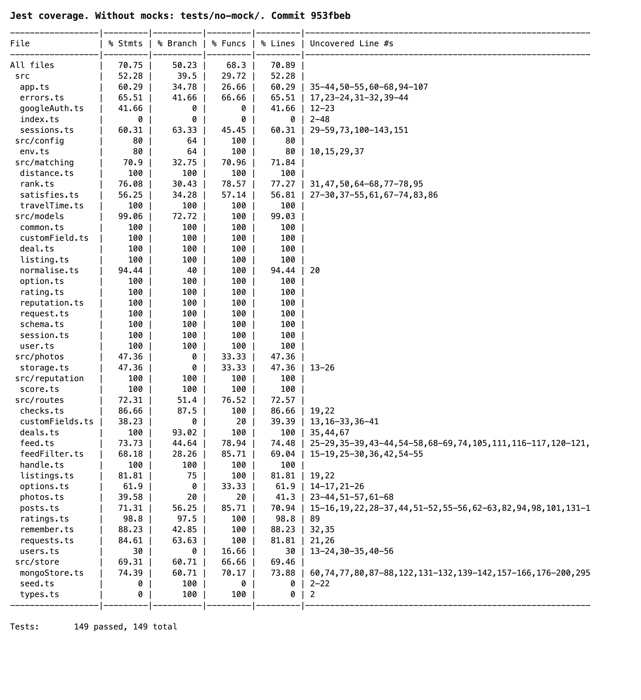
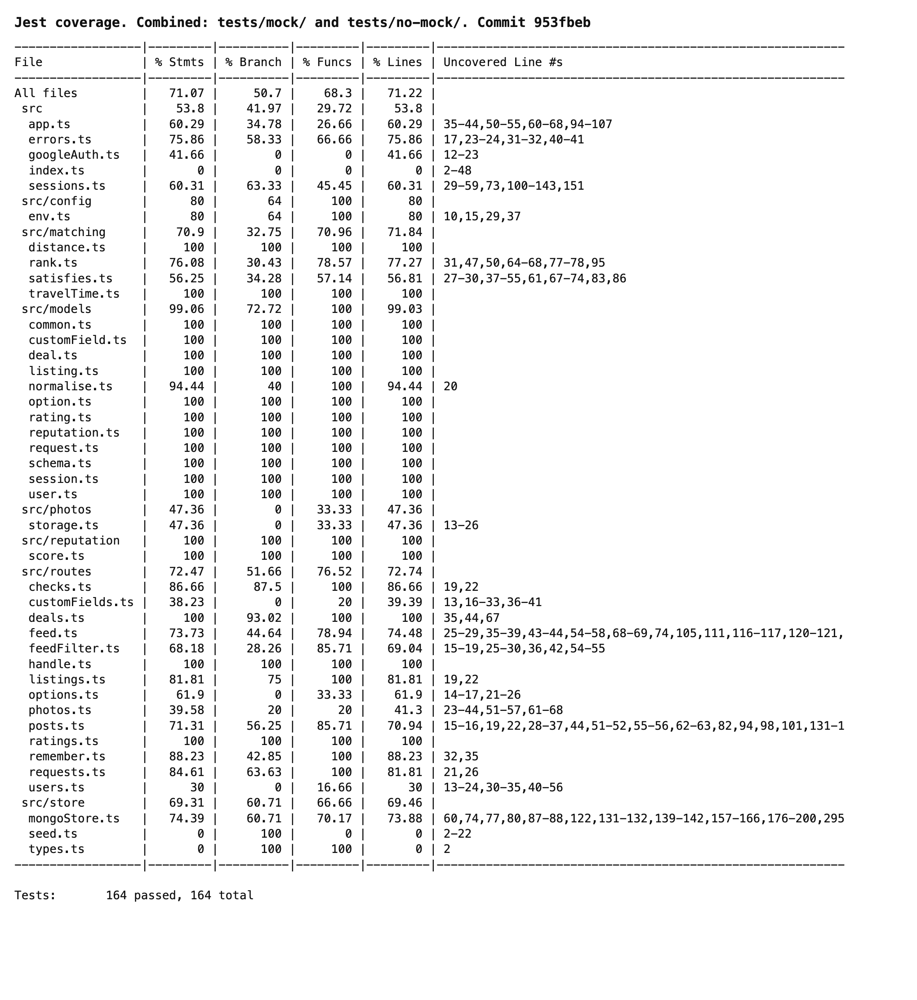

# Testing

## 1. Change History

| **Change Date** | **Modified Sections** | **Rationale** |
| --------------- | --------------------- | ------------- |
| 2026-10-20 | 2 | First version: the front-end end-to-end tests for Feature 1 (Use Cases 1, 2 and 4), how to run them, how each test maps to its use case scenario steps, and the logs of a full run (25/25 passed). Back-end and non-functional requirement tests will be added later. |
| 2026-10-21 | 2 | Replaced the Use Case 1, 2 and 4 tables with one table for the new Use Case 1: Manage Posts, added the new tests for every Use Case 1 success and failure scenario, and added the logs of a full run (42/42 passed). |
| 2026-10-30 | 2 | Added the post name to the Use Case 1 table: the tests enter "Test item" in "Name \*", `rejectsMissingName` covers a missing name (5a), and `createsPostAndShowsItInMyPosts` checks that the name is shown. |
| 2026-10-31 | 2, 3, 4 | Matched the document to the course template: the back-end APIs are section 2, non-functional requirements section 3, and the front-end specification moved from section 2 to section 4. Added the first back-end specification, for the Deals component: where each interface's tests are, how to run them, the coverage reports, and why some coverage is below 100%. |
| 2026-10-30 | 2 | The condition is now picked from a dropdown, so `createsPostWithOptionalFields` opens the condition dropdown before picking "Fair" or "Like New". |

---

## 2. Back-end Test Specification: APIs

This section covers the Deals component only ([Section 4.1](Requirements_and_Design.md#41-main-components)). Tests for the other components will be added here as they are written.

### 2.1. Locations of Back-end Tests and Instructions to Run Them

#### 2.1.1. Tests

| **Interface** | **Describe Group Location, No Mocks** | **Describe Group Location, With Mocks** | **Mocked Components** |
| ------------- | ------------------------------------- | --------------------------------------- | --------------------- |
| **GET /api/deals** | [`tests/no-mock/getDeals.test.ts#L94`](https://github.com/m1lun/m1skeletonProject/blob/953fbeb42f6481a2b5335e85e557c7c7bbbd5a6f/backend/tests/no-mock/getDeals.test.ts#L94) | [`tests/mock/getDeals.test.ts#L45`](https://github.com/m1lun/m1skeletonProject/blob/953fbeb42f6481a2b5335e85e557c7c7bbbd5a6f/backend/tests/mock/getDeals.test.ts#L45) | Deals DB, Ratings DB, Reputations DB, Listings DB, Requests DB |
| **POST /api/deals/:id/ratings** | [`tests/no-mock/ratings.test.ts#L260`](https://github.com/m1lun/m1skeletonProject/blob/953fbeb42f6481a2b5335e85e557c7c7bbbd5a6f/backend/tests/no-mock/ratings.test.ts#L260) | [`tests/mock/ratings.test.ts#L81`](https://github.com/m1lun/m1skeletonProject/blob/953fbeb42f6481a2b5335e85e557c7c7bbbd5a6f/backend/tests/mock/ratings.test.ts#L81) | Deals DB, Ratings DB, Reputations DB |
| **PUT /api/deals/:id/ratings** | [`tests/no-mock/ratings.test.ts#L334`](https://github.com/m1lun/m1skeletonProject/blob/953fbeb42f6481a2b5335e85e557c7c7bbbd5a6f/backend/tests/no-mock/ratings.test.ts#L334) | [`tests/mock/ratings.test.ts#L116`](https://github.com/m1lun/m1skeletonProject/blob/953fbeb42f6481a2b5335e85e557c7c7bbbd5a6f/backend/tests/mock/ratings.test.ts#L116) | Deals DB, Ratings DB, Reputations DB |
| **GET /api/users/:id/reputation** | [`tests/no-mock/reputation.test.ts#L34`](https://github.com/m1lun/m1skeletonProject/blob/953fbeb42f6481a2b5335e85e557c7c7bbbd5a6f/backend/tests/no-mock/reputation.test.ts#L34) | [`tests/mock/reputation.test.ts#L32`](https://github.com/m1lun/m1skeletonProject/blob/953fbeb42f6481a2b5335e85e557c7c7bbbd5a6f/backend/tests/mock/reputation.test.ts#L32) | Reputations DB |
| **GET /api/feed/listings/:id** | [`tests/no-mock/dealPost.test.ts#L97`](https://github.com/m1lun/m1skeletonProject/blob/953fbeb42f6481a2b5335e85e557c7c7bbbd5a6f/backend/tests/no-mock/dealPost.test.ts#L97) | [`tests/mock/dealPost.test.ts#L34`](https://github.com/m1lun/m1skeletonProject/blob/953fbeb42f6481a2b5335e85e557c7c7bbbd5a6f/backend/tests/mock/dealPost.test.ts#L34) | Listings DB |
| **GET /api/feed/requests/:id** | [`tests/no-mock/dealPost.test.ts#L102`](https://github.com/m1lun/m1skeletonProject/blob/953fbeb42f6481a2b5335e85e557c7c7bbbd5a6f/backend/tests/no-mock/dealPost.test.ts#L102) | [`tests/mock/dealPost.test.ts#L54`](https://github.com/m1lun/m1skeletonProject/blob/953fbeb42f6481a2b5335e85e557c7c7bbbd5a6f/backend/tests/mock/dealPost.test.ts#L54) | Requests DB |

The mocked tests use `jest.spyOn` on one store method at a time, so each database failure is forced on its own. Both groups otherwise run against a real MongoDB.

Rules that the HTTP interfaces cannot reach or prove are tested directly in [`no-mock/dealStore.test.ts`](https://github.com/m1lun/m1skeletonProject/blob/953fbeb42f6481a2b5335e85e557c7c7bbbd5a6f/backend/tests/no-mock/dealStore.test.ts): the database validators, the unique indexes, and the store methods behind the routes. No route creates a deal yet, so `deals.insert` is only tested there.

#### 2.1.2. Commit Hash Where Tests Run

`953fbeb42f6481a2b5335e85e557c7c7bbbd5a6f`

#### 2.1.3. Explanation on How to Run the Tests

1. **Clone the Repository**:

   - Open your terminal and run:
     ```
     git clone https://github.com/m1lun/m1skeletonProject.git
     cd m1skeletonProject
     git checkout 953fbeb42f6481a2b5335e85e557c7c7bbbd5a6f
     ```

2. **Install the Tools**:

   - Install [Docker](https://www.docker.com/) and Node.js 22, and start Docker.

3. **Install the Dependencies**:

   - Run:
     ```
     cd backend
     npm ci
     cd ..
     ```

4. **Run the Tests**:

   - From the project root, run:
     ```
     ./scripts/run-backend-interface-tests.sh
     ```
     On Windows, run `scripts\run-backend-interface-tests.ps1`.

The script starts a throwaway MongoDB on port 27018 and runs the tests three times: `tests/mock/`, `tests/no-mock/`, then both together. It writes each coverage report to `backend/coverage/mock/`, `backend/coverage/no-mock/` and `backend/coverage/interface/`, and removes the database when it finishes.

To run tests from an IDE or with `npx jest`, start the database first with `docker compose -f docker-compose.test.yml up -d --wait` from the project root.

**Known issue on macOS:** `tests/no-mock/postName.test.ts` and `tests/no-mock/health.test.ts` use `request(app)`, which listens on all addresses. macOS can give that server a port another program already holds on `127.0.0.1`, such as Android Studio, so a request occasionally gets an unexpected response and the script stops. If this happens, run the script again. The Deals tests bind to `127.0.0.1` through `tests/helpers/testApp.ts` to avoid it.

### 2.2. GitHub Actions Configuration Location

`~/.github/workflows/backend-tests.yml`

### 2.3. Jest Coverage Report Screenshots With Mocks

These are the Jest reports for every back-end file at the commit above: 164 tests in total, 15 with mocks and 149 without. Each image shows Jest's text report from the script.



### 2.4. Jest Coverage Report Screenshots Without Mocks



**With and without mocks combined:**



**Reasons for coverage below 100%:**

These reports cover the whole back-end, but only the Deals component has been tested against all of its interfaces so far. Files with no Deals code, such as `routes/users.ts` and `routes/customFields.ts`, are low because their own components' tests are not written yet.

The Uncovered Line # column shows lines of the compiled JavaScript, not the TypeScript source. The line numbers below are the real source lines.

Combined coverage is 100% for statements, lines, functions and branches in `models/deal.ts`, `models/rating.ts`, `models/reputation.ts`, `models/schema.ts`, `reputation/score.ts` and `routes/ratings.ts`.

| **File** | **Statements** | **Branches** | **Reason** |
| -------- | -------------- | ------------ | ---------- |
| `routes/deals.ts` | 100% | 93.02% | Three defensive branches cannot be reached through the API. Line 40: a stored post always has an `id`. Line 68: Express always gives `req.query` as an object. Line 93: every listing has at least one photo, because the validator requires it. Each one keeps the code safe with the optional types, so removing it would not simplify the logic. |
| `store/mongoStore.ts` | 74.39% | 60.71% | The three Deals store classes (`MongoDealCollection`, `MongoRatingCollection` and `MongoReputationCollection`) reach every line and branch. The uncovered code belongs to other components: options, custom fields, users, sessions, and parts of the post collection. |
| `routes/feed.ts` | 73.73% | 44.64% | The two Deals routes, `GET /api/feed/listings/:id` and `GET /api/feed/requests/:id`, are fully covered, including the `one()` helper. The uncovered code is the Matching feed's filtering and paging. |
| `errors.ts` | 75.86% | 58.33% | The handler is shared by the whole back-end. Every path the Deals routes use is covered. The uncovered paths are the `errorMessage` log helper, a response that has already started, a duplicate field in a post, and a document the database validator rejects. Deals input is checked before it reaches the database, so the Deals routes do not reach them. |
| `app.ts`, `sessions.ts` | about 60% | below 64% | Shared start-up and auth code. The Deals tests cover the routes they use and `requireAuth`; the rest is sign-in and session refresh, which belong to Users and Auth. |

---

## 3. Back-end Test Specification: Tests of Non-Functional Requirements

### 3.1. Test Locations in Git

_To be added with the non-functional requirement tests._

### 3.2. Test Verification and Logs

_To be added with the non-functional requirement tests._

---

## 4. Front-end Test Specification

### 4.1. Location in Git of Front-end Test Suite:

`frontend/app/src/androidTest/java/com/example/cpen321application/e2e/`

| **Test class** | **Use cases** |
| -------------- | ------------- |
| [`CreatePostTest.kt`](../frontend/app/src/androidTest/java/com/example/cpen321application/e2e/CreatePostTest.kt) | [Use Case 1: Manage Posts](Requirements_and_Design.md#uc1), steps 1–7 |
| [`ManagePostsTest.kt`](../frontend/app/src/androidTest/java/com/example/cpen321application/e2e/ManagePostsTest.kt) | [Use Case 1: Manage Posts](Requirements_and_Design.md#uc1), steps 1–2 and 8–9 |

Shared test steps are in `support/PostRobot.kt`, and the differences between the request and listing forms are in `support/PostForm.kt`.

**How the tests are set up.** Following the course rules, each test starts from the app's main screen with the user already signed in, and assumes no existing data:

- **Stand-alone tests.** Every post a test creates uses the category `e2e chair`. Before and after each test, `deleteTestPosts()` deletes every post in that category through the back-end API, so each test starts from an empty state and a failed test leaves nothing behind. The tester's posts in other categories are never touched. Tests that need an existing post create it through the UI first (`createPost`).
- **Both post types.** Requests and listings share the same screens, so both test classes are parameterized over `PostForm` and run every test once for requests (`[REQUEST]`) and once for listings (`[LISTING]`).
- **No mocking.** The tests talk to the real back-end. For failure scenarios 2a, 6a and 8a ("the network or server is unavailable"), the test switches on the emulator's airplane mode, and switches it off again in `@After` even if the test fails.
- **Results checked on the server.** When a scenario says nothing is saved, the test asks the back-end with `testPosts()` and checks the list is empty, instead of trusting the screen.
- **System UI.** The Android photo picker is not part of the app, so it is driven with UI Automator. `TestPhotos` adds small JPEGs to the emulator's gallery before each test and deletes them afterwards.

**How to run them.**

1. Complete the Frontend Setup and the `backend/.env` part of the Backend Setup in the [README](../README.md). Docker must be running, and `java` must be on your `PATH`. Android Studio's bundled JDK works:
   ```bash
   export JAVA_HOME="/Applications/Android Studio.app/Contents/jbr/Contents/Home"   # macOS
   export PATH="$JAVA_HOME/bin:$PATH"
   ```
2. In `frontend/local.properties`, set `API_BASE_URL=http://10.0.2.2:3000` so the app uses the back-end the script starts on your machine.
3. From the project root, run:
   ```bash
   ./scripts/run-frontend-e2e-tests.sh        # Windows: scripts\run-frontend-e2e-tests.ps1
   ```
   The script starts the back-end and the `Pixel_9` emulator (set `AVD_NAME=<name>` for another AVD), then builds and installs the app. When prompted, sign in inside the app on the emulator, wait for the main screen, and press Enter. The full suite takes about 10 minutes.
4. The report is at `frontend/app/build/reports/androidTests/connected/debug/index.html`.

### 4.2. Tests

- **Use Case 1: Manage Posts** ([`CreatePostTest.kt`](../frontend/app/src/androidTest/java/com/example/cpen321application/e2e/CreatePostTest.kt) and [`ManagePostsTest.kt`](../frontend/app/src/androidTest/java/com/example/cpen321application/e2e/ManagePostsTest.kt), each test run once as `[REQUEST]` and once as `[LISTING]`)

  - **Expected Behaviors:**

    | **Scenario Steps** | **Test Case Steps** |
    | ------------------ | ------------------- |
    | 1. The user opens My Posts and chooses "I'm buying" (requests) or "I'm selling" (listings). | Tap "My Posts", then "I'm buying" (`[REQUEST]`) or "I'm selling" (`[LISTING]`). |
    | 2. The app shows the user's open and closed posts of that kind. | Check that "My requests (" or "My listings (" is shown. |
    | 2a. The network or server is unavailable when the posts are loaded. | (`showsErrorWhenPostsCannotLoad`) Open the other kind of post, turn on airplane mode, and tap "I'm buying" or "I'm selling". |
    | 2a1. The app shows "Could not reach the server. Check your connection." | Check that "Could not reach the server" is shown. |
    | 3. The user taps "New request" or "New listing". | Tap "New request" or "New listing". |
    | 4. The app shows the post form. | Check that the "Category \*" field is present on screen. |
    | 5. The user enters a name and a category and picks an address from the suggestions.<br>- For a request: a maximum price (required), and optionally a minimum condition, maximum size, search radius, brand and colour. Each of these fields, including the maximum price, is marked Hard or Soft, and a Soft field gets an importance from 1 to 5. The user may also add a description, custom fields, and up to 10 reference photos.<br>- For a listing: a price, a condition and 1–10 photos, and optionally a brand, colour, size, description and custom fields. | Input "Test item" in "Name \*".<br>Input "e2e chair" in "Category \*".<br>Input "6335 Thunderbird Crescent, Vancouver" in "Address \*", tap the first suggestion, and check that "✓ Address confirmed" is shown.<br>Input "150" as the price.<br>`[LISTING]`: tap "+ Add", select one photo in the system photo picker, tap "Done", and check that "Photos 1/10" is shown.<br>(`createsPostWithSeveralPhotos` selects three photos; `photoIsRequiredOnlyOnListings[REQUEST]` selects none, since photos are optional for requests; `createsPostWithOptionalFields` also inputs "Oak, barely used" in "Description", "120", "75" and "60" in "W", "H" and "D", "ikea" as the brand, "brown" as the colour, and a custom field "Material" with the value "oak" through "+ Add field", and picks "Fair" from the "Any" condition dropdown with a radius of "5" marked "Hard" (`[REQUEST]`) or picks "Like New" from the "Good" condition dropdown (`[LISTING]`).) |
    | 5a. A required field is missing or invalid. | **Missing category** (`rejectsMissingCategory`): open the form and tap the create button without filling it.<br>**Missing name** (`rejectsMissingName`): fill everything except the name and submit.<br>**Missing price** (`rejectsMissingPrice`): fill everything except the price and submit.<br>**Negative price** (`rejectsNegativePrice`): fill the form with the price "-5" and submit.<br>**Missing photo** (`photoIsRequiredOnlyOnListings[LISTING]`): fill everything except the photo and submit. |
    | 5a1. The app shows an error message, such as "Choose a category", "Enter a name", "Max price is required", "Enter a price", "Add at least one photo", or for a price below 0 "max price must be at least 0" (request) or "price must be a number of at least 0" (listing). Nothing is saved. | **Missing category:** check that "Choose a category" is shown and the create button is still on screen.<br>**Missing name:** check that "Enter a name" is shown and the back-end has no test posts.<br>**Missing price:** check that "Max price is required" (`[REQUEST]`) or "Enter a price" (`[LISTING]`) is shown and the back-end has no test posts.<br>**Negative price:** check that an error containing "at least 0" (`[REQUEST]`) or "price must be" (`[LISTING]`) is shown and the back-end has no test posts.<br>**Missing photo:** check that "Add at least one photo" is shown and the back-end has no test posts. |
    | 5b. The address was typed but not picked from the suggestions. | (`rejectsAddressThatWasNotPicked`) Fill the form without picking an address, input "zzzzqqqqxxxx nowhere" in "Address \*", and submit. |
    | 5b1. The app highlights the address field and shows "Choose your address from the suggestions list". | Check that "Choose your address from the suggestions list" is shown and the back-end has no test posts. |
    | 5c. A photo is larger than 5 MB. | (`rejectsPhotoOverFiveMegabytes`) Replace the test photos in the gallery with a single JPEG larger than 5 MB. Fill the form without photos, select that photo in the photo picker, and submit. |
    | 5c1. The app shows "Each photo must be at most 5 MB" and the post is not saved. | Check that "Each photo must be at most 5 MB" is shown and the back-end has no test posts. |
    | 5d. The user tries to add more than 10 photos. | (`limitsPhotosToTen`) Open the form, select 6 photos in the photo picker, then try to select 6 more. |
    | 5d1. The photo picker only lets the user select as many photos as are still allowed, and the app disables adding photos once there are 10. | Check that "Photos 10/10" is shown and the "+ Add" button is disabled. |
    | 6. The user taps "Create request" or "Create listing". | Tap "Create request" or "Create listing". |
    | 6a. The network or server is unavailable when the post is submitted. | (`showsErrorWhenServerIsUnreachable`) Fill the form, turn on airplane mode, and tap the create button. |
    | 6a1. The app shows "Could not reach the server. Check your connection." and the form keeps what the user entered. | Check that "Could not reach the server" is shown.<br>Turn off airplane mode and check that the form, with its create button, is still on screen. |
    | 7. The app saves the post and shows it in My Posts. | (`createsPostAndShowsItInMyPosts`) Check that "My requests (" or "My listings (" is shown with exactly one "e2e chair" post, and that "Test item" is shown.<br>(`createsPostWithOptionalFields` also checks on the back-end that the description, condition, Hard radius, dimensions, brand, colour and material were saved.) |
    | 8. The user opens one of their posts, or its ⋮ menu, and either edits it and taps "Save changes", taps "Close" or "Reopen", or taps "Delete" and confirms. | Create a post through the UI (steps 1–7), then:<br>**Edit** (`editsPost`): tap "More options" on the post, tap "Edit", check that "Edit request" or "Edit listing" is shown, replace the price with "175", and tap "Save changes".<br>**Close and reopen** (`closesAndReopensPost`): tap "More options" and "Close", then "More options" and "Reopen".<br>**Delete** (`deletesPost`): tap "More options", tap "Delete", and confirm "Delete".<br>**From the detail screen** (`managesPostFromItsDetailScreen`): tap the post, then tap "Close", "Reopen", "Edit" (replace the price with "175" and tap "Save changes"), and "Delete" and confirm. |
    | 8a. The network or server is unavailable when a post is saved, closed, reopened or deleted. | Turn on airplane mode, then:<br>**Close** (`keepsPostWhenServerIsUnreachable`): tap "More options" and "Close".<br>**Save** (`keepsPostWhenEditCannotBeSaved`): open "Edit", replace the price with "175", and tap "Save changes".<br>**Reopen** (`keepsPostClosedWhenReopenFails`): close the post first, then tap "More options" and "Reopen".<br>**Delete** (`keepsPostWhenDeleteFails`): tap "More options", tap "Delete", and confirm. |
    | 8a1. The app shows "Could not reach the server. Check your connection." and the post is unchanged. | Check that "Could not reach the server" is shown and turn off airplane mode. Then:<br>**Close:** check that the post still shows "Open".<br>**Save:** tap "Back" and check that "175" is not shown.<br>**Reopen:** check that the post still shows "Closed".<br>**Delete:** check that exactly one "e2e chair" post is still listed. |
    | 8b. An edit makes a field invalid. | (`rejectsInvalidEditAndKeepsPost`) Tap "More options" on the post, tap "Edit", clear "Category \*", and tap "Save changes". |
    | 8b1. The app shows an error message, such as "Choose a category", and the post is unchanged. | Check that "Choose a category" is shown.<br>Tap "Back" and check that exactly one "e2e chair" post is still listed. |
    | 9. The app shows the updated post, or removes the deleted post from the list. | **Edit:** check that "My requests (" or "My listings (" is shown, tap the post, and check that "175" is shown.<br>**Close and reopen:** check that the post shows "Closed", then "Open".<br>**Delete:** check that no "e2e chair" post is listed.<br>**From the detail screen:** check "Closed", "Open" and "175" after each action, and that no "e2e chair" post is listed after deleting. |

  - **Test Logs:**
    ```
    Pixel_9(AVD) - 16 (Android 16, API 36), 2026-10-21, ./scripts/run-frontend-e2e-tests.sh
    Commit 4c7c9b8 (PR #60, merged into main)

    com.example.cpen321application.e2e.CreatePostTest
      rejectsMissingPrice[REQUEST]                     PASSED   7.97 s
      rejectsAddressThatWasNotPicked[REQUEST]          PASSED   5.90 s
      createsPostAndShowsItInMyPosts[REQUEST]          PASSED   6.34 s
      showsErrorWhenServerIsUnreachable[REQUEST]       PASSED  11.81 s
      rejectsMissingCategory[REQUEST]                  PASSED   5.53 s
      limitsPhotosToTen[REQUEST]                       PASSED  10.39 s
      createsPostWithOptionalFields[REQUEST]           PASSED  22.15 s
      rejectsNegativePrice[REQUEST]                    PASSED   6.26 s
      createsPostWithSeveralPhotos[REQUEST]            PASSED   8.34 s
      photoIsRequiredOnlyOnListings[REQUEST]           PASSED   6.26 s
      rejectsPhotoOverFiveMegabytes[REQUEST]           PASSED   9.27 s
      rejectsMissingPrice[LISTING]                     PASSED   8.06 s
      rejectsAddressThatWasNotPicked[LISTING]          PASSED   7.89 s
      createsPostAndShowsItInMyPosts[LISTING]          PASSED   8.43 s
      showsErrorWhenServerIsUnreachable[LISTING]       PASSED  12.35 s
      rejectsMissingCategory[LISTING]                  PASSED   5.12 s
      limitsPhotosToTen[LISTING]                       PASSED  10.30 s
      createsPostWithOptionalFields[LISTING]           PASSED  24.19 s
      rejectsNegativePrice[LISTING]                    PASSED   8.21 s
      createsPostWithSeveralPhotos[LISTING]            PASSED   9.37 s
      photoIsRequiredOnlyOnListings[LISTING]           PASSED   6.15 s
      rejectsPhotoOverFiveMegabytes[LISTING]           PASSED   9.25 s

    com.example.cpen321application.e2e.ManagePostsTest
      editsPost[REQUEST]                               PASSED   6.75 s
      deletesPost[REQUEST]                             PASSED   6.21 s
      keepsPostClosedWhenReopenFails[REQUEST]          PASSED  12.35 s
      keepsPostWhenDeleteFails[REQUEST]                PASSED  26.07 s
      keepsPostWhenServerIsUnreachable[REQUEST]        PASSED  25.11 s
      rejectsInvalidEditAndKeepsPost[REQUEST]          PASSED  22.57 s
      showsErrorWhenPostsCannotLoad[REQUEST]           PASSED   7.10 s
      keepsPostWhenEditCannotBeSaved[REQUEST]          PASSED  25.85 s
      managesPostFromItsDetailScreen[REQUEST]          PASSED  22.45 s
      closesAndReopensPost[REQUEST]                    PASSED   6.67 s
      editsPost[LISTING]                               PASSED   9.68 s
      deletesPost[LISTING]                             PASSED   8.25 s
      keepsPostClosedWhenReopenFails[LISTING]          PASSED  14.13 s
      keepsPostWhenDeleteFails[LISTING]                PASSED  27.81 s
      keepsPostWhenServerIsUnreachable[LISTING]        PASSED  27.02 s
      rejectsInvalidEditAndKeepsPost[LISTING]          PASSED  24.12 s
      showsErrorWhenPostsCannotLoad[LISTING]           PASSED   7.24 s
      keepsPostWhenEditCannotBeSaved[LISTING]          PASSED  27.57 s
      managesPostFromItsDetailScreen[LISTING]          PASSED  25.14 s
      closesAndReopensPost[LISTING]                    PASSED   8.48 s

    Finished 42 tests on Pixel_9(AVD) - 16: 42 passed, 0 failed, 0 skipped (550.4 s)
    ```
